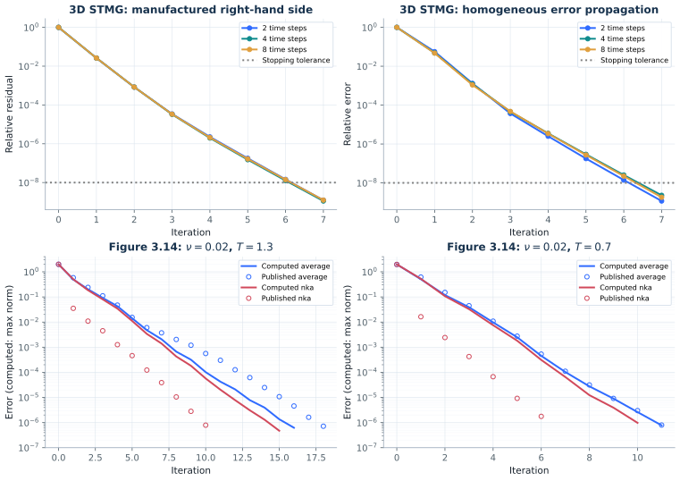

# Reproduction checks, 2026-11-10

The Table 4.1 discretization now has a runnable 3D finite-element baseline, and
both failing numerical tests have been replaced by independent mathematical
checks. The full suite passes **113 tests**, with one CUDA-only test skipped.
Figure 3.14's strong NKA acceleration at `nu = 0.02` remains unmatched after an
independent implementation and 24 controlled runs.



## 3D STMG baseline for Table 4.1

The source is Gander and Neumüller (2016), *Analysis of a new space-time parallel
multigrid algorithm for parabolic problems*, Example 6.1 and Table 3,
[DOI](https://doi.org/10.1137/15M1046605),
[author's final paper](https://www.unige.ch/~gander/Preprints/SpaceTimeMG.pdf).
Acta Table 4.1 quotes these results. Its discretization is reconstructed in
`actapint/stmg_fem.py`:

- Unit cube, homogeneous Dirichlet boundaries, P1 tetrahedral finite elements.
  Twelve tetrahedra join the cube centre to triangulated faces. Four uniform
  red refinements produce 49,152 tetrahedra and 7,471 interior vertices.
- Discontinuous Galerkin degree three in time, four Gauss–Legendre coefficients
  per time slab, `dt = 0.1`. The smallest case has `2 × 4 × 7471 = 59,768` unknowns,
  exactly the first row's problem size.
- One pre/post block-Jacobi sweep in time, damping one, and a time V-cycle with
  polynomial injection and transpose restriction. Each block correction uses a
  spatial V-cycle with damping 1.285 and one forward block-Gauss–Seidel pre/post
  sweep. A spatial block contains the four temporal coefficients at one vertex.
- The coarsest one-slab time system uses direct spatial solves after a 4-by-4
  DG diagonalization. The exact mesh ordering and sweep direction are specified
  here because the source does not supply their implementation.

Two independently checkable problems are run: a manufactured discrete solution
with a nonzero right-hand side, and a zero-right-hand-side error propagation
experiment with uniform `(0,1)` initial coefficients. The latter follows the
convergence protocol in the source's Example 5.1; Example 6.1 supplies the
polynomial degree and smoother settings.

| Time steps | Unknowns | Cycles, nonzero RHS | Relative residual | Difference from direct sequential solution | Cycles, zero RHS |
|---:|---:|---:|---:|---:|---:|
| 2 | 59,768 | 7 | 1.23e-9 | 4.32e-9 | 7 |
| 4 | 119,536 | 7 | 1.12e-9 | 4.15e-9 | 7 |
| 8 | 239,072 | 7 | 1.24e-9 | 4.60e-9 | 7 |

The iteration counts match the small rows of the published table. These are
serial local executions of parallelizable time blocks. They do not supply
MPI communication or strong/weak scaling timings. The sequential comparison
uses direct slab solves; the historical paper timed an iterative spatial
multigrid solver, so its timing ratios are a different measurement.

The independent tests check element volumes and Galerkin identities, the
backward-Euler limit at degree zero, conservation of a constant temporal mode,
agreement with a globally assembled sparse solve, and seventh-order endpoint
convergence of dG(3) on a semidiscrete heat eigenmode.

Smoother choices are numerically significant. On 855 spatial nodes and eight
time steps, hierarchical ordering with forward damped GS takes six cycles;
backward post-smoothing takes twelve. Lexicographic ordering gives seven and
eleven respectively. SOR uses `omega*(D+omega*L)^-1`, whereas damped GS uses
`omega*(D+L)^-1`; the implementation exposes both instead of conflating them.
The full sensitivity results and the original-size runs are saved as JSON.

## Independent Figure 3.14 audit

`actapint/nka_audit.py` forms the residual and solves directly for a correction:

```text
(B ⊗ I + Phi ⊗ Jbar) delta = b - B U - f(U)
U_next = U + delta
```

The existing implementation instead solves for `U_next` after multiplying by
`B^-1`. The audit offers both a global sparse solve and the diagonalization of
`Phi^-1 B`. A separate small-grid comparison agrees at about `1e-14`; regression
tests compare all three formulations. The Frobenius weights also satisfy the
normal-equation orthogonality condition and improve on perturbed weights.

The NKA construction agrees with equations (3.47)–(3.48) of the
[Acta article](https://doi.org/10.1017/S0962492924000072) and Section 3.3 of
[Liu and Wu's original NKA paper](https://arxiv.org/html/2108.01700#S3.SS3).
The coarse spatial step is `1/20`, ten times the fine step `1/200`.
The audit uses `dt = 0.01`; the Acta paragraph does not specify Figure 3.14's
actual time step.

There are 24 trajectories: two viscosities, two horizons, three starting
vectors and two methods. Every iteration records max-norm error, maximum
spatial L2 error, `sqrt(dx)`-scaled spatial L2 error, RMS error, all four
increment norms, and the nonlinear residual. The reference is a converged
all-at-once Newton solution. Each run stops on max-norm solution error `1e-6`,
a large increment, or 100 iterations, and records the termination reason.

For the symmetric random start at `nu = 0.02`:

| Horizon | Method | Computed first-update error | Published first marker after initialization | Computed iterations to 1e-6 |
|---:|---|---:|---:|---:|
| 1.3 | averaged | 0.49513 | 0.5843 | 16 |
| 1.3 | NKA | 0.50310 | 0.03525 | 15 |
| 0.7 | averaged | 0.50710 | 0.6179 | 11 |
| 0.7 | NKA | 0.52658 | 0.01630 | 10 |

At `nu = 0.002`, the initial-condition start gives divergence for averaging
at `T = 1.3` and convergence in 70 iterations for NKA. This recovers qualitative
stabilization, while the digitized paper curve reaches its endpoint around
iteration 48. At `T = 0.7`, the corresponding local counts are 22 and 25.

Shared initial markers in the paper suggest a common initial-error observable,
but do not determine its norm or the starting vector. Changing the recorded norm
in these runs does not recover the large first-step NKA improvement. The previous
report's claim that *no diagonal weights can reproduce the curve* has been
removed: coordinate descent and Powell searches are finite local searches,
not a proof. The next source check needs the Figure 3.14 generator or its exact
time step, initialization, error definition and coarse-model settings.

## Numerical test repairs

The baseline had 101 passing tests, one CUDA skip and two failures on this
machine. The changes address the underlying numerical properties:

- The periodic wave operator has a defective zero eigenvalue with a Jordan
  chain. A dense nonsymmetric eigensolver can split it into a spurious real pair
  around `1e-7`. The test now checks the analytic Fourier dispersion relation,
  eigenvector residuals and zero-mode Jordan chain directly.
- Figure 3.10's last roundoff-sensitive marker is `0.21777` here versus about
  `0.18` in the digitized plot. The test retains the growth comparison and adds
  an independent sequential backward-Euler solve on the same geometric grid.
  Its truncation error is `0.01622346`, separating discretization error from
  diagonalization roundoff without fitting a platform-specific final marker.
- The all-at-once Newton routine now recomputes the returned residual after
  its last update, including when it reaches the iteration limit.

The numerical stack is constrained to Python 3.12, NumPy 2.5.3, SciPy 1.18.1,
Matplotlib 3.11.2 and pytest 9.1.1. Local execution used macOS arm64, a Python
3.12.14 venv and existing read-only dependency packages. CI retains the open-range
Python 3.10 job and adds these numerical constraints to its Python 3.12 job.

## Reproduction commands and evidence

```bash
python3.12 -m venv .venv
source .venv/bin/activate
python -m pip install -c constraints-reproduction.txt -e '.[test]'
export OPENBLAS_NUM_THREADS=1 OMP_NUM_THREADS=1 MKL_NUM_THREADS=1 VECLIB_MAXIMUM_THREADS=1
python -m pytest
actapint stmg_fem_3d --output-dir results/checks
actapint figure_3_14_audit --output-dir results/checks
python -m scripts.check_stmg_smoothers --output results/checks/stmg_sensitivity.json
python -m scripts.plot_reproduction_checks --data-dir results/checks --output results/checks/comparison.svg
```

Raw results are in [`data/reproduction-2026-11-10`](data/reproduction-2026-11-10).
The STMG JSON includes setup, solve and sequential wall times plus environment;
these are single local measurements, not performance acceptance criteria. Earlier
chapter outputs remain in place; this change reran the full test suite and the
new targeted experiments, not every chapter figure.

Algorithm development can use this STMG discretization, its direct reference
solver and the NKA residual-form checker as baselines. The next reproduction
steps are the original NKA configuration and a distributed STMG scaling run.
The existing rough-source normalization and roundoff-tail comparisons remain
recorded in the chapter reports.
