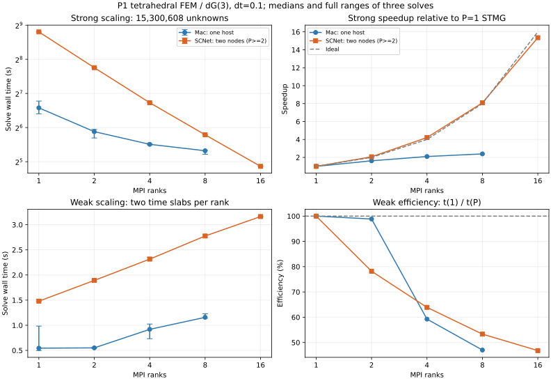

# NKA reconstruction and distributed STMG, 2026-11-11

Figure 3.14 now has a reconstruction with explicit experimental choices, a
closed-form verification of the full-Jacobian NKA weights, and the original
EPS plot coordinates. The key control is **the same starting vector for both
methods**: a coarse-trajectory start improves both methods and cannot itself
be counted as an NKA improvement.

The Table 4.1 solver now distributes time slabs over MPI ranks, exchanges
neighbouring time boundaries, and agglomerates rank pairs on coarse time grids.
Every solver iteration keeps its vectors distributed. Small-system comparisons
check it against a separately assembled global matrix and the serial V-cycle.

## Figure 3.14: reconstruction from the equations

The [Acta paper](https://doi.org/10.1017/S0962492924000072) supplies viscosities
`0.02, 0.002`, horizons `1.3, 0.7`, fine spatial step `1/200`, and coarse spatial
step `1/20`. We use 200 time steps, the count stated for the preceding Figure 3.13
and used in the public neighbouring `Direct_ParaDiag_Burgers.m` example.
The physical initial condition is `sin(2*pi*x)` and the source term is zero,
as in that script. This is an explicit reconstruction choice:
Figure 3.14's paragraph does not specify its time step, starting vector or
plotted error definition.

The canonical grid has 200 **distinct** periodic nodes. A second complete run
uses 201 nodes including both endpoints, following the neighbouring MATLAB
script's convention. Both use centred conservative Burgers differences,
the paper's centred-time BVM with backward-Euler closure, and coarse trapezoidal
time integration to freeze the NKA weights before the fine-grid iteration.

For the semidiscrete problem `u' = -f(u)`, the correction is

```text
(B ⊗ I + diag(phi) ⊗ J(mean(U))) delta = b - B U - f(U)
U_next = U + delta
```

There are three independently cross-checked linear solves: a global sparse
solve, diagonalization of `diag(phi)^-1 B`, and the earlier next-iterate
formulation using `B^-1 diag(phi)`. The new tests additionally verify the
Burgers Jacobian by a directional finite difference and check discrete mass
conservation on the periodic grid.

For centred periodic differences, write `J(u) = D + N(u)`, where `D` is the
diffusion matrix and `N(u) = D_center diag(u)`. Direct calculation gives

```text
<D, N(u)>_F = 0
||D||_F^2 = 6 n nu^2 / h^4
<N(u), N(v)>_F = dot(u, v) / (2 h^2)

phi_j = (12 n nu^2 / h^2 + dot(u_j, mean(u)))
        / (12 n nu^2 / h^2 + dot(mean(u), mean(u)))
```

`actapint/nka_reproduction.py` implements this identity without constructing
all coarse Jacobian matrices. Tests compare it to explicit matrix traces and
the Frobenius normal equations. It includes the diffusion term, which dominates
the weights at `nu=0.02`; omitting that term would change the algorithm.

On the canonical coarse grid, the weight ranges are:

| nu | T | min(phi) | max(phi) |
|---:|---:|---:|---:|
| 0.02 | 1.3 | 0.966752 | 1.054118 |
| 0.02 | 0.7 | 0.956495 | 1.043681 |
| 0.002 | 1.3 | 0.487830 | 1.582450 |
| 0.002 | 0.7 | 0.619543 | 1.235339 |

### What explains the apparent improvement from a coarse initial guess

Each configuration is run with the public script's uniform `[0,1]` random
vector, a symmetric `[-1,1]` random vector (both MT19937, seed 5489), the initial
sine wave repeated in time, and the interpolated coarse trapezoidal trajectory. Each starting vector is identical for averaging and NKA. Stopping
uses the true maximum error `<= 1e-6` against a converged all-at-once Newton
reference, with a separate divergence threshold and a 100-iteration cap.

| nu | T | Start | Averaging iterations | NKA iterations |
|---:|---:|---|---:|---:|
| 0.02 | 1.3 | uniform [0,1] | 14 | 14 |
| 0.02 | 1.3 | symmetric [-1,1] | 16 | 15 |
| 0.02 | 1.3 | repeated initial condition | 12 | 12 |
| 0.02 | 1.3 | coarse TR | 10 | 10 |
| 0.02 | 0.7 | uniform [0,1] | 11 | 11 |
| 0.02 | 0.7 | symmetric [-1,1] | 10 | 10 |
| 0.02 | 0.7 | repeated initial condition | 9 | 9 |
| 0.02 | 0.7 | coarse TR | 7 | 7 |
| 0.002 | 1.3 | uniform [0,1] | diverged | diverged |
| 0.002 | 1.3 | symmetric [-1,1] | diverged | diverged |
| 0.002 | 1.3 | repeated initial condition | diverged | 71 |
| 0.002 | 1.3 | coarse TR | 50 | 64 |
| 0.002 | 0.7 | uniform [0,1] | diverged | diverged |
| 0.002 | 0.7 | symmetric [-1,1] | 38 | 42 |
| 0.002 | 0.7 | repeated initial condition | 21 | 19 |
| 0.002 | 0.7 | coarse TR | 27 | 23 |

The warm-start experiment explains a **confounder in our curve comparisons**:
matching the paper's later NKA points with a better starting guess does not
establish that NKA caused the acceleration. It does not establish which initial
state the authors used. The endpoint-duplicated control also fails to recover
all four published curves under one shared protocol.


The overlay uses maximum update increments, indexed from zero as in the public
neighbouring MATLAB script. Raw results also retain true solution errors,
spatial L2 errors, scaled L2 errors, RMS errors and nonlinear residuals. These
observables are kept separate. The paper's red curve is still an external
comparison, not an acceptance target achieved by parameter fitting.

### Original-source evidence

The [arXiv source archive](https://arxiv.org/src/2503.13526) contains the two
original MATLAB-exported EPS files. `scripts/extract_nka_eps.py` reads their
polylines and calibrates them using the labelled axes. This replaces screenshot
point estimates with numeric vector coordinates; the EPS rounds coordinates to
0.001 PostScript units. Both methods have **exactly identical initial marker
coordinates** for each horizon. The archive also names the generating script
`Sec3_6_1_ParaDiag1_Burgers_NKA.m` in a commented TeX margin note, but does not
include that script. Its sole `.fig` file belongs to PFASST, not NKA.

Archive SHA256:
`cbd4ded34471623ce546eff14d834ec92b7d6088ab94a644a165854e52179672`.
The original EPS hashes and calibration constants are in
`docs/data/reproduction-2026-11-11/figure_3_14_eps.json`.

The reconstruction is consequently a usable mathematical baseline. The specific
large acceleration in Figure 3.14 is not recovered by the published
full-Jacobian weights under these controlled settings. Future algorithm changes
should be compared against these shared-start runs and include coarse-model
setup cost, rather than using a different initialization only for NKA.

## Distributed Table 4.1 implementation

`actapint/stmg_mpi.py` preserves the 49,152-tetrahedron P1 spatial discretization,
7,471 interior vertices, dG(3) time discretization, time step 0.1, V(1,1) cycle,
time damping 1 and spatial damped Gauss-Seidel parameter 1.285.

Each rank owns a contiguous group of time slabs and a full spatial mesh. Matrix
application exchanges only the final slab with its right neighbour. Restriction
is local while a rank owns at least two slabs. Once it owns one slab, odd ranks
send to their even neighbours; those neighbours form the next communicator.
Prolongation returns corrections to the odd ranks. Only one rank reaches the
single-slab direct coarse solve. There is no full-vector gather in the solver
or benchmark. Direct LU factors are created only for blocks that use them.

The benchmark fixes each slab's random seed by its global index, so strong
scaling uses exactly the same problem at every rank count. It measures the
maximum elapsed time across ranks after a barrier, includes communication and
convergence reductions, excludes setup, performs one warm-up and three measured
solves, and saves every timing and residual history. A separate zero-RHS test
checks error reduction. Tests compare complete distributed V-cycles and final
solutions to both serial multigrid and an independent sparse global solve.

Weak scaling uses two slabs per rank, as in Table 4.1. Strong scaling uses 512
slabs, hence exactly **15,300,608 unknowns**, as in its smaller strong-scaling
block. MPI rank count, actual hostnames, CPU affinity, library versions and
source hashes are included in each result file. Cross-node and single-host
runs must be reported separately.

## Reproduction commands

```bash
export OPENBLAS_NUM_THREADS=1 OMP_NUM_THREADS=1 MKL_NUM_THREADS=1 VECLIB_MAXIMUM_THREADS=1
python -m pip install -e '.[test,mpi]'
# Use the cluster MPI module in production; mpi4py + mpich wheels also work locally.
python -m actapint.nka_reproduction --output results/nka_periodic.json
python -m actapint.nka_reproduction --duplicate-endpoint --output results/nka_duplicate_endpoint.json
mpiexec -n 4 python -m scripts.check_stmg_mpi
mpiexec -n 4 python -m scripts.benchmark_stmg_mpi --output results/weak-p4.json
mpiexec -n 4 python -m scripts.benchmark_stmg_mpi --steps 512 --output results/strong-p4.json
```

The MPI implementation follows the direct NumPy-buffer communication interface
in the [mpi4py tutorial](https://mpi4py.readthedocs.io/en/stable/tutorial.html).


<!-- ACTUAL_SCALING_RESULTS -->
## Measured scaling results

All 18 MPI configurations (eight on the Mac, ten on SCNet), each with three
measured solves, converged in **7 cycles**. Across these solves the maximum
relative residual was `1.353e-09` and maximum relative solution error was
`5.132e-09`. The independent homogeneous checks also converged in seven cycles.

### SCNet: two compute nodes

The run used the XiongHeng `xhhctdnormal` partition, nodes `b02r06n03` and
`b02r06n04`, with Hygon C86 7185 32-core processors (64 physical cores per node).
The allocation requested eight ranks per node, one CPU per rank, and 2,000 MB
per CPU. It was shared-node, not exclusive. Every rank was bound to one physical
CPU, recorded in the raw files. The P=1 case used the first node; every P>=2
case used both nodes. NumPy/BLAS thread counts were one.

The runtime was Python 3.10.18, NumPy 1.26.4, SciPy 1.14.1, mpi4py 4.1.2 and
HPC-X Open MPI 4.1.4rc1. Source commit `1d48220fb8cd3c708bacef291cc6bcda5e804783`
was frozen for the MPI campaign; the exact three numerical source hashes are in
every result. Slurm job 25558675 ran all ten scaling cells sequentially.

Strong scaling fixes 512 slabs and 15,300,608 unknowns:

| Ranks | Hosts | Median (s) | Min–max (s) | Speedup vs P=1 STMG | Efficiency |
|---|---|---|---|---|---|
| 1 | 1 | 446.911 | 446.516–447.005 | 1.00 | 100.0% |
| 2 | 2 | 216.078 | 215.918–216.106 | 2.07 | 103.4% |
| 4 | 2 | 106.017 | 105.944–106.110 | 4.22 | 105.4% |
| 8 | 2 | 55.253 | 55.225–55.275 | 8.09 | 101.1% |
| 16 | 2 | 29.108 | 29.095–29.212 | 15.35 | 96.0% |

Speedup in this table means `time(P=1 STMG) / time(P)`. It is separate from the
forward-substitution baseline. The latter applies the same spatial V-cycle
iteratively at each time step until local relative residual is at most `1e-8`,
then independently checks global relative residual and solution error. It uses
no direct LU fine-block shortcut. It ran after the MPI job on the same first
node, under job 25559001, with source commit
`4e5536516cc4a488d9b61d4697d2322cdd24295e`. The 512-slab sequential median was
**212.180 s**, giving a 16-rank speedup of
**7.29** relative to sequential stepping.

Weak scaling fixes two slabs per rank; sequential timings use the corresponding
whole problem size on one CPU:

| Ranks | Slabs | MPI median (s) | Sequential MG (s) | Speedup vs sequential | Weak efficiency |
|---|---|---|---|---|---|
| 1 | 2 | 1.479 | 0.792 | 0.54 | 100.0% |
| 2 | 4 | 1.892 | 1.670 | 0.88 | 78.2% |
| 4 | 8 | 2.315 | 3.367 | 1.45 | 63.9% |
| 8 | 16 | 2.775 | 6.017 | 2.17 | 53.3% |
| 16 | 32 | 3.162 | 13.389 | 4.23 | 46.8% |

The iteration count is independent of rank count in these runs, while weak
scaling time grows with rank count. This is the measured Python/MPI baseline
for subsequent implementation improvements. The runs extend Table 4.1's
experiment to current hardware and 16 ranks; its historical BlueGene/Q timings
and 262,144-core range are not extrapolated from these results.

### Mac: multiple MPI processes on one host

The local machine is an Apple M3 Pro with 12 physical cores and 36 GiB memory;
MPICH 5.0.2 runs every rank on the same host. Its timing distribution reflects
shared CPU and memory resources. All timing samples are retained.

| Ranks | Weak median (s) | Strong median (s) | Strong speedup |
|---|---|---|---|
| 1 | 0.545 | 95.540 | 1.00 |
| 2 | 0.551 | 58.898 | 1.62 |
| 4 | 0.919 | 45.525 | 2.10 |
| 8 | 1.159 | 39.953 | 2.39 |



### Validation and recorded artifacts

- Full local suite: **116 passed, 1 CUDA skip**, in 41.90 seconds.
- [CI validation](https://github.com/freezeng123456/ActaPinT-Python/actions/runs/42891886705):
  Python 3.10 and 3.12 pass, plus 1/2/4-rank MPI checks on Python 3.12.
- The two-node 4-rank check compares the distributed V-cycle to serial MG and
  the solution to a separately assembled global sparse solve; maximum solution
  difference is `8.42e-12`.
- The CI runner exposed an unusable `mana_0` RDMA adapter on one attempt. Only
  CI now sets `UCX_TLS=tcp,self,sm`, following the
  [UCX transport selection documentation](https://openucx.readthedocs.io/en/master/faq.html).
  Cluster runs retain their native MPI transport configuration.
- `docs/data/reproduction-2026-11-11/` contains both full NKA controls, EPS
  coordinates, 18 MPI configurations, six sequential configurations, all
  timing samples and residual/error histories, Slurm scripts and completion
  records, source hashes and dependency/affinity metadata.

To regenerate the scaling plot from the archived results:

```bash
python -m scripts.plot_stmg_scaling \
  --local docs/data/reproduction-2026-11-11/local-mpi \
  --cluster docs/data/reproduction-2026-11-11/scnet-scaling \
  --output-prefix docs/figures/stmg_scaling_2026-11-11
```
