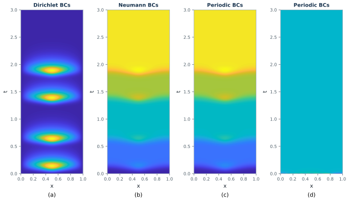
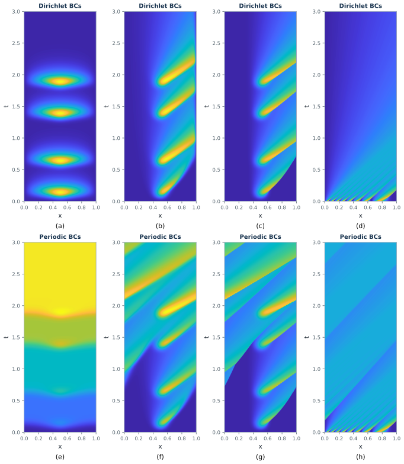
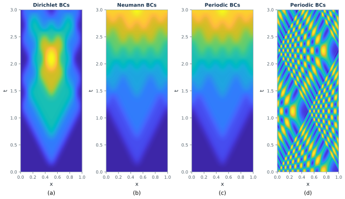
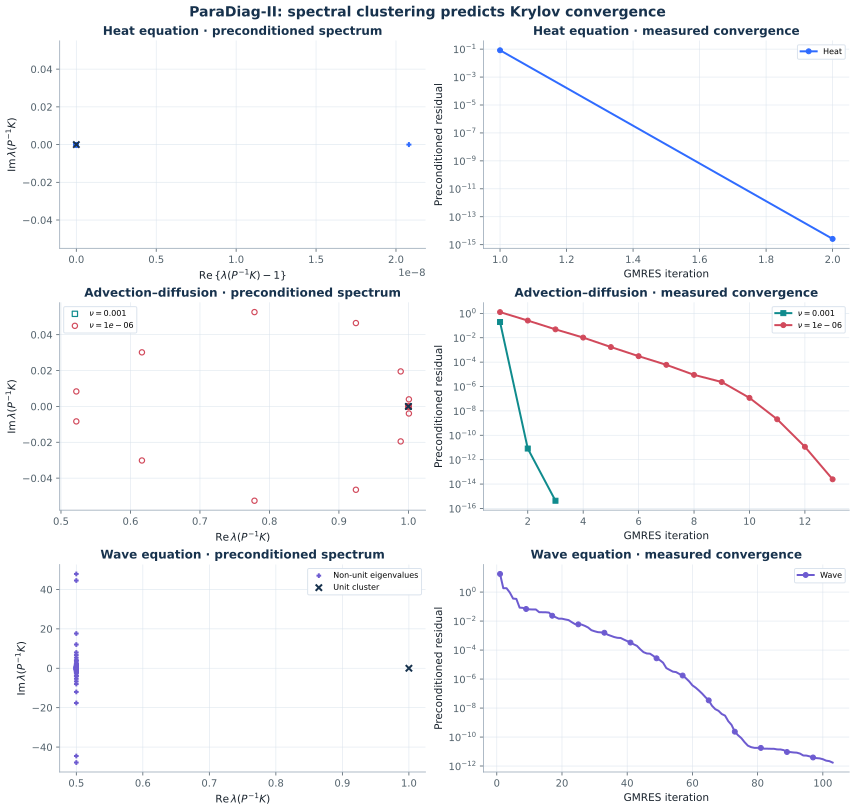
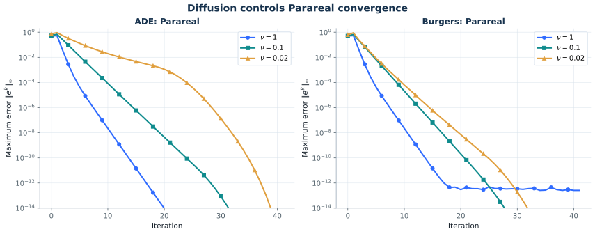
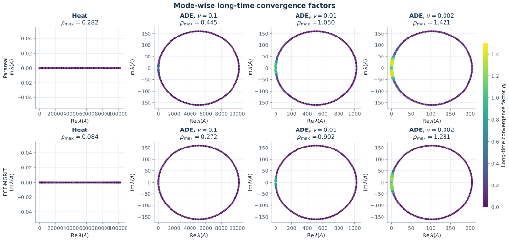
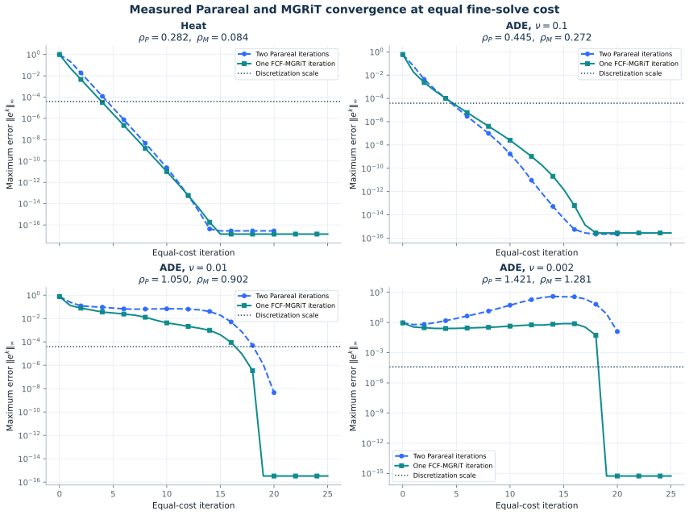
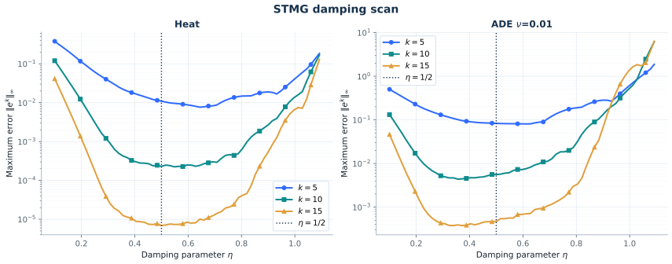
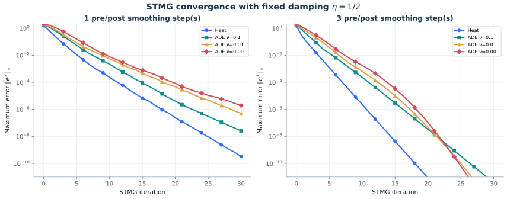

# Paper-scale reproduction results

These artifacts were generated by:

```bash
OPENBLAS_NUM_THREADS=1 OMP_NUM_THREADS=1 MKL_NUM_THREADS=1 \
  actapint paper_validation --output-dir results/paper-full
```

The run used Python 3.11 on Linux. The complete suite required about 4 minutes
24 seconds and less than 280 MiB peak resident memory. The plots are committed
as editable SVGs and high-resolution PNG fallbacks; their numerical data are in
[`docs/data`](data).

## Figures 2.1–2.4 — model problems

Generated by `actapint section2 --output-dir results/section2` in about 30
seconds. Agreement with the published rasters is quantified in
[`data/section2_paper_comparison.json`](data/section2_paper_comparison.json) and
discussed in [`SECTION2_REPRODUCTION.md`](SECTION2_REPRODUCTION.md).








| Figure | Panels | Smoothed correlation, median (min) | Decile mismatch, median (max) |
|---|---:|---:|---:|
| 2.1 | 4 | 0.999 (0.787) | 0.0020 (0.0505) |
| 2.2 | 8 | 0.993 (0.923) | 0.0032 (0.2829) |
| 2.3 | 8 | 0.995 (0.951) | 0.0033 (0.0065) |
| 2.4 | 4 | 1.000 (0.947) | 0.0045 (0.0081) |

The two worst entries are both explained in the report: the Figure 2.1 minimum is
the constant panel 2.1(d), where correlation is undefined, and the Figure 2.2
maximum is panel 2.2(h), whose stripes are aliased in the published raster.

Reproducing Figure 2.3 requires a Burgers flux of `(u^2)_x` rather than the
`0.5*(u^2)_x` given by equation (2.6) and the committed script; the evidence is
in [`SECTION2_REPRODUCTION.md`](SECTION2_REPRODUCTION.md).

## Figure 3.1 — Schwarz waveform relaxation

Generated by `actapint figure_3_1 --output-dir results/section3`, about 40 seconds
on one core. Details and the three corrections it required are in
[`SECTION3_REPRODUCTION.md`](SECTION3_REPRODUCTION.md).


Both panels reproduce point by point. The theoretical Robin factor agrees with all
eight published markers to better than 0.5%, and the measured iteration counts
land on the published values within the precision they can be read at, including
the 92 Dirichlet and 28 Robin iterations at $\nu=0.1$ quoted in the text.

| $\nu$ | 1 | 1/2 | 1/4 | 1/8 | 1/16 | 1/32 | 1/64 | 1/128 |
|---|---:|---:|---:|---:|---:|---:|---:|---:|
| Dirichlet, reproduced | 402 | 272 | 179 | 110 | 61 | 32 | 16 | 13 |
| Dirichlet, published | 402 | 274 | 179 | 110 | 61 | 32 | 16 | 13 |
| Robin, reproduced | 28 | 26 | 29 | 29 | 26 | 20 | 14 | 12 |
| Robin, published | 28 | 28 | 29 | 29 | 26 | 20 | 14 | 12 |

## Figure 3.15 — ParaDiag-II



- Heat: 2 GMRES iterations.
- ADE: 3 iterations at $\nu=10^{-3}$ and 13 at $\nu=10^{-6}$.
- Wave: 89 iterations to preconditioned residual $10^{-11}$ and 103
  single-thread SciPy iterations to its true-residual stopping test.

The paper’s wave curve ends near iteration 88. The spectral geometry and the
slow order-100 Krylov phase match; the final counter depends on the GMRES
residual and stopping convention.

## Figure 4.5 — diffusion dependence of Parareal



| Equation | $\nu=1$ | $\nu=0.1$ | $\nu=0.02$ |
|---|---:|---:|---:|
| advection-diffusion | 14 | 24 | 35 |
| Burgers | 14 | 21 | 25 |

Entries are the first iteration at which the maximum error is at most
$10^{-10}$.

## Figures 4.9–4.10 — Parareal versus MGRiT





| Problem | Parareal | FCF-MGRiT |
|---|---:|---:|
| heat | 0.2824 | 0.0835 |
| ADE, $\nu=0.1$ | 0.4453 | 0.2719 |
| ADE, $\nu=0.01$ | 1.0501 | 0.9021 |
| ADE, $\nu=0.002$ | 1.4211 | 1.2812 |

## Figures 4.19–4.20 — STMG





The best sampled damping after 15 cycles is $\eta=0.500$ for heat and
$\eta=0.372$ for ADE with $\nu=0.01$. Three pre/post smoothing steps reduce
the error in fewer cycles than one, while each cycle costs more.

## GPU performance

The optional CuPy backend batches the independent Burgers fine propagators in
Figure 4.5. On a Tesla T4, the paper-scale batch is 11.76x faster than the
single-thread CPU path, and the complete paper suite falls from 263.57 to 67.92
seconds without changing any reported stopping iteration. Profiling,
correctness details, and remaining CUDA opportunities are documented in
[`GPU_ACCELERATION.md`](GPU_ACCELERATION.md).
