# Paper-scale reproduction results

The coverage of the whole article, the cost of reproducing it and the register of
recovered parameters and corrections are in
[`PAPER_REPRODUCTION.md`](PAPER_REPRODUCTION.md). This file collects the committed
plots and the numbers behind them, chapter by chapter.

The older cross-chapter suite, which predates the per-chapter groups and is
superseded by them, was generated by:

```bash
OPENBLAS_NUM_THREADS=1 OMP_NUM_THREADS=1 MKL_NUM_THREADS=1 \
  actapint paper_validation --output-dir results/paper-full
```

The run used Python 3.11 on Linux. That suite required about 4 minutes 24
seconds and less than 280 MiB peak resident memory; the per-chapter groups
`section2` and `section3` are listed with their own commands and timings below.
The plots are committed as editable SVGs and high-resolution PNG fallbacks;
their numerical data are in [`docs/data`](data).

## Schematics — Figures 1.1, 3.2, 3.4, 3.7, 4.1 and 4.7

Generated by `actapint schematics --output-dir results/schematics` in about 4
seconds. These six figures print no measurement; what each of them carries, and
which of them are computed rather than drawn, is in
[`PAPER_REPRODUCTION.md`](PAPER_REPRODUCTION.md#the-six-schematics).

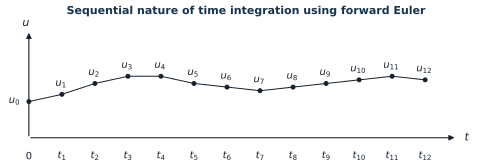

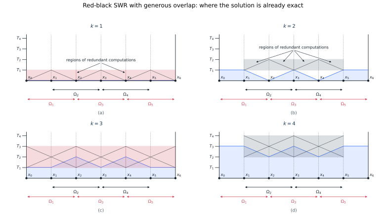

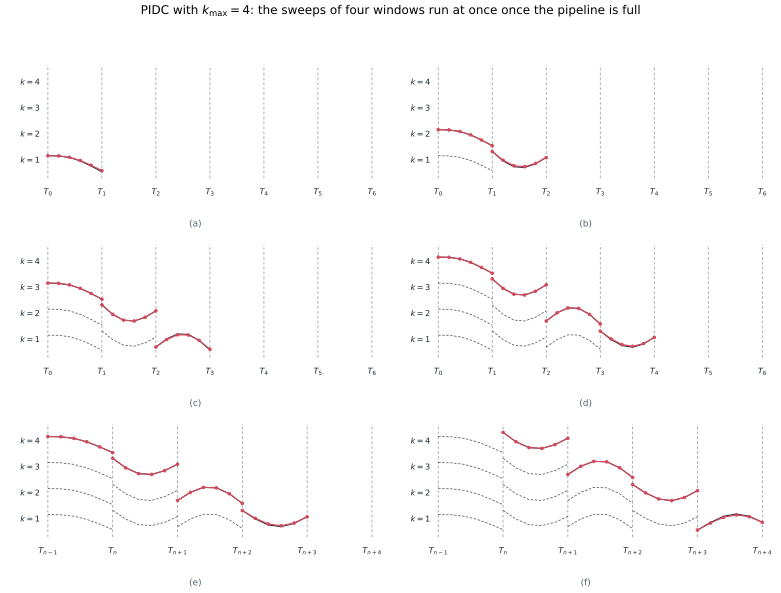

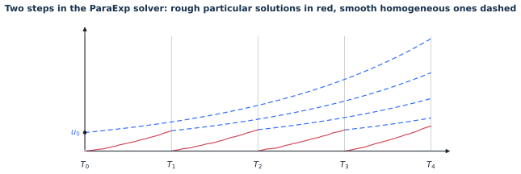

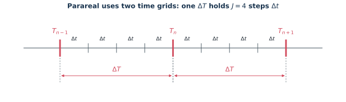

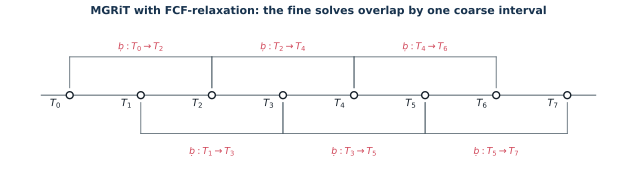

| Figure | What is computed | Check |
|---|---|---|
| 1.1 | nothing; the thirteen values are read off the published page | they sit on a uniform grid, at integer multiples of `1.869` pt |
| 3.2 | where red-black SWR is already exact, propagated along characteristics | each solve advances the exact region by exactly one level, `T_1` to `T_4` |
| 3.4 | IDC sweeps of (3.11) on six windows | every sweep gains about an order of magnitude on the last |
| 3.7 | the pieces (3.13) and (3.14) of ParaExp | their sum matches the sequential solution to `3e-14` |
| 4.1 | nothing; two grids with `J = 4` | — |
| 4.7 | nothing; eight coarse points, `F` over two intervals each | — |

## Figures 2.1–2.4 — model problems

Generated by `actapint section2 --output-dir results/section2` in about 30
seconds. Agreement with the published rasters is quantified in
[`data/section2_paper_comparison.json`](data/section2_paper_comparison.json) and
discussed in [`SECTION2_REPRODUCTION.md`](SECTION2_REPRODUCTION.md).


| Figure | Panels | Smoothed correlation, median (min) | Decile mismatch, median (max) |
|---|---:|---:|---:|
| 2.1 | 4 | 0.999 (0.787) | 0.0020 (0.0505) |
| 2.2 | 8 | 0.993 (0.923) | 0.0032 (0.2829) |
| 2.3 | 8 | 0.995 (0.951) | 0.0033 (0.0065) |
| 2.4 | 4 | 1.000 (0.947) | 0.0045 (0.0081) |

The two worst entries are both explained in the report: the Figure 2.1 minimum is
the constant panel 2.1(d), where correlation is undefined, and the Figure 2.2
maximum is panel 2.2(h), whose stripes are aliased in the published raster.

Reproducing Figure 2.3 requires a Burgers flux of `(u^2)_x` rather than the
`0.5*(u^2)_x` given by equation (2.6) and the committed script; the evidence is
in [`SECTION2_REPRODUCTION.md`](SECTION2_REPRODUCTION.md).

## Section 3 — effective PinT methods for hyperbolic problems

Every figure and both tables of Section 3 are reproduced; the three schematics of
the chapter are in the section above. The whole group is generated by

```bash
OPENBLAS_NUM_THREADS=1 OMP_NUM_THREADS=1 MKL_NUM_THREADS=1 \
  actapint section3 --output-dir results/section3
```

which takes 10 minutes on one core and peaks at 324 MiB. Single figures
can be requested by name, for example `actapint figure_3_14`. Each experiment
writes an SVG, a PNG and a JSON file of the plotted numbers; the JSON files are
committed in [`docs/data`](data). Marker-by-marker comparisons against the
published rasters, the parameter values recovered for each experiment, and the
eight corrections the section required are in
[`SECTION3_REPRODUCTION.md`](SECTION3_REPRODUCTION.md).

| Item | Method | Status |
|---|---|---|
| Figure 3.1 | optimized SWR | every marker |
| Figure 3.3 | red–black SWR / unmapped tent pitching | reproduced |
| Figures 3.5, 3.6 | pipelined and revisionist IDC | reproduced, one constant per rough panel |
| Figure 3.8 | ParaExp against Parareal | reproduced |
| Figures 3.9, 3.10, 3.11, Table 3.1 | ParaDiag I on a geometric mesh | reproduced, two parameters recovered |
| Figures 3.12, 3.13, 3.14, Table 3.2 | ParaDiag I with the BVM discretization | reproduced except NKA at `nu = 0.02` |
| Figures 3.15, 3.16, 3.17, 3.18 | ParaDiag II | reproduced |

### Figure 3.1 — Schwarz waveform relaxation

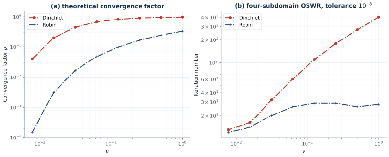

Both panels reproduce point by point. The theoretical Robin factor agrees with all
eight published markers to better than 0.5%, and the measured iteration counts
land on the published values within the precision they can be read at, including
the 92 Dirichlet and 28 Robin iterations at $\nu=0.1$ quoted in the text.

| $\nu$ | 1 | 1/2 | 1/4 | 1/8 | 1/16 | 1/32 | 1/64 | 1/128 |
|---|---:|---:|---:|---:|---:|---:|---:|---:|
| Dirichlet, reproduced | 402 | 272 | 179 | 110 | 61 | 32 | 16 | 13 |
| Dirichlet, published | 402 | 274 | 179 | 110 | 61 | 32 | 16 | 13 |
| Robin, reproduced | 28 | 26 | 29 | 29 | 26 | 20 | 14 | 12 |
| Robin, published | 28 | 28 | 29 | 29 | 26 | 20 | 14 | 12 |

Reproducing the Dirichlet column needs the Courant ratio `dt/(2 dx)` implied by
the half-speed advection of the text, not the `dt/dx` of the committed
`SWR_for_ADE.m`; with the script as committed the same sweep reads 358 instead of
402 iterations at $\nu=1$.

### Figure 3.3 — red–black SWR, equivalently unmapped tent pitching


The four panels show where the error still lives after 0, 4, 8 and 12 sweeps. The
sawtooth front advances exactly as published: its valley sits at $t=0.60$, $1.50$
and $2.20$ in panels (b), (c) and (d), against the published $0.6$, $1.5$ and
$2.2$, and the teeth reach one tenth of a time unit further in each case. The
region behind the front is at roundoff, which is what makes the method
equivalent to tent pitching on an unmapped mesh.

### Figures 3.5 and 3.6 — pipelined and revisionist IDC

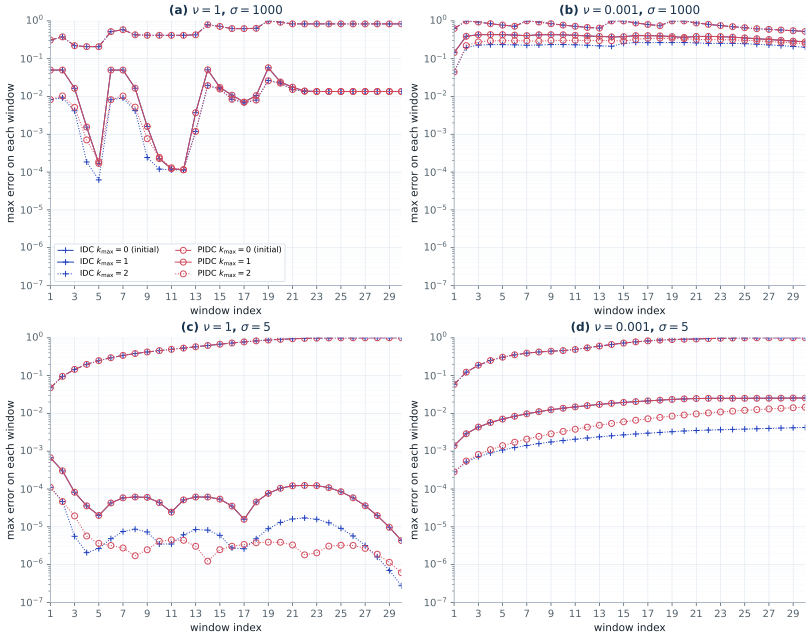

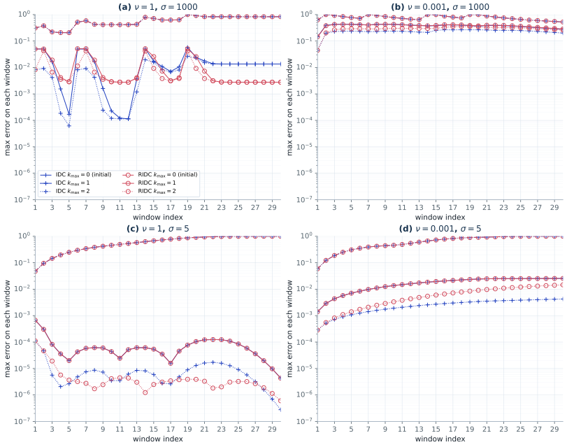

Both variants recover the published behaviour: the pipelined and revisionist
corrections track serial IDC window by window for the smooth source and lag it
for the rough one. The two smooth panels are reproduced to within 2% window by
window. The two rough ones are reproduced up to one constant each, 2.447 and
1.469, which is a normalization rather than a different iteration: it is constant
to better than a per cent over every readable window and over all three sweeps,
and it cannot be the denominator the article prints for the plotted quantity,
which would make the initial curve touch one as it does in the smooth panels and
in all four reproduced ones.

### Figure 3.8 — ParaExp for Burgers' equation

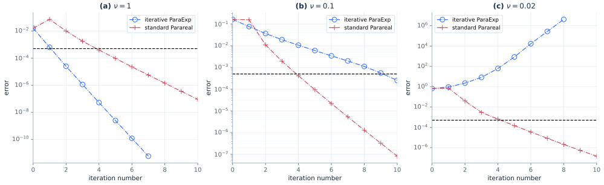

| $\nu$ | ParaExp | Parareal | Published |
|---|---|---|---|
| 1 | `1.6e-2` to `2.5e-9` by sweep 5 | `1.6e-2` to `9.5e-5` | ParaExp clearly faster |
| 0.1 | `1.6e-1` to `6.0e-3` | `1.6e-1` to `9.4e-5` | Parareal faster |
| 0.02 | `6.6e-1` growing to `8.4e+2` | `6.6e-1` to `1.5e-4` | ParaExp diverges |

The crossover and the divergence at $\nu=0.02$ are the point of the figure: the
linear-propagator splitting that makes ParaExp attractive for the diffusive case
stops being a good model of the nonlinear dynamics once advection dominates.

### Figures 3.9, 3.10, 3.11 and Table 3.1 — ParaDiag I on a geometric mesh

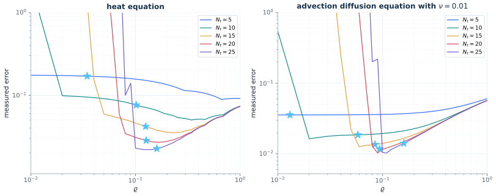

Figure 3.9 is the trade-off between truncation error, which wants a graded mesh,
and the roundoff amplified by the conditioning of the eigenvector matrix, which
wants a uniform one. The minima agree with the published ones to about 1% for
$N_t \le 20$, at ratios that agree to one digit.

Two parameters had to be recovered to get here. The advection-diffusion panels
transport at speed one half, not the speed one of `Direct_ParaDiag_ADE.m`;
speed one puts the whole panel a factor of four high, while speed one half
matches all seven published points to better than 1%. And the blow-up of
Figure 3.10 only appears when the mesh ratio is *held fixed* at a suboptimal
value as $N_t$ grows — re-optimizing it for every $N_t$, as Figure 3.9 does,
gives a flat error of about `1.9e-2` instead of a rise.

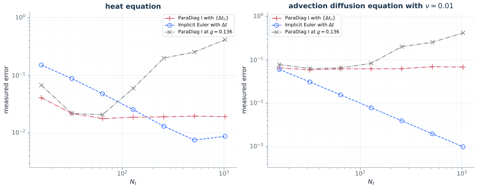

| $N_t$ | 16 | 32 | 64 | 128 | 256 | 512 | 1024 |
|---|---:|---:|---:|---:|---:|---:|---:|
| heat, published | 0.065 | 0.022 | 0.019 | 0.058 | 0.18 | 0.28 | 0.37 |
| heat, ratio fixed at 0.136 | 0.0676 | 0.0218 | 0.0207 | 0.0595 | 0.200 | 0.254 | 0.416 |
| heat, ratio re-optimized | 0.041 | 0.022 | 0.018 | 0.019 | 0.019 | 0.020 | 0.019 |

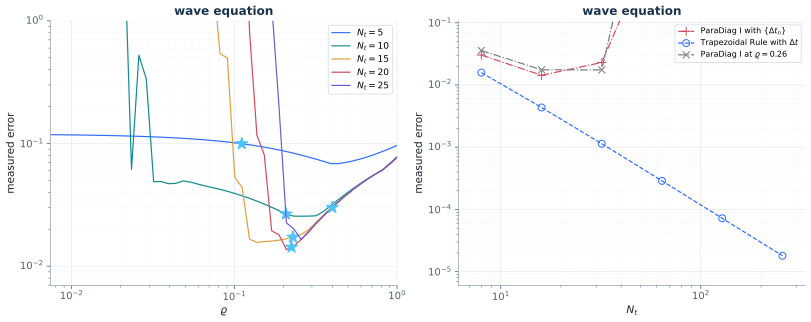

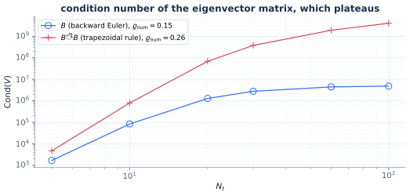

For the wave equation the published stars are hit to three digits, and all twelve
entries of Table 3.1 agree to the two digits it prints, from `1.7e3` at $N_t=5$
to `4.1e9` for $\tilde B^{-1}B$ at $N_t=100$. The blow-up leaves the axis at
$N_t=64$ as published, but only with the script's own `It/V`: applying that
formed inverse rather than solving with $V$ is what realizes the roundoff, and
solving pushes the onset a full octave late.

### Figures 3.12, 3.13, 3.14 and Table 3.2 — the BVM discretization

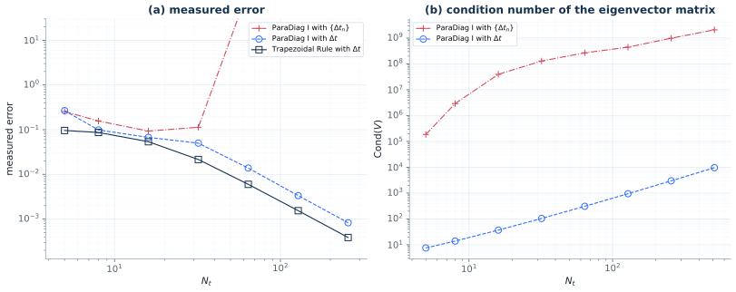

The BVM discretization is what removes the conditioning penalty. Its eigenvector
matrix grows only like $N_t^{1.6}$, from `7.55` to `9.6e3` over the sampled range,
against a published `7.45` to `9.49e3` — every one of the eight within 2% — while
on the geometric mesh the same quantity starts above `1e5` and reaches `2.1e9`.
The BVM error therefore stays second order,
`0.266, 0.0986, 0.0672, 0.0500, 0.0139, 0.00335, 0.000829` against a published
`0.265, 0.0989, 0.0673, 0.0502, 0.0138, 0.00336, 0.000834`, while the geometric
mesh stalls at `9e-2` and then leaves the axis between $N_t=32$ and 64, as
published. Panel (a) needed two corrections to the stated setup to get there: the
markers sit at $N_t = 5, 8, 16, \dots$ rather than at powers of two, and the
horizon is `0.4` rather than `0.5`. The latter is what the earlier record called a
uniform factor 1.7 on all three curves of the panel, the purely sequential one
included.

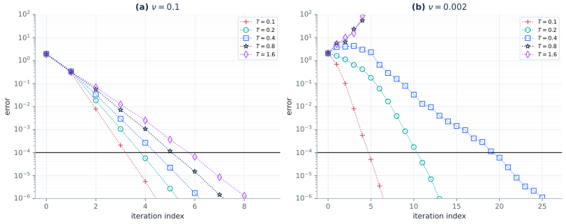

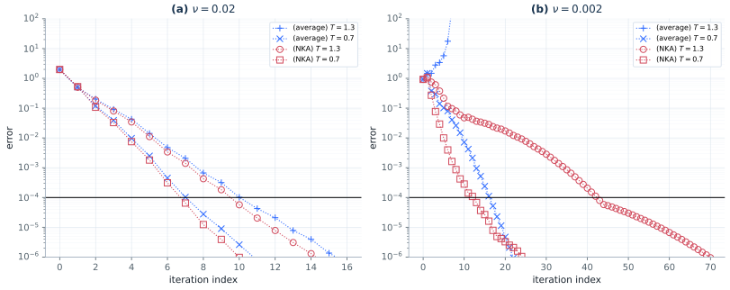

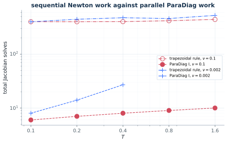

| $T$ | 0.1 | 0.2 | 0.4 | 0.8 | 1.6 |
|---|---:|---:|---:|---:|---:|
| sequential, $\nu=0.1$, published and reproduced | 401 | 401 | 403 | 419 | 443 |
| ParaDiag I, $\nu=0.1$, published | 5 | 5 | 6 | 7 | 7 |
| ParaDiag I, $\nu=0.1$, reproduced | 5 | 6 | 7 | 8 | 8 |
| ParaDiag I, $\nu=0.002$, published | 7 | 12 | 22 | x | x |
| ParaDiag I, $\nu=0.002$, reproduced | 7 | 13 | 18 | 22 | x |

The sequential column of Table 3.2 is exact and the parallel column agrees to one
or two Jacobian solves, including the divergence at small $\nu$ and long $T$. The
one experiment that does not fully reproduce is the nearest-Kronecker-product
variant of Figure 3.14: it delivers the published advantage at $\nu=0.002$, where
the averaged Jacobian diverges outright, but at $\nu=0.02$ the weights it computes
on the coarse mesh are too nearly constant to beat averaging. The averaged curves
of that panel are on the published ones once the iteration starts from a random
iterate on $(-1,1)$ — twelve of twelve digitized points within 22% at $T=0.7$ —
and the missing speed-up is a property of the mesh rather than of the reduced
model: the diffusion part of the Jacobian is 19.6 times the advective part in
Frobenius norm at $\Delta x = 1/200$, and even weights optimized directly against
the spectral radius stop 39% above the published contraction factor.

### Figures 3.15, 3.16, 3.17 and 3.18 — ParaDiag II

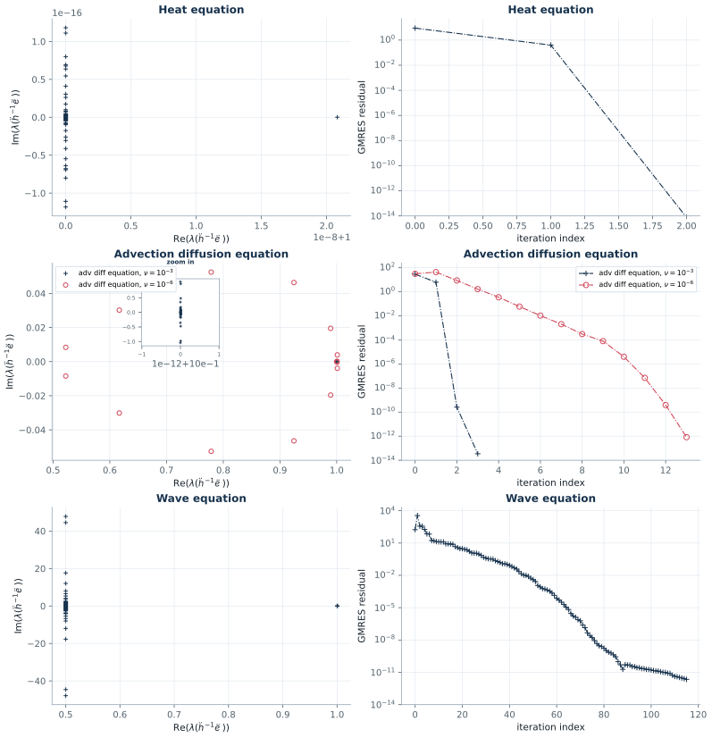

The spectra reproduce to three digits, which is the substance of the figure: the
heat eigenvalues sit within `2.1e-8` of 1, the advection-diffusion ones within
`2.2e-14` at $\nu=10^{-3}$ but spread over $[0.52, 1.00]$ at $\nu=10^{-6}$, and
the wave eigenvalues cluster at real part $1/2$ with imaginary parts out to
$\pm 47.9$. GMRES needs 2 iterations for heat, 3 and 13 for the two
advection-diffusion cases, and order 100 for the wave equation, where the
published curve ends near iteration 88 and SciPy's near 116 — the counter depends
on the residual and stopping convention, not on the operator. The `paper_validation`
suite keeps an earlier, coarser version of this experiment as
[`figure_3_15_validation`](figures/figure_3_15_validation.svg) so that the
cross-chapter run remains self-contained.

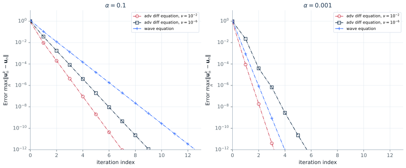

Figure 3.16 matches every published marker to within a few percent over eleven
orders of magnitude, and shows the mechanism plainly: the contraction is the
coupling parameter $\alpha$ itself, so $\alpha=10^{-3}$ converges in three
iterations where $\alpha=0.1$ needs six.

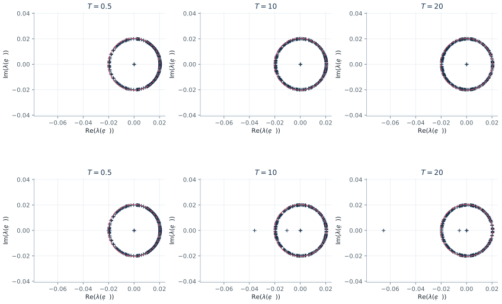

| $\gamma$ | $T=0.5$ | $T=10$ | $T=20$ | $\alpha/(1-\alpha)$ |
|---|---:|---:|---:|---:|
| 1/120 | 0.020408 | 0.020408 | 0.020408 | 0.020408 |
| 1/120.01 | 0.021078 | 0.035958 | 0.065270 | 0.020408 |

Figure 3.17 isolates the assumption behind that bound. Exactly at the stability
limit the spectral radius equals $\alpha/(1-\alpha)$ for every horizon; a
relative perturbation of $10^{-4}$ past the limit leaves eigenvalues drifting off
the circle, and the radius grows with $T$ instead of staying bounded.

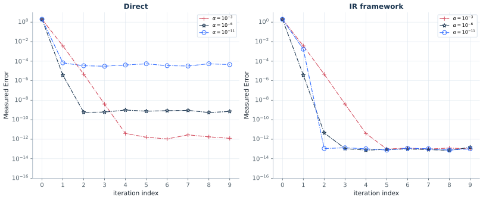

| $\alpha$ | direct, reproduced | direct, published | refinement, reproduced | published |
|---|---:|---:|---:|---:|
| 1e-3 | `1.0e-13` | `~3e-12` | `7.9e-14` | `~3e-14` |
| 1e-6 | `4.5e-11` | `~3e-10` | `9.3e-14` | `~3e-14` |
| 1e-11 | `3.1e-6` | `~3e-5` | `9.1e-14` | `~3e-14` |

Figure 3.18 is the practical conclusion of the section. Applying the diagonalized
solve directly makes the attainable accuracy floor scale like $1/\alpha$, so a
small $\alpha$ buys fast convergence and then loses it to roundoff; using the same
solve as an inner correction removes the dependence entirely and reaches `1e-13`
for every $\alpha$. Both reproduced floors are about an order of magnitude below
the published ones, again because the reproduction solves where the scripts
invert.

## Section 4 — PinT methods for parabolic problems

Every figure of Section 4 is reproduced, the two schematics of the chapter in the section above. The whole group is
generated by

```bash
OPENBLAS_NUM_THREADS=1 OMP_NUM_THREADS=1 MKL_NUM_THREADS=1 \
  actapint section4 --output-dir results/section4
```

which takes about 25 minutes on one core, most of it in the four nonlinear
experiments. Single figures can be requested by name, for example
`actapint figure_4_20`. Marker-by-marker comparisons, the parameters recovered
where the text or the scripts are silent, and the corrections the section required
are in [`SECTION4_REPRODUCTION.md`](SECTION4_REPRODUCTION.md).

| Item | Method | Status |
|---|---|---|
| Figures 4.2, 4.3, 4.4, 4.5 | Parareal | reproduced, `J` and two initial conditions recovered |
| Figure 4.6 | PFASST | reproduced from the text, all four factors within 0.6% |
| Figures 4.8, 4.9, 4.10, 4.11 | MGRiT with FCF-relaxation | reproduced, every marker of 4.10, one printed factor questioned |
| Figures 4.12, 4.13 | Parareal with a diagonalized coarse grid correction | reproduced |
| Figures 4.14, 4.15, 4.16, 4.17 | Parareal with a diagonalized coarse solver | reproduced, `J = 20` recovered for the heat panels |
| Figures 4.18, 4.19, 4.20, 4.21, 4.22 | space–time multigrid | reproduced, every marker of 4.20 and 4.22 |
| Table 4.1 | full STMG on 262 144 cores | historical table from Gander–Neumüller; [current MPI scaling](REPRODUCTION_CHECKS_2026-11-11.md) |

### Figures 4.9 and 4.10 — Parareal against MGRiT

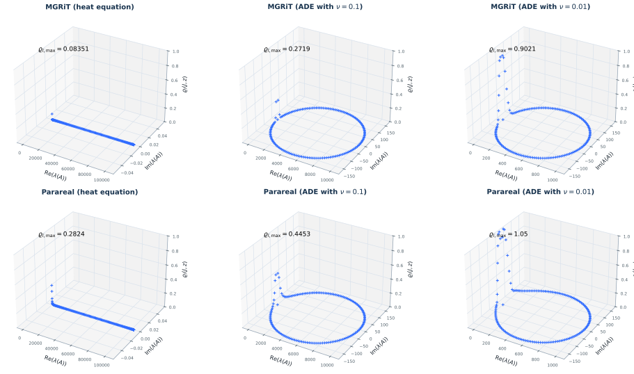

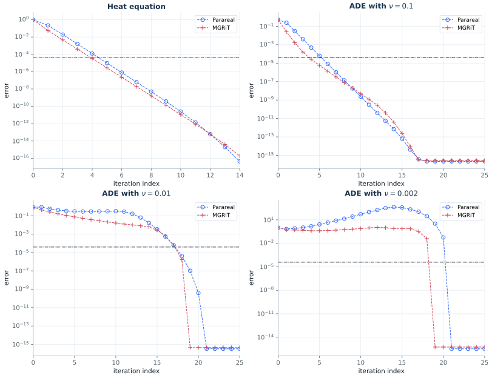

| Problem | Parareal | published | FCF-MGRiT | published |
|---|---:|---:|---:|---:|
| heat | 0.2824 | 0.2822 | 0.0835 | 0.08375 |
| ADE, $\nu=0.1$ | 0.4453 | 0.4453 | 0.2719 | 0.2718 |
| ADE, $\nu=0.01$ | 1.0501 | 0.9986 | 0.9021 | 0.9021 |
| ADE, $\nu=0.002$ | 1.4211 | 1.4211 | 1.2812 | 1.2812 |

Seven of the eight entries agree to four digits. The eighth, the Parareal factor
at $\nu=0.01$, is printed just below one and comes out just above; the argument
that this is a typo rather than a different setup is in the report.

The measured errors of Figure 4.10 were read off the published raster, 124 points
over the four panels, and every one of them above the round-off floor is
reproduced to within 6%, most to 1%. It takes two setups to do it: the first
three panels come from the plain $\sin^2(2\pi(1-x))$ started from $u_0$ at every
level, the divergent one from the chirped initial condition started from the
random draw, and both are lines of the same script. Swapping them costs a factor
of 4.6 at $\nu=0.1$, 17 at $\nu=0.01$ and 15 in the divergent panel.

### Figure 4.6 — PFASST

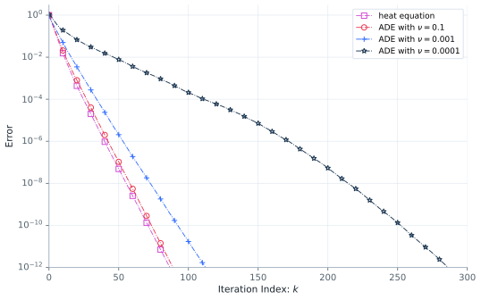

No script ships for PFASST, so it is built from the printed block iteration. The
four collocation and transfer matrices come out equal to the printed ones. Against
the published curves digitized from the article page, the factor per iteration is
0.7400, 0.7421, 0.7874 and 0.9146 against 0.7355, 0.7381, 0.7894 and 0.9114, all
four within 0.6%, and $10^{-12}$ is reached after 87, 89, 113 and 287 iterations
against 88, 90, 115 and 288.

### Figure 4.20 — space–time multigrid

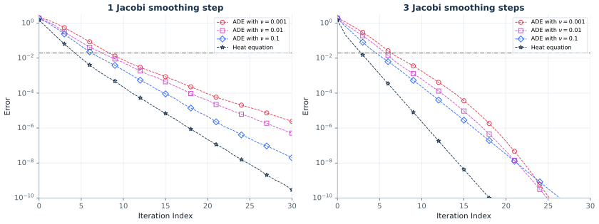

The most quantitative figure of the chapter, reproduced marker by marker; the
per-cycle factor spreads only from 0.63 to 0.48 across three decades of $\nu$,
which is the insensitivity to diffusion that distinguishes STMG from Parareal and
MGRiT.

### Figure 4.22 — space–time multigrid for Burgers' equation

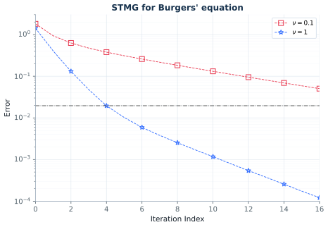

At $\nu=1$ the error reaches $1.2\cdot10^{-4}$ in sixteen cycles against
$1.1\cdot10^{-4}$ published; at $\nu=0.1$ the same sixteen cycles gain barely
more than one order, published and reproduced alike.

## GPU performance

The optional CuPy backend batches the independent Burgers fine propagators in
Figure 4.5. On a Tesla T4, the paper-scale batch is 11.76x faster than the
single-thread CPU path, and the complete paper suite falls from 263.57 to 67.92
seconds without changing any reported stopping iteration. Profiling,
correctness details, and remaining CUDA opportunities are documented in
[`GPU_ACCELERATION.md`](GPU_ACCELERATION.md).
