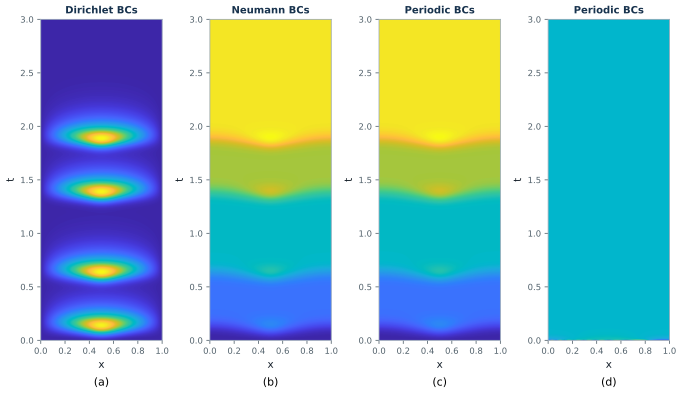
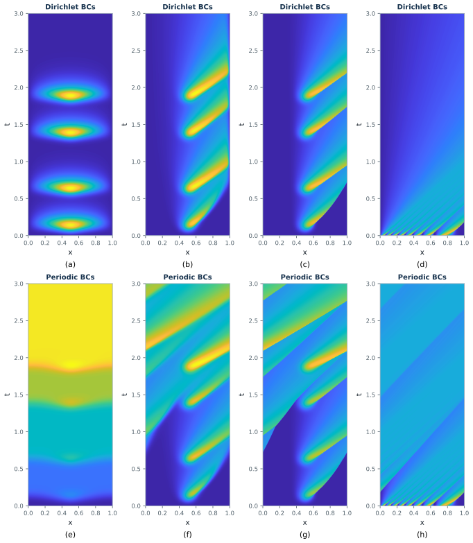
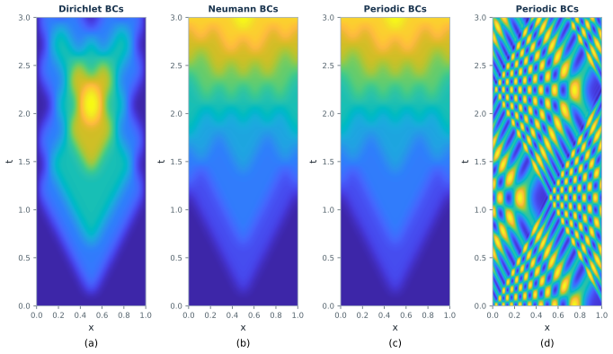

# Section 2 reproduction: model problems linking the parabolic and hyperbolic world

Section 2 of Gander, Wu and Zhou (*Acta Numerica* 2025, pp. 388–396) introduces
the four model equations used throughout the article and argues, before any
algorithm appears, that parabolic and hyperbolic problems must be time-paralleled
differently. The argument is made entirely with pictures: four figures holding
**24 space-time solution panels**, and no tables or iteration counts.

Reproduce everything with

```bash
actapint section2 --output-dir results/section2
```

which takes about 30 seconds on one CPU core and writes four combined figures
plus per-panel metrics.

## What the chapter claims

| Subsection | Equation | Claim about time parallelization |
|---|---|---|
| 2.1 heat | `u_t = u_xx + g` | Dirichlet: the solution is local in time, so later intervals can be computed before earlier ones. Neumann and periodic: heat accumulates, but only the constant mode survives, so a coarse grid suffices. |
| 2.2 advection–diffusion | `u_t + u_x - nu u_xx = g` | Dirichlet: information always leaves the domain, so PinT stays easy for every `nu`. Periodic with small `nu`: ever finer detail is transported far in time and PinT becomes hard. |
| 2.3 Burgers | `u_t - nu u_xx + c (u^2)_x = g` | Nonlinearity generates shocks that were not in the data; the high frequencies they carry travel far and are very hard to propagate on a coarse grid. |
| 2.4 wave | `u_tt = c^2 u_xx + g` | Detailed long-time propagation with reflections appears for *every* boundary condition. This is why hyperbolic problems need a different class of PinT method. |

Common setup: `Omega = (0,1)`, `T = 3`, source term (2.4) with amplitude 10,
sharpness 200, centre `x = 0.5` and pulses at `t = 0.1, 0.6, 1.35, 1.85`;
the source-free panels instead use `u0(x) = sin^2(8*pi*(1-x)^2)`.

## Panel inventory

Panel titles and boundary conditions were read off the published panels, not
guessed from the captions: panels 2.1(d) and 2.4(d) are **periodic**, which the
captions leave implicit.

| Figure | Panels | Configuration | Upstream script |
|---|---|---|---|
| 2.1 | a, b, c | heat, source, Dirichlet / Neumann / periodic | `Solution_Heat_ADE.m` with `a=0`, `nu=1` |
| 2.1 | d | heat, periodic, zero source, oscillating `u0` | same |
| 2.2 | a–c, e–g | advection–diffusion, source, Dirichlet / periodic, `nu = 1, 1e-2, 5e-4` | `Solution_Heat_ADE.m` with `a=1` |
| 2.2 | d, h | advection–diffusion, zero source, `nu = 5e-4` | same |
| 2.3 | a–c, e–g | Burgers, source, Dirichlet / periodic, `nu = 1, 1e-2, 5e-4` | `Solution_Bergers.m` |
| 2.3 | d, h | Burgers, zero source, `nu = 5e-4` | same |
| 2.4 | a, b, c | wave, `c^2 = 0.2`, source, Dirichlet / Neumann / periodic | `Solution_Wave.m` |
| 2.4 | d | wave, periodic, zero source, oscillating `u0` | same |

Discretizations follow the upstream scripts exactly, including their
inconsistencies: the Dirichlet and periodic heat/advection–diffusion branches use
IMEX Euler with implicit diffusion and explicit advection, while the Neumann
branch uses the trapezoidal rule; Burgers uses Crank–Nicolson with Newton and the
tolerance `max(dt^2, dx^2)/10`; the wave equation uses the trapezoidal rule on the
first-order system. Grids are `dt = dx = 1e-3` for heat/advection–diffusion and
`dt = dx = 1/400` for Burgers and the wave equation.

## Agreement with the published figures

Because the chapter states no numbers, the reproduction is checked against the
published rasters themselves:

```bash
python scripts/compare_with_paper.py paper.pdf \
  --output docs/data/section2_paper_comparison.json
```

The script renders each article page, locates the panels, inverts their pixels
through the calibrated parula table to recover normalised solution values, and
compares them with the reproduced fields. Results are in
[`docs/data/section2_paper_comparison.json`](data/section2_paper_comparison.json).

Across the 24 panels the median smoothed correlation is **0.996** and the median
decile mismatch is **0.0026**. Read the metrics as follows.

* `pearson` / `rms` are pointwise and only meaningful on smooth panels.
* `pearson_smoothed` removes sensitivity to aliasing.
* `decile_mad` compares the two value *distributions* and is invariant to any
  spatial shift, which separates "same solution, aliased rendering" from
  "different solution".

Seventeen of the 24 panels agree at `pearson_smoothed >= 0.99` with
`decile_mad <= 0.007`, and 20 of them at `pearson_smoothed >= 0.94` with
`decile_mad <= 0.01`. The four panels outside that band are all explained:

| Panel | Reading | Explanation |
|---|---|---|
| 2.1(d) | `rms` 0.052, `pearson` 0.40 | The reproduced field is constant to `1.2e-12`, so it carries no spatial signal and the correlation only compares quantization noise. The `rms` is the palette offset discussed below. |
| 2.2(d), 2.2(g), 2.2(h) | `decile_mad` 0.154, 0.098, 0.283 | Advection–diffusion at `nu = 5e-4` keeps its stripes sharp for all time, and their spacing approaches the published raster's pixel pitch, so the figure itself is aliased. Smoothed correlation stays at 0.957, 0.965, 0.923. |
| 2.4(d) | `rms` 0.107 | Same effect for the wave equation's criss-cross reflections; `decile_mad` is 0.008, so the value distributions still match. |

## Finding: the published Burgers panels use twice the flux of the committed script

Equation (2.6) of the article and `Solution_Bergers.m` both specify the flux
`0.5 (u^2)_x`; the script builds `A1 = spdiags([-e e], [-1,1], Nx, Nx)/(4*dx)`.
With that coefficient, panels 2.3(b–d) and 2.3(f–h) do not reproduce: the shock
front sits too far left and the domain drains too slowly. Doubling the flux to
`(u^2)_x`, that is `/(2*dx)`, reproduces every panel.

| Panel | `pearson_smoothed`, flux 0.5 | flux 1.0 | `decile_mad`, flux 0.5 | flux 1.0 |
|---|---:|---:|---:|---:|
| 2.3(b) | 0.847 | 0.984 | 0.0251 | 0.0065 |
| 2.3(c) | 0.828 | 0.995 | 0.0420 | 0.0021 |
| 2.3(d) | 0.813 | 0.990 | 0.1260 | 0.0044 |
| 2.3(f) | 0.703 | 0.997 | 0.0397 | 0.0019 |
| 2.3(g) | 0.608 | 0.995 | 0.0607 | 0.0040 |
| 2.3(h) | 0.152 | 0.951 | 0.0628 | 0.0050 |

The following were ruled out before concluding that the coefficient is the cause.

* **Discretization error.** The reproduction is grid-converged: `dt = 1/800` and
  `dt = 1/1600` agree to four digits (`max u = 1.1900` versus `1.1899`), and both
  differ from the published panel in the same way.
* **Numerical dissipation.** Replacing the centred flux derivative with the
  first-order upwind form that sits commented out in the upstream Neumann branch,
  and separately raising `nu` four-fold, leave the profiles essentially unchanged.
* **An implementation error in the flux.** The periodic solver conserves mass to
  `4.7e-16`, so the nonlinear term is in correct divergence form.
* **A source-term amplitude difference.** Panels 2.3(a) and 2.3(e) use `nu = 1`,
  where diffusion dominates and the response is effectively linear; they match at
  `pearson = 1.000`. Since MATLAB's `caxis` normalises each panel by its own
  range, amplitude is invisible in the linear panels, so this evidence comes from
  the source-free panels 2.3(d,h), whose amplitude is fixed at 1 by the initial
  condition and which also require flux 1.0.

`actapint.section2.BURGERS_FLUX_COEFFICIENT` therefore defaults to `1.0` so the
figures reproduce. Pass `flux_coefficient=BURGERS_FLUX_COEFFICIENT_UPSTREAM` to
`solve_burgers` to run the committed script's variant instead.

The Section 4 Burgers experiments turned out to need both coefficients, which is
why `actapint/section4/common.py` names them separately: Figures 4.5(b) and 4.11
are reproduced with the doubled flux of this section, while Figures 4.13 and 4.22
are reproduced with the committed `0.5 (u^2)_x`. See
[`SECTION4_REPRODUCTION.md`](SECTION4_REPRODUCTION.md).

## Other corrections to the upstream scripts

* `Solution_Wave.m` sets `A2(1,1)=nu/dx^2` in its Neumann branch, but `nu` is
  never assigned in that script, so the branch cannot run as committed. The
  reproduction uses `c^2/dx^2`, the coefficient the surrounding branches use, and
  panel 2.4(b) then matches at `pearson = 1.000`.
* The Neumann end-row treatment is inconsistent across the upstream scripts: the
  heat and wave branches use a first-order reflection, the Burgers branch a
  second-order one. `neumann_negative_laplacian` takes the end-row diagonal as an
  explicit `corner` argument so each script's choice stays visible.
* `Solution_Heat_ADE.m` runs a trapezoidal loop in its periodic branch and then
  overwrites the result with an IMEX loop; the first loop is dead code. The
  reproduction uses the IMEX loop, which is what the committed script produces.
* The periodic grids keep both `x = 0` and `x = 1` as separate unknowns, as
  upstream does, so the effective period is `1 + dx` rather than 1. This is
  reproduced rather than corrected, since it is what generated the figures.
* `Solution_Heat_ADE.m` plots every second grid point (`dxt = 2`) while the
  Burgers and wave scripts plot the full array. The stride changes the colour
  limits and which node each pixel shows, so the comparison script applies it per
  figure.

## Colour map

The published panels use MATLAB's default `parula`, which Matplotlib does not
ship. Rather than transcribe the table, it is sampled from the article itself:

1. `scripts/extract_parula.py` recovers the palette *path* from a lossless panel
   raster by sorting its colours by luminance. The endpoints come out as
   `(0.2392, 0.1490, 0.6588)` and `(0.9765, 0.9804, 0.0824)`, which match the
   documented `parula` endpoints to three decimals.
2. `scripts/calibrate_parula.py` fixes the *parameterization* by mapping every
   pixel of panels 2.1(a–c) to its reproduced solution value.

The table lives in `actapint/data/parula.csv`; `viridis` is used if it is absent.
One residual remains: panel 2.1(d) is uniform, and its published colour sits at
palette position 0.506 while the reproduced constant is 0.4554 of the panel's
range, a 0.05 discrepancy that pooling three calibration panels did not remove.
The colour scaling of that panel is therefore not fully explained. It affects
only the palette position, not the solution, whose constant is the conserved mean
of the initial condition and is reproduced to `1.2e-12` uniformity.

## Reproduced panels

### Figure 2.1 — heat equation



Dirichlet forgets the four heating events completely: the final maximum is
`4.3e-6` against a panel maximum of `0.178`, a ratio of `2.4e-5`. Neumann and
periodic instead accumulate to `0.6241` and `0.6240` against maxima of `0.6611`
and `0.6612`, and their final states are constant to within `4.4e-12`, which is
the chapter's point that heat is retained but only the lowest-frequency mode
survives.

### Figure 2.2 — advection–diffusion equation


### Figure 2.3 — Burgers' equation



Newton needs at most 4 iterations per step at `nu = 5e-4` and 2 at `nu = 1`.

### Figure 2.4 — second-order wave equation



Every boundary condition retains detail: the ratio of the final-time maximum to
the panel maximum is `0.24` for Dirichlet and `1.00, 1.00, 0.98` for the other
three, against `2.4e-5` for the Dirichlet heat equation. The trapezoidal rule
conserves the discrete wave energy to `2.1e-13` over 1200 steps.
