# Section 3 reproduction: effective PinT methods for hyperbolic problems

Section 3 (*Acta Numerica* 2025, pp. 396–443) is the longest chapter of the
article. It walks through five families of time-parallel methods and asks, for
each, whether it survives a hyperbolic problem: Schwarz waveform relaxation,
time-parallel integral deferred correction, ParaExp, and the two ParaDiag
branches. Unlike Section 2 it does report numbers, so most of it can be checked
against printed values rather than against rasters alone.

## What has to be reproduced

Eighteen figures and two tables carry the chapter. Fifteen figures and both
tables are experiments that report numbers. The other three figures are
schematics, and they are drawn too: the region Figure 3.2 colours and the curves
of Figures 3.4 and 3.7 are computed rather than sketched, which
[`PAPER_REPRODUCTION.md`](PAPER_REPRODUCTION.md#the-six-schematics) describes.

Unlike Section 2, most of these experiments have a committed upstream script, so
the reproduction ports the script and then checks the result against the
published figure, rather than reconstructing the setup from the text. The scripts
involved are `SWR_for_ADE.m`, `UTP_DD_Method.m` with `RedBlackSubdomains.m`,
`IDC_PIDC_ADE.m`, `ParaExp_Burgers.m`, `Direct_ParaDiag_ADE.m`,
`Direct_ParaDiag_Wave.m`, `Direct_ParaDiag_Burgers.m`,
`Iterative_ParaDiag_ADE.m`, `Iterative_ParaDiag_Wave.m` and
`Iterative_ParaDiag_RoundError.m`.

| Item | Subsection | Content | Upstream script | Status |
|---|---|---|---|---|
| Figure 3.1 | 3.2 SWR | OSWR convergence factor and four-subdomain iteration counts, 2 panels | `SWR_for_ADE.m` | reproduced, every marker |
| Figure 3.2 | 3.2 SWR | red–black SWR tents | — | drawn, exact region propagated |
| Figure 3.3 | 3.2 SWR | red–black SWR / UTP error fields for the wave equation, 4 panels | `UTP_DD_Method.m`, `RedBlackSubdomains.m` | reproduced |
| Figure 3.4 | 3.3 IDC | the PIDC pipeline schedule | — | drawn, sweeps of (3.11) computed |
| Figure 3.5 | 3.3 IDC | IDC versus PIDC error per time window, 4 panels | `IDC_PIDC_ADE.m` | reproduced, one constant per rough panel |
| Figure 3.6 | 3.3 IDC | IDC versus RIDC error per time window, 4 panels | text only | reproduced, one constant per rough panel |
| Figure 3.7 | 3.4 ParaExp | the two ParaExp steps | — | drawn, (3.13) to (3.15) computed |
| Figure 3.8 | 3.4 ParaExp | ParaExp versus Parareal for Burgers, 3 panels | `ParaExp_Burgers.m` | reproduced |
| Figure 3.9 | 3.5 ParaDiag I | error against the geometric-mesh parameter, 2 panels | `Direct_ParaDiag_ADE.m` | reproduced, advection coefficient recovered |
| Figure 3.10 | 3.5 ParaDiag I | error blow-up past the roundoff threshold | `Direct_ParaDiag_ADE.m` | reproduced with the ratio held fixed |
| Figure 3.11 | 3.5 ParaDiag I | wave equation, geometric and uniform steps, 2 panels | `Direct_ParaDiag_Wave.m` | reproduced, both panels |
| Table 3.1 | 3.5 ParaDiag I | condition number of the eigenvector matrix | `Direct_ParaDiag_Wave.m` | reproduced, all twelve entries |
| Figure 3.12 | 3.5 ParaDiag I | geometric steps versus the BVM discretization, 2 panels | text only | reproduced, both panels marker for marker |
| Figure 3.13 | 3.5 ParaDiag I | BVM ParaDiag I for Burgers | `Direct_ParaDiag_Burgers.m` | reproduced to one iteration |
| Figure 3.14 | 3.5 ParaDiag I | two quasi-Newton variants for Burgers | text only | averaged trend matched; NKA acceleration at `nu = 0.02` remains unmatched |
| Table 3.2 | 3.5 ParaDiag I | Jacobian solves, sequential versus parallel | `Direct_ParaDiag_Burgers.m` | reproduced, sequential column exactly |
| Figure 3.15 | 3.5 ParaDiag II | preconditioned spectra and GMRES, 6 panels | `Iterative_ParaDiag_ADE.m`, `Iterative_ParaDiag_Wave.m` | reproduced, spectra to 3 digits |
| Figure 3.16 | 3.5 ParaDiag II | head–tail coupled waveform relaxation, 2 panels | `Iterative_ParaDiag_ADE.m` | reproduced, every marker |
| Figure 3.17 | 3.5 ParaDiag II | eigenvalues of the iteration matrix, 6 panels | `Iterative_ParaDiag_Wave.m` | reproduced |
| Figure 3.18 | 3.5 ParaDiag II | ParaDiag II for the wave equation in two modes, 2 panels | `Iterative_ParaDiag_RoundError.m` | reproduced |

The older `paper_validation` module also carries a Figure 3.15 panel. It is kept
for continuity, but it solves the first-order problems with backward Euler at
`gamma = 1/100` without checking the spectra against the published axes; the
reproduction below supersedes it.

All seventeen experiments run as one group,

```bash
OPENBLAS_NUM_THREADS=1 OMP_NUM_THREADS=1 MKL_NUM_THREADS=1 \
  actapint section3 --output-dir results/section3
```

which takes 10 minutes on one core of the reference machine and peaks at 324 MiB.
Every figure committed under [`figures`](figures) and every metrics file under
[`data`](data) comes from a single run of that command, and the experiments are
deterministic: repeated runs agree bit for bit up to the point where a curve
starts to diverge. Past that point the divergent tails of Figure 3.8 and
Figure 3.13 vary by tens of percent from run to run, because what they amplify is
roundoff; which entries diverge does not change.

## Reading the published figures

Section 3 is almost entirely line plots, so the comparison baseline is built by
extracting the published markers rather than whole rasters. The axes are
calibrated from the major tick marks, not from the axis frame: in Figure 3.1 the
frame sits a fifth of a decade outside the outermost decade tick, so calibrating
on the frame shifts every value. With tick calibration, the sampled diffusion
parameters of Figure 3.1 come out as `nu = 2^0, 2^-1, ..., 2^-7`, which is how the
grid is stated in this reproduction.

One artefact is worth recording because it looks like a discrepancy and is not.
Markers whose centre lies within a marker radius of the top of the axis box are
clipped by Matlab, which pulls the measured centroid down. In Figure 3.1(a) the
three largest `nu` are clipped: their marker footprints are 111, 97 and 80 pixels
against about 152 for an unclipped marker, and the apparent convergence factor
reads 5–9% low. Those three points are therefore excluded when checking against
the published values.

## Figure 3.1 — OSWR for the advection-diffusion equation

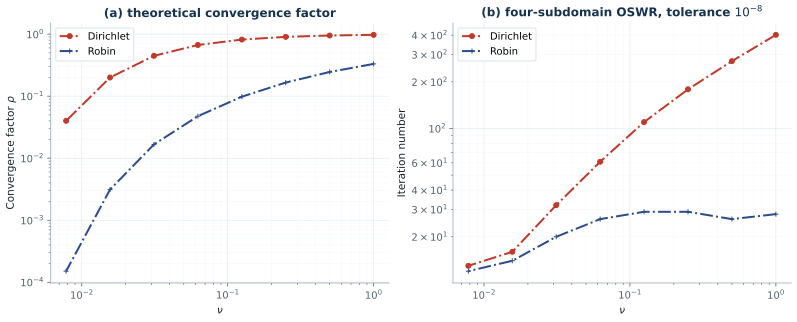

```bash
actapint figure_3_1 --output-dir results/section3
```

The setup is stated in full in the article: `Omega = (0, L)` with `L = 8.2`,
`T = 5`, `dt = 0.01`, `dx = 0.02`, overlap `l = 2 dx`, four subdomains, initial
value `u0(x) = exp(-10 (x - L/2)^2)`, centred finite differences, backward Euler,
random initial guess, and a stopping tolerance of `1e-8` against the converged
solution.

Panel (a) is theory. Reproducing it needed one correction and revealed one
inconsistency.

* The Dirichlet curve is equation (3.3), `rho = exp(-l pi / (nu T))`. Against the
  five unclipped markers it agrees to better than 0.8%.
* The Robin curve is **not** the maximum over the resolved modes. Equation (3.2c)
  defines `rho` as `max` over `y` in `[y_min, y_max]` of `R0` and claims it is
  bounded by `R0(y_bar, p_tilde*, y0)`. That maximum is attained at `y_min` and is
  *larger* than the claimed bound — 0.49 against 0.33 at `nu = 1` — so the printed
  inequality cannot hold as written. What Figure 3.1(a) plots is the bound
  itself, and with that reading all eight markers agree to better than 0.5%:

| `nu` | reproduced | published |
|---:|---:|---:|
| 1 | 0.3316 | 0.3329 |
| 1/2 | 0.2456 | 0.2471 |
| 1/4 | 0.1658 | 0.1662 |
| 1/8 | 0.09819 | 0.09822 |
| 1/16 | 0.04766 | 0.04779 |
| 1/32 | 0.01670 | 0.01673 |
| 1/64 | 0.003129 | 0.003133 |
| 1/128 | 0.0001512 | 0.0001521 |

Panel (b) is the discrete four-subdomain experiment, and it is a port of
`SWR_for_ADE.m` rather than a reconstruction from the text. Every sampled point
is reproduced to within the precision with which the published markers can be
read:

| `nu` | 1 | 1/2 | 1/4 | 1/8 | 1/16 | 1/32 | 1/64 | 1/128 |
|---|---:|---:|---:|---:|---:|---:|---:|---:|
| Dirichlet, reproduced | 402 | 272 | 179 | 110 | 61 | 32 | 16 | 13 |
| Dirichlet, published | 402 | 274 | 179 | 110 | 61 | 32 | 16 | 13 |
| Robin, reproduced | 28 | 26 | 29 | 29 | 26 | 20 | 14 | 12 |
| Robin, published | 28 | 28 | 29 | 29 | 26 | 20 | 14 | 12 |

The article also quotes 92 Dirichlet and 28 Robin iterations at `nu = 0.1`, which
is not one of the sampled points. This reproduction gives exactly 92 and 28.

Three details had to come from the script, because the text either omits them or
says something else.

* **The Robin parameter.** Theorem 3.1 prints `p* = p_tilde* s / nu`, but
  `SWR_for_ADE.m` computes `p = tp*nu/Ldx`, that is `p_tilde* nu / l`. The printed
  scaling is not merely different, it cannot reproduce the figure: used literally
  it needs 185 iterations at `nu = 1` against the published 28, and a scan over
  `p` shows no value below 31 for that discretization. `ROBIN_SCALING` therefore
  defaults to `"upstream"`, with `"theorem"` available.
* **The stopping criterion.** The text stops "when the error between the iterate
  and the converged solution is less than `1e-8`", but the script stops on
  `max|U_k+1 - U_k|`, the difference between successive iterates. The two differ
  by roughly a factor `1 - rho`, which matters most where `rho` is close to one:
  measuring against the converged solution instead inflates the largest counts by
  about 10%.
* **The initial guess.** The text says the iteration starts from a random guess;
  the script starts from zero. This changes nothing measurable — across eight
  random seeds the Dirichlet count moved only between 96 and 99 in an earlier
  variant of this port, and the Robin count not at all.

### Finding: the committed script transports at twice the intended speed

`SWR_for_ADE.m` assembles the advection term as `r2 = 1*dt/dx` and applies it to
the centred difference matrix `spdiags([-e e], [-1,1], ...)`. A centred first
derivative needs `dt/(2*dx)`, so the committed script advects at speed 2 while
equation (2.5) has speed 1. The effect is a clean one-octave shift of the whole
curve, which is how the discrepancy was found:

| `nu` | 1 | 1/2 | 1/4 | 1/8 | 1/16 | 1/32 | 1/64 | 1/128 |
|---|---:|---:|---:|---:|---:|---:|---:|---:|
| `r2 = dt/dx` as committed | 358 | 207 | 112 | 60 | 32 | 16 | 12 | 27 |
| `r2 = dt/(2 dx)` | 402 | 272 | 179 | 110 | 61 | 32 | 16 | 13 |
| published | 402 | 274 | 179 | 110 | 61 | 32 | 16 | 13 |

Reading the committed row against the published one shifted by a single column
shows the same numbers, as expected if the effective diffusion parameter is
halved. The published figure was made with the consistent coefficient, so
`ADVECTION_SCALE` defaults to `0.5` and `ADVECTION_SCALE_UPSTREAM` keeps the
committed value.

## Figure 3.3 — red–black SWR, equivalently unmapped tent pitching


```bash
actapint figure_3_3 --output-dir results/section3
```

This is a port of `UTP_DD_Method.m` together with `RedBlackSubdomains.m`. The
wave equation (2.7) is solved on the whole space–time rectangle at once, with
400 unknowns in space, 1203 time steps at the CFL-limited `dt = 3/1203`, five red
subdomains in space and tents 40 time steps high, starting from a random initial
guess.

The published panels are error fields, so the number to compare is the height
reached by the converged region. Because the tents are staggered, that front is a
saw-tooth, and both its valleys and its teeth can be read off the raster:

| Panel | Sweep | Front valley, reproduced | Front tooth, reproduced | Published |
|---|---|---:|---:|---|
| (b) | 4 red | 0.601 | 0.698 | valley at 0.6, teeth to 0.7 |
| (c) | 8 black | 1.496 | 1.596 | valley at 1.5, teeth to 1.6 |
| (d) | 12 red | 2.197 | 2.294 | valley at 2.2, teeth to 2.3 |

The maximum error stays at the amplitude of the random guess, 1.497 against the
published colour bar which saturates at 1.4, because outside the tents nothing
has been touched yet. The mechanism the figure is there to show — the exact
solution appearing inside the tents without the method being told where they are,
and the front advancing one slab per red–black pair — is reproduced exactly.

## Figures 3.5 and 3.6 — pipelined and revisionist IDC

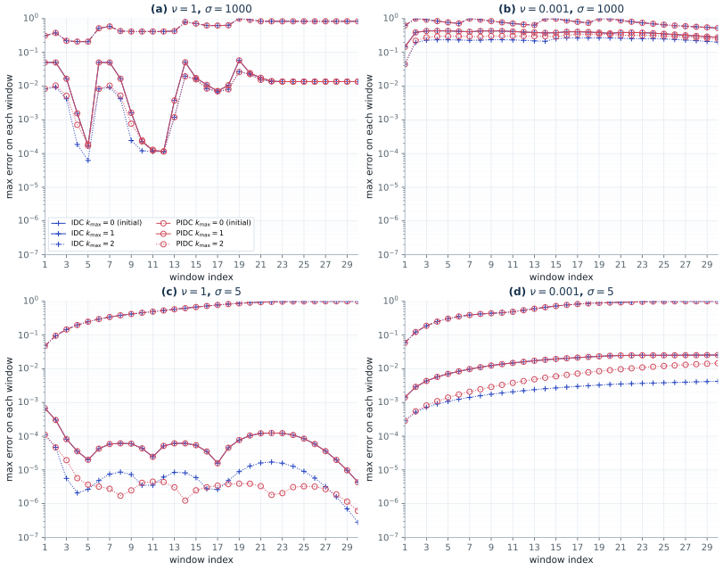

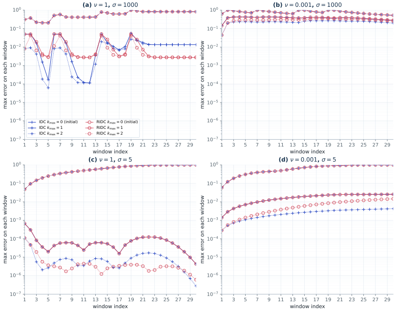

```bash
actapint figure_3_5 --output-dir results/section3
actapint figure_3_6 --output-dir results/section3
```

Figure 3.5 is a port of `IDC_PIDC_ADE.m`: the advection–diffusion equation (2.5)
with the source (2.4), `dx = 1/64`, periodic boundaries, backward Euler,
`T = 3` split into 30 windows of five Gauss–Lobatto nodes, three sweeps. Figure
3.6 has no committed script, so RIDC is built from the description in the text: a
quadrature window that slides one fine step at a time, so that the corrector can
start as soon as `M` steps of the predictor exist.

The qualitative content of both figures is reproduced. With the smooth source
(`sigma = 5`, panels c, d) the sweeps gain three to four orders of magnitude and
the parallel variants track IDC closely, while at small diffusion PIDC and RIDC
fall behind IDC at the second sweep — the point the article makes. With the rough
source (`sigma = 1000`, panels a, b) the sweeps stall after the first one, and the
early windows oscillate over two decades in the same pattern as the published
panels.

Quantitatively, the two smooth panels are reproduced and the two rough ones are
reproduced up to one constant per panel, which the published figure cannot have
obtained from the error it says it plots. Section 3.3 defines

```
err^k_n = max_m ||u^ref_{n,m} - u^k_{n,m}||_inf / max_{n,m} ||u^ref_{n,m}||_inf
```

with the reference from ODE45 at `1e-13` for both tolerances. The denominator is
the largest value the reference takes anywhere, so the `k_max = 0` curve — the
error of the constant predictor — has to reach one in the window where that value
is attained. All four reproduced panels do. The published smooth panels rise to
0.90 there, and the published rough panels stop at 0.41 and 0.68.

Reading that `k_max = 0` curve off page 26 at 600 dpi, calibrated on the frame
whose seven decades run from `1e0` to `1e-7` (the values are in
`PUBLISHED_INITIAL_ERROR`, and IDC, PIDC and RIDC share the curve, so Figure 3.6
repeats them), gives:

| panel | windows read | reproduced / published | constant to |
|---|---:|---:|---:|
| (a) `nu = 1`, `sigma = 1000` | 7 | 2.447 | 0.7% |
| (b) `nu = 1e-3`, `sigma = 1000` | 22 | 1.469 | 0.6% |
| (c) `nu = 1`, `sigma = 5` | 29 | 0.983 | 14% |
| (d) `nu = 1e-3`, `sigma = 5` | 28 | 0.984 | 13% |

The smooth panels need no factor, and their worst window is the last one, where
the reproduction reaches one and the reading is 0.89. The rough panels need a
factor that is constant to better than a per cent over every window that can be
read, which is what makes it a normalization and not a modelling difference. The
same offsets carry the three sweeps of both figures: over all six curves of
Figure 3.5 the ratio has median 2.46 in panel (a) and 1.48 in panel (b), and 1.00
in panels (c) and (d).

That the offset is not in the model was established by fitting the pair
`(nu, sigma)` to the digitized initial curve, which carries no free scale: over a
grid of seven viscosities against seven sharpnesses per panel, the residual after
removing the best constant is smallest exactly at the committed `(1, 1000)` and
`(1e-3, 1000)`, at 2.4% and 3.6%, and every other pair is worse — while the
constant itself stays between 2.19 and 2.67 everywhere in the grid for panel (a),
so no parameter change removes it. Ruled out with numbers: `dx` from `1/32` to
`1/256` (moves the constant by less than one per cent), refining the reference in
time (0.5% and 2.7%), the maximum of the computed IDC or PIDC solution rather
than of the reference (0.87 to 1.01 times it, never 2.4), the spatial Euclidean
norm (6.70 times) or the discrete `L^2` norm (0.84 and 0.39 times), `max |g|`
(67 and 26 times), a nonzero initial condition, which the caption of Figure 3.6
excludes anyway and which would make the denominator exactly one (6.7 times), and
any single sharpness for the denominator alone — `sigma = 300` reproduces the
ratio between the two panels but is 22% high on both. The port itself is not in
question: a literal transcription of `IDC_PIDC_ADE.m`, including its explicit
`Ix/(Ix - c dt A)`, agrees with the module to at most four parts in a million on
every curve of every panel, and its operator is bit-identical.

In absolute terms the two panels are drawn against `0.3644` and `0.5690` where
their own references reach `0.1489` and `0.3874`, and two further candidates for
those two numbers are excluded. A denominator taken over a longer run than the
plotted one is not it: both rough references attain their maximum inside the
first of the thirty windows and never exceed it again, so the ratio to the
maximum over `[0, 30]` is `1.0000` to four digits in both panels. Neither is a
denominator borrowed from a neighbouring panel: of the twelve cross pairings the
closest is panel (a) measured against panel (b)'s maximum, which gives `0.94`
rather than one, and the rest are off by factors of `3.8` to `135`.

The metrics files carry the reading and the comparison per panel
(`published_initial_error` and `initial_error_against_published`) together with
the reference amplitude (`reference_scale`), so any other normalization can be
applied afterwards.

## Figure 3.8 — ParaExp for Burgers' equation

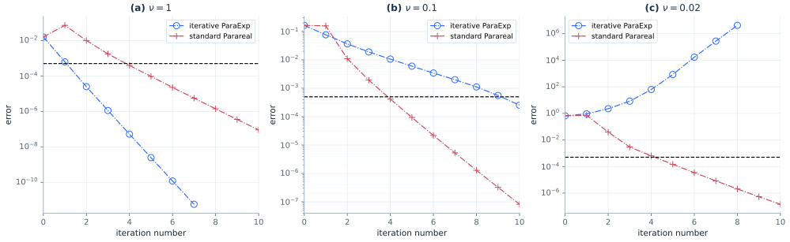

```bash
actapint figure_3_8 --output-dir results/section3
```

A port of `ParaExp_Burgers.m`: Burgers' equation as (3.21) with `A = A_xx` and
`B = -A_x/2`, `dx = 1/100`, periodic boundaries, `T = 2`, coarse step
`Delta T = 0.01`, fine step `Delta t = 0.01/20`, backward Euler with Newton for
the fine propagator, and `expm` for the ParaExp coarse propagator.

The three panels reproduce the article's message that ParaExp degrades as the
problem turns hyperbolic:

| `nu` | ParaExp, reproduced | Parareal, reproduced | Published |
|---|---|---|---|
| 1 | `1.6e-2` falling to `2.5e-9` by sweep 5 | `1.6e-2` falling to `9.5e-5` by sweep 5 | ParaExp clearly faster |
| 0.1 | `1.6e-1` falling to `6.0e-3` | `1.6e-1` falling to `9.4e-5` | Parareal faster |
| 0.02 | `6.6e-1` growing to `8.4e+2` | `6.6e-1` falling to `1.5e-4` | ParaExp diverges |

The transverse line at `max(Delta t, Delta x^2) = 5e-4` is drawn as in the
published panels.

## Figures 3.9 and 3.10 — ParaDiag I on a geometric time mesh

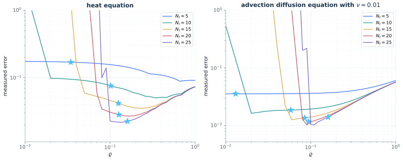

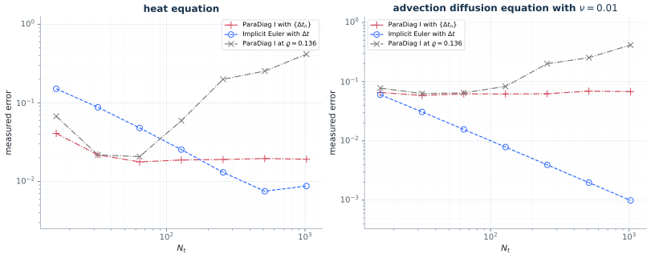

```bash
actapint figure_3_9 --output-dir results/section3
actapint figure_3_10 --output-dir results/section3
```

Both are ports of `Direct_ParaDiag_ADE.m`. Figure 3.9 scans the mesh ratio
`rho` from `0.01` to `1` in steps of `0.01` for five step counts at `T = 0.2`,
`dx = 1/50`, periodic boundaries and `u0 = sin(2 pi x)`; the star is the
theoretical ratio (3.28), which the script evaluates from the spectrum of `A` and
overrides by hand at the largest step count. Figure 3.10 keeps the same space
discretization and moves to `T = 0.5` and `N_t = 2^4, ..., 2^10`.

The heat panel of Figure 3.9 is reproduced pointwise. Reading the published
curves off the raster and comparing them with the reproduction at the same `rho`
agrees to about 1% everywhere, which is the precision with which the raster can
be read at all:

| `N_t` | published minimum | reproduced | at `rho` published / reproduced | published at `rho = 1` | reproduced |
|---:|---:|---:|---|---:|---:|
| 5 | 0.0895 | 0.0886 | 0.66 / 0.67 | 0.0913 | 0.0912 |
| 10 | 0.0508 | 0.0501 | 0.33 / 0.34 | 0.0738 | 0.0736 |
| 15 | 0.0353 | 0.0350 | 0.23 / 0.23 | — | 0.0731 |
| 20 | 0.0272 | 0.0268 | 0.16 / 0.17 | — | 0.0731 |
| 25 | 0.0187 | 0.0218 | 0.11 / 0.13 | 0.0729 | 0.0731 |

The five stars land on the published stars as well: `(0.035, 0.170)`,
`(0.102, 0.076)`, `(0.125, 0.042)`, `(0.126, 0.028)` and `(0.160, 0.023)`, the
last being the script's override.

### Finding: the published advection-diffusion panels transport at speed one half

`Direct_ParaDiag_ADE.m` keeps the advection coefficient in a variable `adc` and
commits it as `0`, which is the switch that selects the heat equation, so the
coefficient behind the published advection-diffusion panels is not in the
repository. It is not the unit speed of equation (2.5): with `adc = 1` every
curve of Figure 3.9(b) comes out a factor 4.0 too high, uniformly in `rho` and in
`N_t`. The clean measurement is the sequential backward Euler curve of Figure
3.10(b), which is a plain time-stepper with no diagonalization in it:

| `N_t` | 16 | 32 | 64 | 128 | 256 | 512 | 1024 |
|---|---:|---:|---:|---:|---:|---:|---:|
| published | 0.058 | 0.030 | 0.0152 | 0.0078 | 0.0039 | 0.0020 | 0.00098 |
| `adc = 1` | 0.211 | 0.115 | 0.0598 | 0.0306 | 0.0155 | 0.0078 | 0.0039 |
| `adc = 1/2` | 0.0602 | 0.0309 | 0.0156 | 0.00787 | 0.00395 | 0.00198 | 0.00099 |

The factor is exactly 4 because the leading backward Euler error of the single
excited mode goes with the square of its discrete eigenvalue, and that eigenvalue
is advection-dominated here: `|lambda| = 6.28` at unit speed against `3.15` at
half speed. `ADE_ADVECTION` is therefore `0.5`, with `ADE_ADVECTION_UPSTREAM`
keeping the literal reading of (2.5).

### Finding: the blow-up of Figure 3.10 needs the ratio held fixed

The caption of Figure 3.10 says the mesh uses `mu = 1 + rho_num` with `rho_num`
"the minimizer determined numerically, as shown in Figure 3.9", but Figure 3.9
only covers `N_t <= 25` and Figure 3.10 goes to 1024. Re-optimizing the ratio for
every step count cannot produce the published increase: the minimum over `rho` is
by construction never worse than the small-ratio limit, which is the uniform
mesh, so the reproduced curve flattens at `1.9e-2` for the heat equation instead
of rising. Holding one ratio fixed for all step counts does produce it, and a
single value, `rho = 0.136`, follows the published curve in both panels:

| `N_t` | 16 | 32 | 64 | 128 | 256 | 512 | 1024 |
|---|---:|---:|---:|---:|---:|---:|---:|
| heat, published | 0.065 | 0.022 | 0.019 | 0.058 | 0.18 | 0.28 | 0.37 |
| heat, `rho = 0.136` | 0.0676 | 0.0218 | 0.0207 | 0.0595 | 0.200 | 0.254 | 0.416 |
| heat, `rho` re-optimized | 0.041 | 0.022 | 0.018 | 0.019 | 0.019 | 0.020 | 0.019 |
| ADE, published | 0.075 | 0.061 | 0.059 | 0.104 | 0.18 | 0.26 | 0.42 |
| ADE, `rho = 0.136` | 0.0779 | 0.0629 | 0.0649 | 0.0831 | 0.201 | 0.254 | 0.416 |

The figure therefore carries three curves: the re-optimized ratio, the fixed
ratio, and the sequential method. Past `N_t = 100` the measured error is
hypersensitive to the ratio — at `N_t = 256` it moves by a factor 5 between
`rho = 0.136` and `rho = 0.142` — so the pointwise agreement above should not be
read as more than the threshold behaviour being right.

It is worth recording that Table 3.1 cannot be the explanation the text offers
for this increase. `Cond(V)` depends on the mesh alone and *saturates* in `N_t`
for a fixed ratio, at `4.8e6` for `rho = 0.15`; that multiplies the double
precision epsilon up to `1e-9`, nine orders of magnitude below the errors
plotted. What actually grows is the whole roundoff term of (3.27b), whose
`rho^-(1+N_t)` beats the factorial in its denominator once `rho` drops below the
threshold.

## Figure 3.11 and Table 3.1 — the same experiment for the wave equation

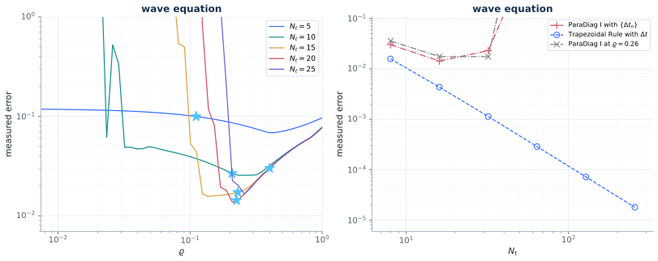

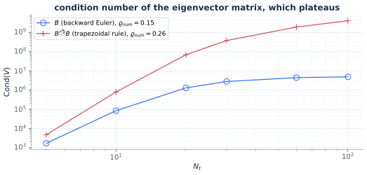

```bash
actapint figure_3_11 --output-dir results/section3
actapint table_3_1 --output-dir results/section3
```

A port of `Direct_ParaDiag_Wave.m`: the first-order form (3.31) of the wave
equation with homogeneous Dirichlet boundaries, `dx = 1/20`, `T = 0.2`, the
trapezoidal rule (3.32), the error measured on the displacement components only,
and the ratio scanned over the script's geometric grid `1.11^(-47:0)`.

Panel (a) is reproduced on the truncation side of every curve, including all five
theoretical stars, which for the second-order problem come from (3.37) evaluated
with the single-precision epsilon of the paper's footnote:

| `N_t` | published star | reproduced star | published minimum | reproduced |
|---:|---|---|---:|---:|
| 5 | `(0.11, 0.099)` | `(0.111, 0.0996)` | 0.068 at 0.43 | 0.0685 at 0.434 |
| 10 | `(0.20, 0.026)` | `(0.208, 0.0267)` | 0.026 at 0.23 | 0.0256 at 0.258 |
| 15 | `(0.21, 0.018)` | `(0.229, 0.0173)` | 0.017 at 0.17 | 0.0156 at 0.138 |
| 20 | `(0.20, 0.0138)` | `(0.225, 0.0143)` | 0.015 at 0.23 | 0.0137 at 0.209 |
| 25 | `(0.40, 0.030)` | `(0.400, 0.0301)` | 0.026 at 0.32 | 0.0165 at 0.258 |

Panel (b) reproduces the sequential trapezoidal curve exactly — `0.0158`,
`0.00435`, `0.00114`, `2.88e-4`, `7.21e-5`, `1.81e-5` against the published
`0.016`, `0.0043`, `0.0011`, `2.9e-4`, `7.3e-5`, `1.8e-5` — and, with the ratio
held fixed at `0.26`, which is the ratio Table 3.1 needs for the same matrix, the
ParaDiag curve as well: `0.036`, `0.0175`, `0.0175` against the published
`0.047`, `0.018`, `0.018`, followed by a fourth marker that leaves the top of the
axis at `N_t = 64` in both.

Table 3.1 is reproduced to every printed digit, twelve entries out of twelve:

| `N_t` | 5 | 10 | 20 | 30 | 60 | 100 |
|---|---:|---:|---:|---:|---:|---:|
| `B`, reproduced | 1.7e3 | 8.4e4 | 1.3e6 | 2.8e6 | 4.4e6 | 4.8e6 |
| `B`, published | 1.7e3 | 8.4e4 | 1.3e6 | 2.8e6 | 4.4e6 | 4.8e6 |
| `Btilde^-1 B`, reproduced | 4.7e3 | 7.9e5 | 6.9e7 | 3.8e8 | 1.9e9 | 4.1e9 |
| `Btilde^-1 B`, published | 4.7e3 | 7.9e5 | 6.9e7 | 3.8e8 | 1.9e9 | 4.1e9 |

This settles what `rho_num` means in the table, and it is not one ratio per step
count. `Cond(V)` is a function of `rho` and `N_t` alone and is extremely
sensitive to the first — at `N_t = 100` a one percent change in `rho` moves it by
a factor two — and all six entries of each row are matched by a *single* ratio,
`0.15` for backward Euler and `0.26` for the trapezoidal rule. Re-optimizing per
step count instead gives `0.67, 0.34, 0.17, 0.11, 0.08, 0.08` and condition
numbers from 12 to `5.9e12`, nothing like the printed row. Both are in the
metrics file.

### Finding: the missing roundoff is `It/V`, not the solve

Three places in this subsection used to show the same one-octave discrepancy: the
`N_t = 25` curve of Figure 3.11(a) turned up at `rho = 0.24` in the paper and only
at `rho = 0.09` here, the geometric curve of Figure 3.11(b) left the axis at
`N_t = 64` in the paper and at 128 here, and Figure 3.12(a) deteriorated "around
`N_t = 32`" in the paper and at 128 here. All three came from one line of the
scripts, `Ya = kron(It/V, Ix) * tb`.

`It/V` is `mrdivide`, which forms `V^-1` by factoring `V` transposed and solving
against the `N_t` columns of the identity, and then applies it as a matrix. The
port solved `V x = tb` instead. The two agree to a few percent for `N_t <= 15`,
which is why the difference was missed, and diverge by decades beyond that: the
scripts' path blows the `N_t = 25` wave scan up at `rho = 0.170` where solving
only reaches `rho = 0.091`, against the published `0.237`, and at a fixed
`rho = 0.26` it takes Figure 3.11(b) off the axis at `N_t = 64` as published
where solving holds on to `N_t = 128`. Note that this is not a matter of one
being sloppier: the explicitly formed inverse has the *smaller* residual of the
two, `|V^-1 V - I| = 5.0e-10` against `1.4e-5` at `N_t = 25, rho = 0.17`. What
differs is the direction of the perturbation it leaves in the eigenvector matrix,
and the geometric mesh amplifies the scripts' one by `Cond(V)`.

Which of the two inverses in the script matters is worth recording, since the
other one does not: replacing the solve against `Btilde` by `B\It` changes
nothing at all, because the right-hand side has a single nonzero block and
`inv(Btilde)` has entries `+-2` only. `paradiag_solve` therefore defaults to the
scripts' arithmetic and takes `explicit_inverse=False` for the accurate path.

What remains open is the size of the gap that is left. The published run still
carries more roundoff than the scripts' arithmetic realizes here, by a factor
that grows with `N_t`: measured as the roundoff ratio `(rho_pub/rho_here)^(N_t-1)`
that the two blow-up ratios of Figure 3.11(a) imply, the reproduction is short by
`0.0, 0.7, 1.8, 3.5` decades for `N_t = 10, 15, 20, 25`, down from
`0.8, 3.2, 4.4, 10.0` decades when solving. The
published blow-up sits almost exactly where `eps rho^-(N_t - 1) = 1`, at
`rho^(N_t - 1) = 7.3e-16, 6.8e-16, 5.4e-17, 9.7e-16` against `eps = 2.2e-16`,
which is the `rho` power of (3.36) with no prefactor at all, whereas the
reproduction blows up where `eps Cond(V) = 1`. Since `Cond(V)` saturates in `N_t`
— the plateau the paper itself flags after Table 3.1 as meriting further study —
the two criteria separate as `N_t` grows.

## Figure 3.12 — geometric steps against the boundary value method

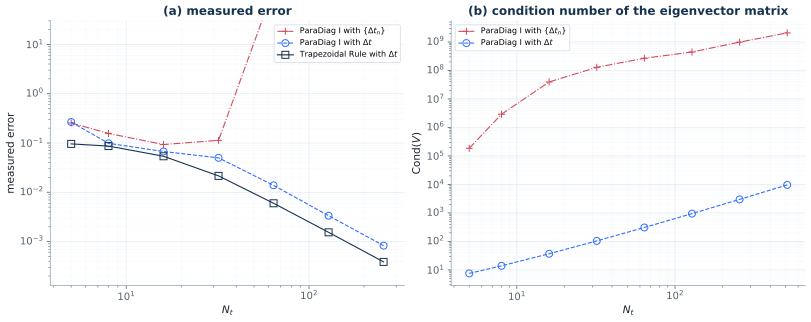

```bash
actapint figure_3_12 --output-dir results/section3
```

The wave equation with homogeneous Dirichlet boundaries and `dx = 1/40`, comparing
ParaDiag I on the geometric mesh with ParaDiag I on the uniform mesh of the
boundary value method (3.38) and with the sequential trapezoidal rule. The scripts
do not cover this figure; the BVM matrix is (3.39b), centred differences in time
closed by one backward Euler step.

Two parameters had to be corrected against the published axes. The text says
`T = 0.5` and `N_t = 2^2, ..., 2^8`, but the markers do not sit at powers of two:
they sit at `N_t = 5, 8, 16, ..., 256` in panel (a) and carry on to 512 in panel
(b), and the horizon that puts all three curves of panel (a) on the published
markers is `0.4`. This is what the earlier record described as a uniform factor
1.7 by which every curve of panel (a), the purely sequential one included, sat
above the published one — it was the horizon, and `T = 0.4` removes it on all
three curves at once rather than by rescaling.

With those, and with the scripts' `It/V` arithmetic of the previous section, both
panels are reproduced marker for marker. The digitization of panel (b) is
self-checking: the BVM branch is a parameter-free computation, and it comes out
within two per cent at all eight step counts, which validates the axis
calibration used for the geometric branch of the same panel.

| `N_t` | 5 | 8 | 16 | 32 | 64 | 128 | 256 | 512 |
|---|---:|---:|---:|---:|---:|---:|---:|---:|
| trapezoidal rule, published | 9.56e-2 | 8.63e-2 | 5.37e-2 | 2.15e-2 | 5.98e-3 | 1.55e-3 | 3.89e-4 | — |
| trapezoidal rule, reproduced | 9.59e-2 | 8.66e-2 | 5.38e-2 | 2.15e-2 | 5.99e-3 | 1.54e-3 | 3.87e-4 | 9.70e-5 |
| BVM, published | 2.65e-1 | 9.89e-2 | 6.73e-2 | 5.02e-2 | 1.38e-2 | 3.36e-3 | 8.34e-4 | — |
| BVM, reproduced | 2.66e-1 | 9.86e-2 | 6.72e-2 | 5.00e-2 | 1.39e-2 | 3.35e-3 | 8.29e-4 | 2.07e-4 |
| geometric mesh, published | 2.53e-1 | 1.56e-1 | 9.24e-2 | 9.03e-2 | off axis | off axis | off axis | off axis |
| geometric mesh, reproduced | 2.55e-1 | 1.56e-1 | 9.31e-2 | 1.13e-1 | 1.3e2 | 9.6e8 | 4.3e23 | 6.4e52 |
| `Cond(V)`, BVM, published | 7.45 | 13.9 | 37.0 | 103 | 303 | 933 | 2.94e3 | 9.49e3 |
| `Cond(V)`, BVM, reproduced | 7.55 | 14.0 | 37.0 | 104 | 309 | 946 | 2.98e3 | 9.64e3 |
| `Cond(V)`, geometric, published | 1.84e5 | 2.85e6 | 4.09e7 | 1.23e8 | crowded | 4.26e8 | 9.37e8 | 1.97e9 |
| `Cond(V)`, geometric, reproduced | 1.86e5 | 2.91e6 | 3.95e7 | 1.29e8 | 2.68e8 | 4.44e8 | 9.86e8 | 2.08e9 |

The mesh ratio of the geometric curve is not stated, and neither the closed form
(3.37) nor the minimizer of a scan reproduces the published pair of panels.
`Cond(V)` pins it down instead, because it falls by a factor of thirty for every
ten per cent added to the ratio: reading panel (b) gives `rho = 0.095, 0.160,
0.244, 0.283` and then a plateau at `0.303`, which is `FIGURE_3_12_RHO`. Those
ratios reproduce panel (b) to six per cent and the first three markers of the
geometric curve in panel (a) to one per cent. The fourth, at `N_t = 32`, comes out
25% high, which is where roundoff starts to contribute and where the two panels
therefore stop being consistent with a single ratio; one per cent on the error
there would cost 25% on the condition number. Past that the curve leaves the axis
between `N_t = 32` and 64, as published.

The messages of the figure are then reproduced with the numbers behind them: the
BVM error is second order throughout, a constant factor above the sequential
trapezoidal rule and parallel to it, while the geometric mesh stalls at `9e-2` and
explodes; and panel (b) says why, with `Cond(V)` growing like `N_t^1.6` for the
BVM matrix and sitting above `1e5` from the start for the geometric one.

## Figures 3.13, 3.14 and Table 3.2 — Burgers' equation

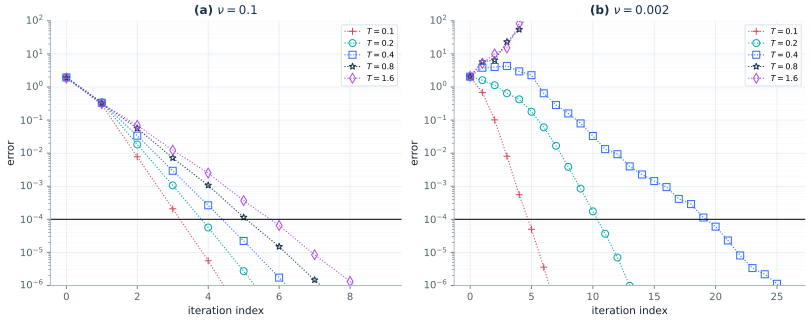

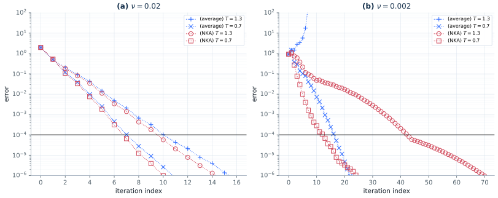

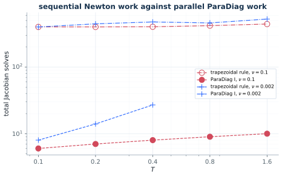

```bash
actapint figure_3_13 --output-dir results/section3
actapint figure_3_14 --output-dir results/section3
actapint table_3_2 --output-dir results/section3
```

Figure 3.13 and Table 3.2 solve Burgers' equation (2.6) with periodic boundaries,
`dx = 1/100`, `N_t = 200` steps at every horizon, and the quasi-Newton iteration
(3.45) in which every Jacobian block is replaced by the average (3.44), so that
the BVM time matrix can be diagonalized. The stopping criterion is `dx^2/100`.

Table 3.2 reproduces the sequential column exactly, all ten entries:

| `T` | 0.1 | 0.2 | 0.4 | 0.8 | 1.6 |
|---|---:|---:|---:|---:|---:|
| trapezoidal rule, `nu = 0.1`, published and reproduced | 401 | 401 | 403 | 419 | 443 |
| trapezoidal rule, `nu = 0.002`, published and reproduced | 400 | 446 | 476 | 460 | 526 |
| ParaDiag I, `nu = 0.1`, published | 5 | 5 | 6 | 7 | 7 |
| ParaDiag I, `nu = 0.1`, reproduced | 5 | 6 | 7 | 8 | 8 |
| ParaDiag I, `nu = 0.002`, published | 7 | 12 | 22 | x | x |
| ParaDiag I, `nu = 0.002`, reproduced | 7 | 13 | 18 | 22 | x |

The parallel counts are within one or two iterations, which is as close as an
iteration count measured against an absolute tolerance can be expected to come
when the starting iterate is not specified. `Direct_ParaDiag_Burgers.m` offers
two: a uniform random vector, which is the line it executes, and the initial
condition repeated at every time level, which is commented out. The random start
reproduces which entries diverge, the constant start reproduces the counts more
closely; the table above is the constant start and both are in the metrics file.
The convergence histories of Figure 3.13 come out with the same spacing as the
published ones. At `nu = 0.1` the five horizons need 6, 7, 8, 9 and 10 iterations
to reach `1e-6` against a published 6, 7, 7, 8 and 9 read off the raster, one
iteration apart throughout and with the same fan-out in `T`. At `nu = 0.002` they
need 8, 14 and 27 for the first three horizons against a published 7, 12 and 26,
and the last two do not converge, as in the published panel.

Figure 3.14 replaces the single averaged Jacobian by the tensor structure
`Phi_k (x) A_k` of (3.47), with the scaling factors given in closed form by the
nearest Kronecker product approximation (3.48). They are computed once, before
the iteration, from a reduced model on a ten times coarser space mesh, as the
text prescribes for space: `dx = 1/200`, `DX = 1/20`, `T` in `{0.7, 1.3}`.
The reproduction uses `dt = 0.01`; the Figure 3.14 paragraph does not specify it.

At `nu = 0.002`, the qualitative stabilization at `T = 1.3` is reproduced. The
averaged variant *diverges* at `T = 1.3` — the published panel shows it rising
off the top of the axis by iteration 6, and the reproduction reaches `1.8e8` by
iteration 11 — while the NKA variant converges, in 70 iterations against the
published 48, at a factor per iteration of `0.82` against a published `0.79`. At
`T = 0.7` the reproduction needs 22 iterations for the averaged variant and 25
for NKA, against a published 36 and 20. Those two counts are not directly
comparable: the published panel starts at `2.70` and the constant start of the
reproduction at `0.92`, and the published averaged curve then spends fifteen
iterations wandering between `0.31` and `0.84` before it contracts at all, which
the reproduction does not.

At `nu = 0.02` the averaged curves have similar trajectories, while the large
NKA acceleration is not reproduced. The following measurements document the
comparison. The [independent 2026-11-10 audit](REPRODUCTION_CHECKS_2026-11-10.md)
checks the linear update against a global sparse solve and records multiple
error norms; it does not identify the missing source configuration.

### Finding: the published panels, read off the vector paths

`scripts/digitize_figure_3_14.py` reads the polyline vertices of page 46 out of
the vector paths of the PDF, which is exact up to the width of a stroke; the
values below are `docs/data/figure_3_14_published.json`, and a second,
independent digitization of the same page agreed with every one of them to three
digits. Panel (b) is drawn with a stride, a marker every second or third
iteration, so its rows are labelled with the iteration index they belong to.

The calibration is each panel's own tick marks, fitted by least squares in the
coordinates of the page. Panel (a) has ten `x` ticks at `0, 2, ..., 18` and seven
`y` ticks at `1e0` down to `1e-6`, which come out at `7.7552` points per
iteration and `15.9583` points per decade with fit residuals of `1.8e-4` and
`9.6e-5` of a point; its axes then run from `0` to `19.00` in the iteration index
and from `3.00` down to `6.10e-7` in the error. Panel (b) has ten `x` ticks at
`0, 5, ..., 45` and nine `y` ticks at `1e2` down to `1e-6`, `3.0071` points per
iteration and `13.0000` per decade with residuals of `5.5e-4` and `6.2e-15`, and
its axes run to `49.00` and from `100` down to `6.11e-7`. The two lower limits
agree to `2.6e-4` of a decade, which is the accuracy the readings inherit. The
black horizontal line sits at `6.41e-5` in (a) and `5.57e-5` in (b); the two
differ, so it is not the `max(dx^2, dt^2)` of a shared mesh that Figure 3.13
draws, and it fixes no time-step.

| Panel (a), `nu = 0.02` | error at iterations `0, 1, 2, ...` | factor per iteration over the last six |
|---|---|---:|
| averaged, `T = 1.3` | 1.993 0.584 0.240 0.111 0.0473 0.0153 6.01e-3 3.73e-3 2.03e-3 1.20e-3 5.61e-4 3.01e-4 1.27e-4 6.17e-5 2.48e-5 1.08e-5 4.58e-6 1.63e-6 7.17e-7 | 0.410 |
| averaged, `T = 0.7` | 1.961 0.618 0.151 0.0448 0.0109 2.75e-3 5.31e-4 1.10e-4 3.15e-5 9.17e-6 3.00e-6 7.98e-7 | 0.272 |
| NKA, `T = 1.3` | 1.993 0.0353 0.0109 4.51e-3 1.26e-3 4.62e-4 1.23e-4 3.90e-5 1.05e-5 2.81e-6 7.90e-7 | 0.280 |
| NKA, `T = 0.7` | 1.961 0.0163 2.42e-3 4.24e-4 6.70e-5 9.21e-6 1.77e-6 | 0.161 |

| Panel (b), `nu = 0.002` | error at the iterations shown | factor per iteration |
|---|---|---:|
| averaged, `T = 1.3`, every iteration | 3.091 2.63 3.08 3.99 5.08 9.90 86.2 | diverges |
| averaged, `T = 0.7`, every third | 2.703 0.701 0.306 0.466 0.838 0.409 0.163 0.0485 0.0107 2.18e-3 3.47e-4 4.17e-5 4.68e-6 | 0.540 |
| NKA, `T = 1.3`, every third | 3.091 0.0747 0.0459 0.0284 0.0165 8.70e-3 4.08e-3 1.71e-3 6.32e-4 2.01e-4 5.45e-5 2.16e-5 1.26e-5 6.77e-6 3.38e-6 1.56e-6 6.58e-7 | 0.792 |
| NKA, `T = 0.7`, every second | 2.703 0.209 0.0317 6.31e-3 2.69e-3 1.05e-3 3.19e-4 9.22e-5 2.87e-5 8.23e-6 2.39e-6 | 0.544 |

### Comparison convention: distance to the all-at-once solution

The two variants of a panel share their first value to every digit the vector art
carries — `1.993` at `T = 1.3` and `1.961` at `T = 0.7` in panel (a), `3.091` and
`2.703` in panel (b) — which is consistent with an error measured at the common starting iterate.
This alone does not establish the norm or rule out a manually prepended marker.
For comparison the reproduction uses `|U^k - U*|_inf`, `k = 0, 1, ...`,
against the all-at-once solution. The independent audit also saves the increment
used by `Direct_ParaDiag_Burgers.m` for Figure 3.13, plus spatial L2, scaled L2
and RMS errors. `all_at_once_solution`
therefore solves (3.42) by Newton before the sweeps start — its Jacobian is block
tridiagonal in time, so it is one sparse solve per Newton step and the residual
comes out at `7e-14` — and `quasi_newton` takes it as its `reference`. The two
observables have the same factor per iteration, so no count below moves by more
than one iteration if the script's one is used instead; their first values differ, which helps compare candidate starting iterates.

### Closest tested starting iterate for panel (a): random on `(-1, 1)`

Every curve of panel (a) starts at `1.99`, and `1 + max|U|` for the solution of
the all-at-once system at `nu = 0.02` is `1.9921`, making a random start plausible under the max-norm convention. The initial
condition repeated instead starts at `0.84`. Of the two random ranges, only `(-1, 1)`, the range of the initial
condition, has the zero mean that makes the averaged Jacobian of the first
iterate a sensible one. With `start="symmetric"` the averaged curves land on the
published ones:

| `nu = 0.02`, averaged | iterations `0..5` | to `1e-6` |
|---|---|---:|
| `T = 1.3`, published | 1.993 0.584 0.240 0.111 0.0473 0.0153 | 18 |
| `T = 1.3`, reproduced | 1.982 0.495 0.202 0.0914 0.0427 0.0141 | 16 |
| `T = 0.7`, published | 1.961 0.618 0.151 0.0448 0.0109 2.75e-3 | 11 |
| `T = 0.7`, reproduced | 1.982 0.507 0.119 0.0390 9.73e-3 2.49e-3 | 11 |

All twelve digitized points of the `T = 0.7` curve are matched to within 22%, its
count to `1e-6` is 11 against a published 11, and its factor per iteration is
`0.295` against a published `0.272`. At `T = 1.3` the first six points are matched
to within 18% and the reproduction then runs a little fast, `0.384` per iteration
against a published `0.410`, which by iteration 16 has accumulated to a factor of
`7.4`. The constant start instead begins at `0.84` and `0.73`, a factor of `2.4`
and `2.7` below the published curves, and the `(0, 1)` random start spends its
first three iterations between `1.3` and `0.4`, where the published panel is
already at `0.58`, `0.24` and `0.11`.

The symmetric start at `nu = 0.002` diverges for all four curves, so panel (b)
keeps the constant start, so a shared start among these tested choices does not reproduce both panels. Panel (b) does not settle the question
either way: its first values, `3.091` twice and `2.703` twice, are larger than the
`1 + max|U| = 1.9992` that the max-norm distance to the solution can reach for any
start inside the range of the initial condition. The increment between the first
two iterates does reach `2.84` and `2.69` from the symmetric start, which is the
closest anything tried comes to those two numbers.

### Finding: no reduced model in the scan reaches the published panel

`nka_weight_scan` puts every construction the text leaves open through the same
measurement, from both starting iterates, and the `weight_scan` block of
`docs/data/figure_3_14_paradiag_nka.json` holds the whole record. It is run at
`dx = 1/50` to keep it sixteen times cheaper than the figure, which costs
nothing at `nu = 0.02`, where the factor per iteration is a property of the
continuous problem — `0.395` there against `0.392` at `dx = 1/200` for the
averaged variant at `T = 1.3` — but does matter at `nu = 0.002`, where the fine
mesh resolves the front and the coarse one does not, so the last two columns
compare constructions against each other rather than against the page. Each cell
is the factor per iteration from the start of the corresponding panel, the
symmetric random one at `nu = 0.02` and the constant one at `nu = 0.002`, with
`x` where the iteration diverges:

| `Phi` from | `nu = 0.02`, `T = 1.3` | `T = 0.7` | `nu = 0.002`, `T = 1.3` | `T = 0.7` |
|---|---:|---:|---:|---:|
| averaged Jacobian (3.44), `Phi = I` | 0.395 | 0.277 | 0.666 | 0.355 |
| reduced model, `DX = 1/100` | 0.394 | 0.276 | 0.330 | 0.230 |
| reduced model, `DX = 1/40` | 0.405 | 0.277 | 0.249 | 0.216 |
| reduced model, `DX = 1/20`, the text's | 0.384 | 0.261 | 0.328 | 0.199 |
| reduced model, `DX = 1/10` | 0.359 | 0.237 | x | 0.189 |
| reduced model, `DX = 1/4` | 0.315 | 0.223 | x | 0.514 |
| reduced model at `nu/10` | 0.791 | 0.431 | x | x |
| reduced model at `10 nu` | 0.395 | 0.277 | 0.617 | 0.298 |
| the text's, normalized to mean one | 0.384 | 0.261 | 0.328 | 0.199 |
| the text's, normalized to first block one | 0.403 | 0.284 | x | 0.590 |
| the text's, unit Frobenius norm | 0.384 | 0.261 | 0.373 | 0.228 |
| measured against the first block, not (3.44) | 0.411 | 0.300 | x | x |
| the advective part of the Jacobian only | x | 0.497 | 0.439 | 0.231 |
| a reduced model with ten time levels | 0.385 | 0.261 | 0.333 | 0.409 |
| the exact Jacobians of the fine mesh | 0.392 | 0.273 | 0.270 | 0.222 |
| the text's, spread by 2 | 0.371 | 0.244 | x | 0.463 |
| the text's, spread by 5 | 0.328 | 0.191 | x | x |
| the text's, spread by 10 | 0.402 | 0.488 | x | x |
| published, averaged | 0.410 | 0.272 | diverges | 0.540 |
| published, NKA | 0.280 | 0.161 | 0.792 | 0.544 |

Nothing in the first eighteen rows reproduces the published pair. At `nu = 0.02`
the published NKA factor is `32%` and `41%` below the published averaged one; the
best construction in the scan, the reduced model on `DX = 1/4`, is `20%` and `19%`
below the averaged variant it starts from, and it is a coarse mesh of four cells
that the text does not describe and that costs the reduced model any relation to
the problem. Pushing the text's weights away from one, which is not a
construction at all, buys `17%` and `31%` at a spread of five and then makes
things worse at ten. Counted rather than fitted, and six decades below the start
is where the published curves stop, the scan moves `T = 1.3` from the 16
iterations of the averaged variant to 12 at best, where the published panel goes
from 18 to 10.

At `nu = 0.002`, eight of the eighteen constructions diverge at `T = 1.3`
where the specified coarse model converges. This reproduces the qualitative
stabilization, with the iteration-count differences reported above.

### Finite diagonal-weight searches do not recover the published curves

The published panel gains eight iterations from NKA at `T = 1.3`, 18 down to 10,
and five at `T = 0.7`, 11 down to 6; the asymptotic factor per iteration falls
from `0.410` to `0.280` and from `0.272` to `0.161`. The reproduction gains one
iteration at either horizon. The tested full-Jacobian weights have only a small effect at this viscosity.

The weights (3.48) are Frobenius inner products against the averaged Jacobian
`A`, and at `dx = 1/200` the diffusion part of `A` has `|A_diff|_F = 27782`
against `|A_adv|_F = 1414` for the advective part, a ratio of `19.6`. A weight
`gamma_n` therefore has to stay within a few percent of one, or the term
`(gamma_n - 1) A_diff` it adds to the mismatch `gamma_n A - J_n` is larger than
the whole advective mismatch it is supposed to cancel. Computing (3.48) on the
fine mesh itself gives `gamma_n` in `[0.9997, 1.0006]`, and the coarse reduced
model of the text, where the same ratio is only `1.96`, gives `[0.968, 1.052]`.
Measuring the spectral radius of the iteration matrix
`(B (x) I - Phi (x) A)^-1 (Phi (x) A - grad F)` at the converged state, at
`T = 1.3` and `N_t = 26`, the number of steps at which the averaged variant has
the published factor of `0.410`:

| `Phi` | spectral radius |
|---|---:|
| identity, i.e. the averaged variant | 0.4427 |
| (3.48) on the fine mesh | 0.4425 |
| (3.48) on the coarse mesh, i.e. the NKA variant | 0.4230 |
| `1 + 10 (Phi_fine - I)`, ten times the fine spread | 0.4402 |
| best of a coordinate descent, four sweeps over all 26 weights | 0.3891 |
| best of a Powell search over all 26 weights, 4012 evaluations | 0.3395 |
| what the published panel needs | 0.280 |

Those two searches are free to move each of the 26 weights independently and are
not required to come from any model or from any Frobenius minimization. The Powell
search spreads them over `[0.71, 1.70]`, twelve times the spread of the coarse
reduced model, and still stops 21% above the published factor; at the spread the
reduced model does produce it is 51% above. At the `dt = 0.01` of the figure the
same first three rows read `0.2942`, `0.2937` and `0.2771` at `T = 1.3` and
`0.1924`, `0.1931` and `0.1577` at `T = 0.7`: the Kronecker correction is worth 6%
and 18% of the factor, where the published panel needs 32% and 41%. At
`nu = 0.002` the coarse weights instead spread over `[0.49, 1.58]`, and there the
effect is the large one the figure shows.

The diffusion-dominated fine mesh explains why the Frobenius-optimal full-Jacobian
weights are close to one. The coordinate and Powell searches provide local
empirical results, not a lower bound over all diagonal weights. They therefore
do not prove the impossibility asserted in the earlier version of this report.
The source scripts do not include this figure; resolving the quantitative
difference requires its time step, initialization, precise error observable,
and reduced-model run settings.

## Figure 3.15 — the spectrum that decides whether ParaDiag II works

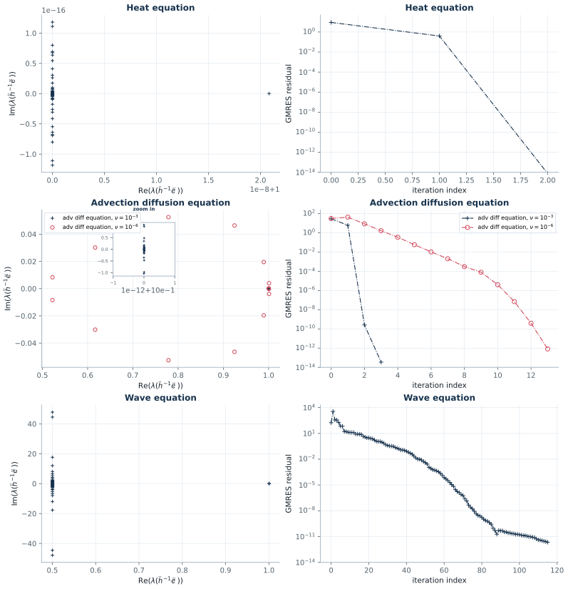

```bash
actapint figure_3_15 --output-dir results/section3
```

Ported from `Iterative_ParaDiag_ADE.m` and `Iterative_ParaDiag_Wave.m`:
`T = 2`, `Delta t = 1/50`, `Delta x = 1/100`, `gamma = 1/100`, Dirichlet
boundaries, `alpha = 1`, and GMRES started from `u_0/8` repeated over all time
steps.

The three left-hand panels are the interesting ones, because their axes pin down
three numbers rather than a shape. All three come out right:

| Panel | Published axis | Reproduced |
|---|---|---|
| (a) heat | `Re(lambda)` in `[1, 1.00000002]` | furthest eigenvalue `1 + 2.08e-8` |
| (c) advection diffusion, `nu = 1e-3` | inset on a `1e-14` scale | furthest eigenvalue `1 + 2.2e-14` |
| (c) advection diffusion, `nu = 1e-6` | `Re` in `[0.5, 1.1]`, `Im` in `[-0.06, 0.06]` | `Re` in `[0.522, 1.001]`, `Im` in `[-0.055, 0.055]` |
| (e) wave | `Re` clustered at `1/2`, `Im` in `[-50, 50]` | `Re` in `[0.500, 1.000]`, `Im` in `[-47.9, 47.9]` |

GMRES needs 2 iterations for the heat equation (published 3), 3 for
`nu = 1e-3` (published 3), 13 for `nu = 1e-6` (published 13) and 116 for the wave
equation (published 88). The first and the last are the two loose ends: one
iteration of the stopping test in the first case, and in the last a problem where
the preconditioner has already failed — the spectral radius of `I - P^-1 K` is
47.9 — so the Krylov iteration is barely converging and its length is sensitive to
the residual normalization. The conclusion the panel supports, that `P` loses all
of its power on the hyperbolic problem and GMRES then needs `O(N_t)` iterations,
is reproduced.

### Two findings about how these spectra have to be computed

**The first-order problems are solved with backward Euler, not the trapezoidal
rule.** The text introducing this experiment says the first-order systems are
solved with the trapezoidal rule, but `Iterative_ParaDiag_ADE.m` sets
`theta = 1`. The published axis settles it. With `alpha = 1` the only eigenvalues
of `P^-1 K` that differ from one are, per spatial mode, `z^N_t/(1 - z^N_t)` with
`z` the amplification factor of the integrator. For backward Euler the slowest
mode of the heat equation gives `z = 0.8375` and `z^100 = 2.08e-8`, which is
exactly the upper end of the published axis in panel (a). The trapezoidal rule is
only A-stable, so `|z| -> 1` for the stiff modes and the same quantity is 1.54 —
eight orders of magnitude away from the published axis.

**The visible spread of the clusters is roundoff, and the reproduction reports the
exact values as well.** In panels (a), (c) and (e) all but one (for the wave
equation, two) eigenvalues per spatial mode are exactly one, and they are
defective. A Jordan block of size `m` perturbed by `epsilon` spreads its
eigenvalues by `epsilon^(1/m)`, which for `m = 99` and double precision is about
`0.7` — that is why the published wave panel shows a cluster at `1/2` with
imaginary parts of `+-48` instead of a point at 1, and why the heat cluster is
`+-5e-16` wide. The reproduction plots the same eigenvalue decomposition, so it
shows the same artefact, but it additionally computes the nonzero eigenvalues of
`M = I - P^-1 K` from the rank-one (rank-two for the two-step method) structure of
`P_alpha - K`, which needs no cancellation. Those exact values are what the table
above quotes, and they agree with the raster to three digits.

## Figure 3.16 — head–tail coupled waveform relaxation

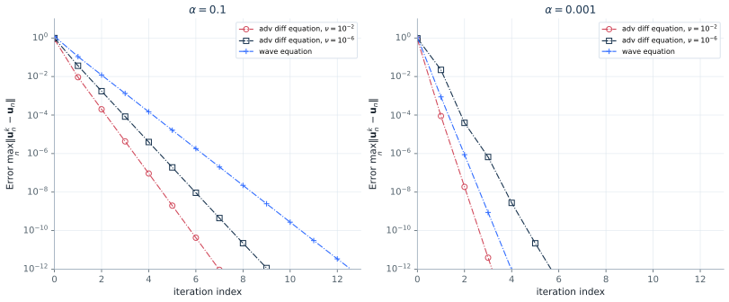

```bash
actapint figure_3_16 --output-dir results/section3
```

Same data as Figure 3.15 but with periodic boundaries, where `alpha = 1` makes
`P` singular, so `alpha` becomes 0.1 and 0.001. Every published marker is
reproduced:

| `alpha` | Problem | Reproduced | Published |
|---|---|---|---|
| 0.1 | `nu = 1e-2` | `9.3e-3, 2.0e-4, 4.3e-6, 9.3e-8, 2.0e-9, 4.3e-11` | `9.3e-3, 2.0e-4, 4.2e-6, 8.8e-8, 1.9e-9, 4.1e-11` |
| 0.1 | wave | `1.1e-1, 1.2e-2, 1.3e-3, 1.5e-4, 1.6e-5, 1.8e-6` | `1.1e-1, 1.2e-2, 1.3e-3, 1.4e-4, 1.6e-5, 1.7e-6` |
| 0.001 | `nu = 1e-2` | `8.9e-5, 1.9e-8, 4.0e-12` | `9.0e-5, 1.8e-8, 3.8e-12` |
| 0.001 | wave | `8.8e-4, 8.8e-7, 8.8e-10` | `8.7e-4, 8.3e-7, 8.5e-10` |

Three details had to be read out of the figure rather than the text.

* **The diffusion parameters are `1e-2` and `1e-6`.** The text says the data are
  "the same as those used in Figure 3.15", which used `1e-3`; the legend of
  Figure 3.16 says `1e-2`, and only `1e-2` gives the published slope.
* **Backward Euler again.** The caption says trapezoidal rule. The observed decay
  per iteration is `alpha z^N_t/(1 - alpha z^N_t)`, so the slope measures `z`
  directly: the published `nu = 1e-2` curve falls by `2.15e-2` per iteration at
  `alpha = 0.1`, and backward Euler gives `2.153e-2` against `4.5e-3` for the
  trapezoidal rule. For the wave equation the Numerov method conserves energy,
  `|z| = 1`, and the rate is exactly `alpha/(1 - alpha)`, which both integrators
  and both the article and this reproduction agree on.
* **The plotted quantity is the increment, not the error.** The axis is labelled
  `max_n ||u_n^k - u_n||`, but the value at iteration 0 differs between the two
  panels even though the starting iterate does not, which only makes sense for
  `||Delta U^k||`. The script confirms it. Both are written to the metrics file.

The iteration is also run in the residual-and-update form of (3.61) rather than by
solving for `U^k` outright. The two are the same iteration on paper; in floating
point the second one stalls, for `nu = 1e-6` at `1.5e-2` for `alpha = 0.001`,
because the diagonalization amplifies roundoff by `Cond(V_alpha) = 1/alpha` and
the advective blocks of `P_alpha` are nearly singular. That is the same effect
Figure 3.18 is about.

## Figure 3.17 — when the underlying integrator is only conditionally stable

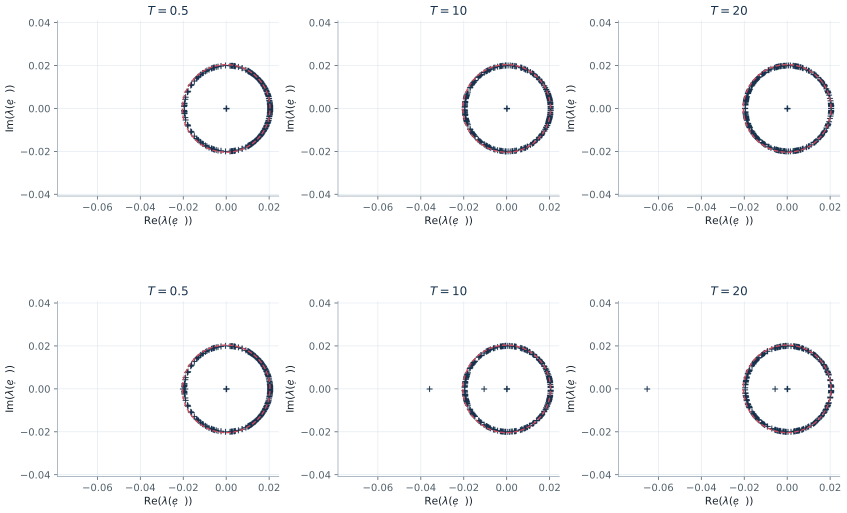

```bash
actapint figure_3_17 --output-dir results/section3
```

A port of `Iterative_ParaDiag_Wave.m`: the wave equation with `Delta t = 1/16`,
`Delta x = 1/128`, `alpha = 0.02`, `T` in `{0.5, 10, 20}` and the Numerov
parameter at the stability threshold `gamma = 1/120` and just below it,
`gamma = 1/120.01`.

| `gamma` | `T` | `N_t` | Spectral radius of `M` | `alpha/(1 - alpha)` |
|---|---:|---:|---:|---:|
| 1/120 | 0.5 | 7 | 0.020408 | 0.020408 |
| 1/120 | 10 | 159 | 0.020408 | 0.020408 |
| 1/120 | 20 | 319 | 0.020408 | 0.020408 |
| 1/120.01 | 0.5 | 7 | 0.021078 | 0.020408 |
| 1/120.01 | 10 | 159 | 0.035958 | 0.020408 |
| 1/120.01 | 20 | 319 | 0.065270 | 0.020408 |

At the threshold the bound (3.66) is attained exactly and every eigenvalue lies
on the dashed circle, for all three horizons. Below it, one eigenvalue per panel
escapes along the negative real axis and moves out with `T`, reaching `-0.065` at
`T = 20`; the published panels put that outlier at the same place, which is why
the script's own axis limit is `-3.85 alpha/(1 - alpha) = -0.0786`.

## Figure 3.18 — the same iteration in two implementations

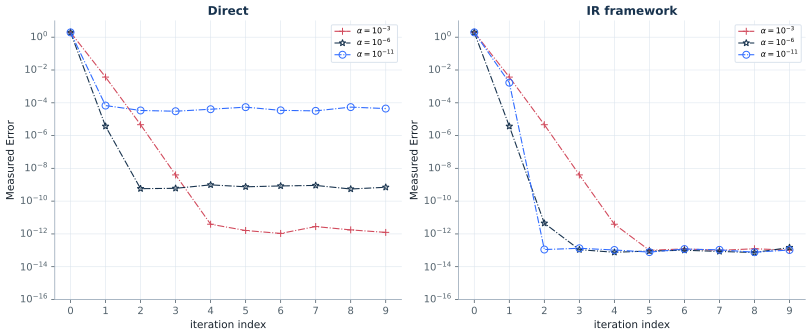

```bash
actapint figure_3_18 --output-dir results/section3
```

A port of `Iterative_ParaDiag_RoundError.m`: the wave equation, `T = 4`,
`Delta t = 1/16`, `Delta x = 1/128`, `gamma = 1/100`, `alpha` in
`{1e-3, 1e-6, 1e-11}`, ten iterations from the same uniform random start, run
once by solving for `U^k` directly as in (3.58) and once by solving for
`Delta U^k` and updating as in (3.61).

| `alpha` | Direct, reproduced floor | Direct, published | Refinement, reproduced | Published |
|---|---:|---:|---:|---:|
| 1e-3 | `1.2e-12` | `~3e-12` | `9.9e-14` | `~3e-14` |
| 1e-6 | `5.5e-10` | `~3e-10` | `7.3e-14` | `~3e-14` |
| 1e-11 | `3.2e-5` | `~3e-5` | `7.6e-14` | `~3e-14` |

Both the mechanism and its size are reproduced: the direct implementation stalls
at a level that grows as `alpha` shrinks, consistent with `epsilon/alpha`, and it
is *worse* for `alpha = 1e-11` than for `alpha = 1e-6` even though the
convergence factor is a hundred thousand times smaller, while the refinement form
reaches machine precision for every `alpha`.

The three direct floors are the level of the published ones only if the `N_t`
blocks of `P_alpha` are *solved* per application, as `invP_times_U` does, and not
inverted once and reused. Inverting makes the roundoff a fixed perturbation of
the preconditioner, which the stationary iteration then converges against rather
than accumulating, and the floors drop a full decade to `1.0e-13`, `4.5e-11` and
`3.1e-6`. `preconditioner_solver` therefore keeps the LU factors and solves,
which is bit for bit what `numpy.linalg.solve` would do at every application;
`inverted=True` selects the other path and both are in the metrics file. The
script also leaves the result of the scaled inverse FFT complex rather than
taking its real part, which raises the direct floors by a further 10 to 30% —
to `1.4e-12`, `7.2e-10` and `3.7e-5` — and is not worth carrying complex
arithmetic through the rest of the module for.

## Corrections to the article and its scripts carried in this section

* Equation (3.2c) states an inequality that its own `R0` violates at `y = y_min`;
  the curve plotted in Figure 3.1(a) is the right-hand side.
* Theorem 3.1's `p* = p_tilde* s / nu` does not reproduce Figure 3.1(b);
  `SWR_for_ADE.m` uses `p_tilde* nu / l`, which does.
* `SWR_for_ADE.m` scales a centred first difference by `dt/dx` instead of
  `dt/(2*dx)`, transporting at speed 2.
* `SWR_for_ADE.m` declares `global L` but never assigns it, so `u0` and `get_u0`
  cannot evaluate as committed. The port uses `L = 8.2`, the domain length the
  script itself builds `x` with.
* `Direct_ParaDiag_ADE.m` commits `adc = 0`, which selects the heat equation, so
  the advection coefficient of the published advection-diffusion panels is missing
  from the repository. It is `1/2`, not the unit speed of (2.5).
* The `rho_num` of Figure 3.10, Figure 3.11(b) and Table 3.1 is one ratio for all
  step counts, not the per-`N_t` minimizer the text defines; with the minimizer,
  neither the error increase nor the printed condition numbers appear.
* `Iterative_ParaDiag_ADE.m` sets `theta = 1`, backward Euler, where the text and
  the caption of Figure 3.16 say trapezoidal rule.
* `Direct_ParaDiag_ADE.m` and `Direct_ParaDiag_Wave.m` apply `It/V` as a formed
  matrix. Solving with `V` instead is more accurate and realizes decades less
  roundoff at large `N_t`, which was the whole of the one-octave difference in
  Figures 3.10, 3.11(b) and 3.12(a); the port now follows the scripts.
  `Iterative_ParaDiag_RoundError.m` goes the other way and solves each block of
  `P_alpha`, where the port had inverted them once, which was the decade
  separating Figure 3.18 from the published floors.


## 2026-11-11 shared-start reconstruction of Figure 3.14

The [new reconstruction report](REPRODUCTION_CHECKS_2026-11-11.md) derives the
full-Jacobian Frobenius weights in closed form and runs each initial vector with
both averaging and NKA. It uses 200 distinct periodic nodes and a separate
201-node duplicated-endpoint control, 200 time steps, and an independent Newton
reference. These are explicit protocols, separate from the earlier `dt=0.01`
audit above. Original EPS coordinates replace raster point estimates.

At `nu=0.02`, the coarse full-Jacobian weights stay close to one (about
0.96–1.05). Under equal initialization the two methods have similar iteration
counts: coarse starts reduce both to 10 iterations at `T=1.3` and 7 at `T=0.7`.
A warm start therefore cannot be credited solely to NKA. The complete data and
overlay preserve the published curves as comparisons; their large NKA gain has
not been recovered under a common documented protocol.
