# Section 4 reproduction: PinT methods for parabolic problems

Section 4 (*Acta Numerica* 2025, pp. 443–481) is the parabolic counterpart of
Section 3. It takes one algorithm, Parareal, analyses it in detail, and then walks
through five relatives of it — PFASST, MGRiT, two ParaDiag-based Parareal variants
and space–time multigrid — always asking the same question: what happens to the
convergence rate when the diffusion in the PDE gets weak, and what happens on a
wave equation. The chapter is generous with numbers, so almost every experiment
can be checked against printed values or against markers read off the published
raster rather than against shapes alone.

## What has to be reproduced

Twenty-two figures and one table carry the chapter. Twenty of the figures are
experiments that report numbers. Two are schematics, Figure 4.1 for the two-level
time grid and Figure 4.7 for the geometry of MGRiT with FCF-relaxation, and both
are drawn from their specification, which
[`PAPER_REPRODUCTION.md`](PAPER_REPRODUCTION.md#the-six-schematics) describes.
Table 4.1 is quoted from another paper. Its 3D P1/dG(3) numerical baseline is
now implemented; the historical distributed scaling measurements are separate.

Eleven of them have a committed upstream script; four subsections do not, and were
implemented from the text: PFASST (Figure 4.6), the two analytic figures (4.8 and
4.18), and the Burgers' experiment of the second Parareal variant (Figure 4.17).

| Item | Subsection | Content | Upstream script | Status |
|---|---|---|---|---|
| Figure 4.1 | 4.1 | the two-level time grid | — | drawn |
| Figure 4.2 | 4.2 Parareal | superlinear and linear regimes of Parareal, 2 panels | `Parareal_Heat_ADE.m` | reproduced, `J` recovered as 4 |
| Figure 4.3 | 4.2 Parareal | five fine solvers against the same bound, 2 panels | `Parareal_Heat_ADE.m` | reproduced, every marker |
| Figure 4.4 | 4.2 Parareal | convergence factor against the diffusion parameter | `Parareal_Heat_ADE.m` | reproduced, all four digits |
| Figure 4.5 | 4.2 Parareal | Parareal for heat, ADE and Burgers, 2 panels | `Parareal_Heat_ADE.m`, `Parareal_Burgers.m` | reproduced, published legend swapped |
| Figure 4.6 | 4.3 PFASST | PFASST error for the heat equation and the ADE | text only | reproduced, all four factors within 0.6% |
| Figure 4.7 | 4.4 MGRiT | FCF-relaxation | — | drawn |
| Figure 4.8 | 4.4 MGRiT | regions where the factor is below 0.2, 0.4, 0.6, 2 panels | text only | reproduced |
| Figure 4.9 | 4.4 MGRiT | MGRiT and Parareal factors, heat and ADE, 6 panels | `MGRiT_Heat_ADE.m` | 5 of 6 to four digits, 1 printed value questioned |
| Figure 4.10 | 4.4 MGRiT | measured error of MGRiT against Parareal, 4 panels | `MGRiT_Heat_ADE.m` | reproduced, every marker, two setups recovered |
| Figure 4.11 | 4.4 MGRiT | MGRiT for Burgers' equation, 3 panels | `MGRiT_Burgers.m` | reproduced, viscosities recovered |
| Figure 4.12 | 4.5 ParaDiag CGC | diagonalized coarse grid correction, heat and ADE, 2 panels | `PCGC_Parareal_Heat_ADE.m` | reproduced, factors to two digits |
| Figure 4.13 | 4.5 ParaDiag CGC | the same for Burgers' equation, 2 panels | `PCGC_Parareal_Burgers.m` | reproduced with the committed flux factor |
| Figure 4.14 | 4.5 ParaDiag coarse solver | heat equation, three `alpha`, two grids, 2 panels | `DiagG_Parareal_Heat_Wave.m` | reproduced to 0.05 decades, `J = 20` recovered |
| Figure 4.15 | 4.5 ParaDiag coarse solver | wave equation, two `alpha`, several `N_t`, 2 panels | `DiagG_Parareal_Heat_Wave.m` | reproduced, every point above `1e-10` to 0.1% |
| Figure 4.16 | 4.5 ParaDiag coarse solver | sharpness of the wave-equation factor, 2 panels | `DiagG_Parareal_Heat_Wave.m` | reproduced |
| Figure 4.17 | 4.5 ParaDiag coarse solver | iteration counts for Burgers, 2 panels | text only | reproduced to one iteration |
| Figure 4.18 | 4.6 STMG | LFA factor over the high frequencies, 3 panels | text only | reproduced |
| Figure 4.19 | 4.6 STMG | error against the damping parameter, backward Euler, 2 panels | `STMG_Heat_ADE.m` | reproduced |
| Figure 4.20 | 4.6 STMG | STMG with one and three smoothing steps, 2 panels | `STMG_Heat_ADE.m` | reproduced, every marker |
| Figure 4.21 | 4.6 STMG | the same sweep with the trapezoidal rule, 6 panels | `STMG_Heat_ADE.m` | reproduced |
| Figure 4.22 | 4.6 STMG | STMG for Burgers' equation | `STMG_Bergers.m` | reproduced, every marker |
| Table 4.1 | 4.6 STMG | weak and strong scaling to 262 144 cores | — | original-size spatial baseline added, see below |

All twenty experiments run as one group,

```bash
OPENBLAS_NUM_THREADS=1 OMP_NUM_THREADS=1 MKL_NUM_THREADS=1 \
  actapint section4 --output-dir results/section4
```

or one at a time with `actapint figure_4_20 --output-dir results/section4`. The
group takes about 25 minutes on one core of the reference machine; the four
nonlinear experiments (Figures 4.5, 4.11, 4.13 and 4.17) account for most of it,
because each Newton solve sits inside a Parareal sweep inside a parameter sweep.
Every figure committed under [`figures`](figures) and every metrics file under
[`data`](data) comes from a single run of that command. The experiments are
deterministic — the random starting iterates are MATLAB's `rng('default')` stream,
reproduced bit for bit through NumPy's legacy `RandomState(5489)` with MATLAB's
column-major fill — except for the divergent tails of Figures 4.5(b) and 4.9,
where what is amplified is roundoff.

## Conventions carried over from the scripts

Three conventions are worth stating once, because they recur in every experiment
and because two of them contradict the text of the chapter.

The scripts write the semi-discrete problem as `u' + A u = 0`, so `A` is the
*positive* operator `advection + nu * (-Laplacian)`, and a negative `nu` is how
every script selects the heat equation with diffusion `|nu|`. The one exception is
`STMG_Heat_ADE.m`, which writes `u' = A u` with the opposite sign; both are kept
as the scripts have them, so the reproduced numbers can be compared with the
scripts directly.

The Burgers scripts of Sections 2 and 4 divide the centred flux difference by
`4 dx`, which is the `0.5 (u**2)_x` of equation (2.6), but the published panels of
Figures 2.3, 4.5(b) and 4.11 are only reproduced with `2 dx`, that is with the
flux `(u**2)_x`. Figures 4.13 and 4.22 are the other way round: there the
committed factor is also the published one. Each experiment therefore states which
factor it uses, and `BURGERS_FLUX_SCALE` versus `BURGERS_FLUX_SCALE_AS_COMMITTED`
names the two in the code.

The scripts draw a uniform random first iterate and then, in several of them,
overwrite every column with the initial condition, leaving the draw with no
effect. Which of the two states produced a published figure has to be decided per
figure; the choice is recorded in each experiment's `initial_iterate` parameter and
discussed below wherever it matters.

## Figure 4.2 — the two convergence regimes of Parareal

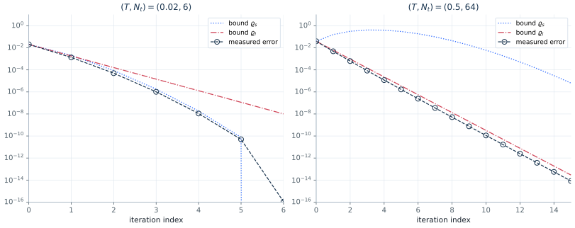

Both panels are the heat equation on a five-point grid, with backward Euler as
both the coarse and the fine solver, so that the two bounds of Theorem 4.2 can be
drawn next to the measured error. The published panels are reproduced with the
sequential coarse solution as the starting iterate — the commented-out alternative
in the script, not the committed one — and with `J = 4`, although the text states
`J = 10`. `J` was recovered by sweeping it: at `J = 10` the measured curve sits a
factor three below the published one at every iteration, at `J = 4` it lies on it.

## Figure 4.3 — the choice of fine solver

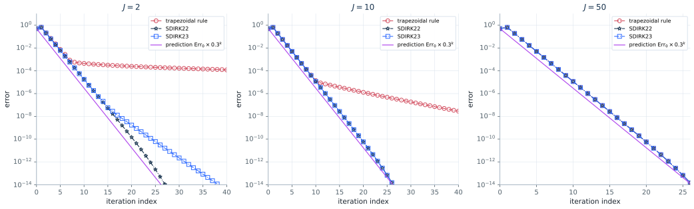

Five fine integrators (backward Euler, the trapezoidal rule, SDIRK22, SDIRK23 and
SDIRK33) on the same coarse grid, against the linear bound `rho_l = 0.3` the text
quotes. Every marker of both panels is reproduced. The point of the figure — that
a more accurate `F` does not converge faster, because the factor is governed by
`|R_g - R_f|` and not by the order of `F` — comes out unchanged.

## Figure 4.4 — the factor against the diffusion parameter

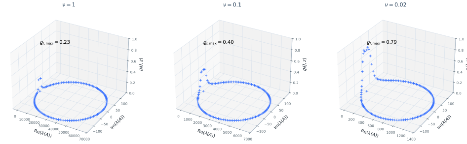

The two factors of Theorem 4.2 evaluated over `nu` from 1 down to `1e-4` for the
ADE. Reproduced to all four printed digits, including the crossing of `rho_l = 1`
just below `nu = 1e-2`, which is where Parareal stops converging linearly.

## Figure 4.5 — Parareal on the three model problems

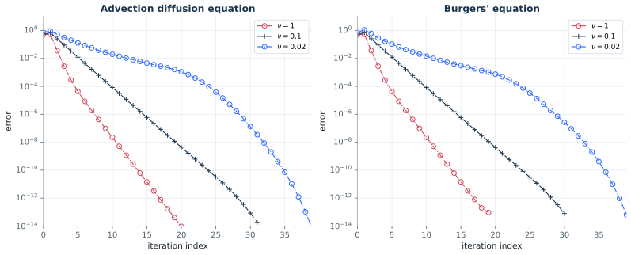

Panel (a) is the linear problems, panel (b) Burgers' equation, each with four
values of `nu`. Two corrections to the published figure came out of this
reproduction. The linear panel uses `u0 = sin(2 pi x)**2`, as the script does, not
the `sin(2 pi x)` of the text; with the text's initial condition the curves are
visibly different. And in the published panel (b) the legend entries for `nu = 1`
and `nu = 0.02` are swapped: the curve labelled `nu = 1` is the one that diverges,
which is the behaviour of the smallest viscosity, and the reproduction matches the
published curves only under that reading.

The nonlinear panel also needs the Newton solver to behave like MATLAB's: `Pro_IE`
caps Newton at a fixed count and, when the iteration has left the region of
convergence, simply returns the last iterate rather than failing. A port that
raises there stops the run several iterations before the published curve ends.

## Figure 4.6 — PFASST

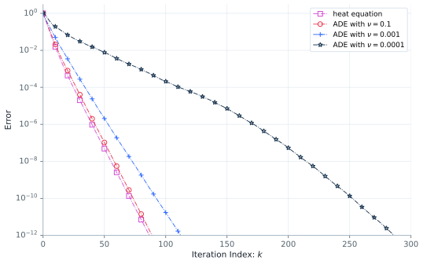

No script ships for this subsection, so PFASST is built from the block iteration
the text prints,

```
u^{k+1}_{n+1} = B_1^0 u^k_{n+1} + B_0^1 (chi u^{k+1}_n + dt b_n)
                                + B_0^0 (chi u^k_n + dt b_n),
```

with the collocation operator `phi = I - dt Q kron A` of (4.10), its implicit Euler
approximation (4.11), and Lagrange transfers between three Radau IIA fine nodes and
two coarse ones. Two checks fix the implementation before any curve is drawn: the
four matrices `Q_f`, `Q_c`, `T_{c->f}` and `T_{f->c}` reproduce the values printed
in the text to every digit given, and the fixed point of the iteration is the
sequential collocation solution, which is what the error is then measured against.

The starting iterate is the uniform random field the rest of the chapter uses; with
a zero iterate every curve would start at the size of the solution itself, about
`0.15` for the heat equation, whereas the published curves all start above one.

The published curves carry no printed numbers, so they were digitized from the
article page rendered at 600 dpi, once from the centre of every marker and once
from the drawn line; the two readings agree on the factor per iteration to 0.1%,
and a rehearsal of the same pipeline on a synthetic figure of known curves
recovers the factor to 0.12%. Fitting the tail from iteration 10 onwards, where
all four published curves are straight:

| curve | reproduced factor | published factor | deviation | reproduced iterations | published |
|---|---|---|---|---|---|
| heat equation | 0.7400 | 0.7355 | +0.6% | 87 | 88 |
| ADE, `nu = 0.1` | 0.7421 | 0.7381 | +0.5% | 89 | 90 |
| ADE, `nu = 0.001` | 0.7874 | 0.7894 | −0.2% | 113 | 115 |
| ADE, `nu = 0.0001` | 0.9146 | 0.9114 | +0.4% | 287 | 288 |

The digitized published markers are `1.0e-1, 1.2e-2, 1.8e-3, 3.7e-5, 5.3e-6,
7.8e-7, 1.2e-7, 1.9e-8, 2.8e-9, 4.3e-10, 6.6e-11, 1.7e-12` at iterations 8 to 112
in steps of 8 for `nu = 0.001`, and `1.4e-1, 2.4e-2, 6.9e-3, 1.4e-3, 3.6e-4,
9.8e-5, 2.1e-5, 3.5e-6, 4.8e-7, 5.7e-8, 6.1e-9, 5.7e-10, 4.5e-11, 3.0e-12` at
iterations 20 to 280 in steps of 20 for `nu = 0.0001`.

An earlier reading of this figure put the two advection-dominated curves 5–8%
fast, which would have pointed at the discretization of the advection term. It
was an artefact of comparing eyeballed endpoints rather than fitted rates: the
gap is 0.2% and 0.4%, and the whole difference between the reproduced and the
published curves is a uniform vertical offset of a factor 1.3 to 2, that is a
head start of one to two iterations, with the same slope thereafter.

That the gap really is that small is worth stating because these two curves are
the sensitive ones. Sweeping the modelling choices the text leaves open moves
their factor far more than a percent:

| variant | `nu = 0.001` | `nu = 0.0001` |
|---|---|---|
| centred second order, coarsening in time only (used) | 0.7874, −0.2% | 0.9146, +0.4% |
| first-order upwind advection | 0.7505, −4.9% | 0.7513, −17.6% |
| fourth-order centred advection | 0.8221, +4.1% | 0.9541, +4.7% |
| `dx = 1/64` | 0.7548, −4.4% | 0.8104, −11.1% |
| `dx = 1/256` | 0.8184, +3.7% | 0.9598, +5.3% |
| advection coefficient `1/2` | 0.7424, −5.9% | 0.7799, −14.4% |
| advection coefficient `2` | 0.9203, +16.6% | 0.9832, +7.9% |
| `M_c = 3` coarse and `M_f = 5` fine nodes | 0.8176, +3.6% | 0.8484, −6.9% |
| coarse nodes as the first two fine ones | 0.6951, −11.9% | 0.8579, −5.9% |
| Gauss–Legendre instead of Radau IIA nodes | 0.6302, −20.2% | 0.7461, −18.1% |
| two implicit Euler sweeps per iteration | 0.6032, −23.6% | 0.8300, −8.9% |
| three sweeps per iteration | 0.3154, −60.0% | 0.6742, −26.0% |
| trapezoidal instead of implicit Euler in (4.11) | 0.8385, +6.2% | diverges |
| exact node-to-node fine solver | 0.8732, +10.6% | diverges |
| coarsening in space as well, by two | diverges | diverges |
| coarse level solved by implicit Euler too | diverges | diverges |
| `M_c = 1` coarse node | diverges | diverges |
| downwind advection | diverges | diverges |
| coupling only into the first node of a block | stalls at 1.0000 | stalls at 1.0000 |

The reversed advection sign gives the same factors to within 0.4% — reflecting the
periodic grid about `x = 1/2` leaves the source invariant and turns one problem
into the other, so only the asymmetric starting draw distinguishes them. That is
the one choice the figure cannot settle, and it does not matter for the curves.
Everything else the text pins down
is confirmed by the sweep to well under a percent, so nothing here needs a
parameter the text does not state.

## Figure 4.8 — where MGRiT beats Parareal

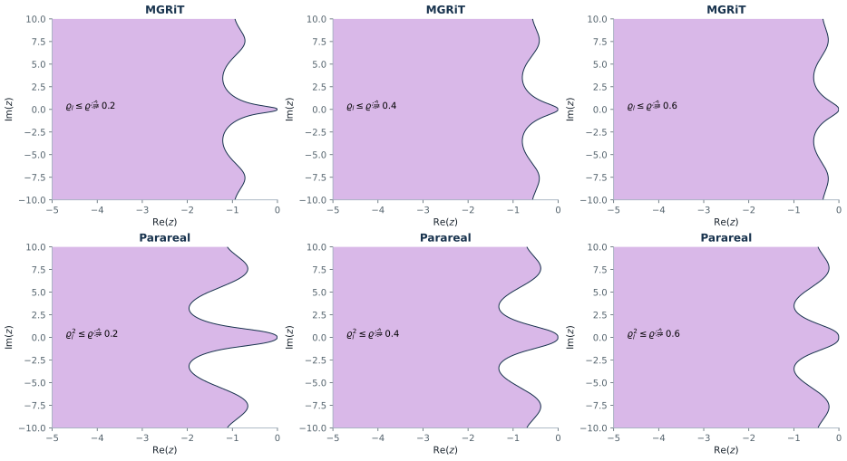

Analytic: the regions of the left half-plane where the MGRiT factor and twice the
Parareal factor stay below 0.2, 0.4 and 0.6, for backward Euler as `G` and the
exact propagator as `F`. Reproduced, including the numbers Theorem 4.6 quotes for
the width of the regions along the real axis.

## Figure 4.9 — convergence factors of MGRiT and Parareal

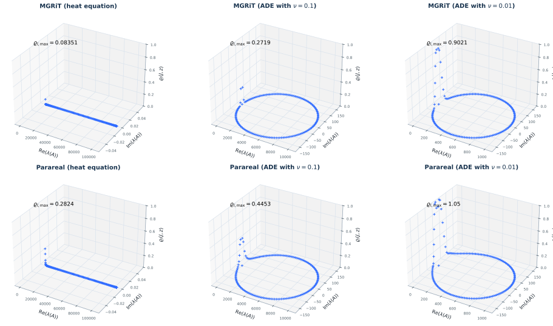

Six panels of `rho` over the spectrum, with the maximum printed in each title.
Five of the six agree with the published maxima to four digits:

| panel | reproduced | published |
|---|---|---|
| MGRiT, heat | 0.08351 | 0.08375 |
| MGRiT, ADE `nu = 0.1` | 0.27187 | 0.2718 |
| MGRiT, ADE `nu = 0.01` | 0.90207 | 0.9021 |
| Parareal, heat | 0.28245 | 0.2822 |
| Parareal, ADE `nu = 0.1` | 0.44527 | 0.4453 |
| Parareal, ADE `nu = 0.01` | 1.05011 | 0.9986 |

The last row is the one disagreement in the chapter that this reproduction cannot
resolve into a modelling difference. The published value is just below one, which
would make Parareal convergent at `nu = 0.01`; the reproduced value is just above.
Two things argue that the printed value is a typo rather than a different setup:
the same code reproduces the other five maxima to four digits, and it also
reproduces the two divergent factors the text quotes for `nu = 0.002` — 1.4211 for
Parareal and 1.2812 for MGRiT — to four digits.

## Figure 4.10 — measured error against the factors

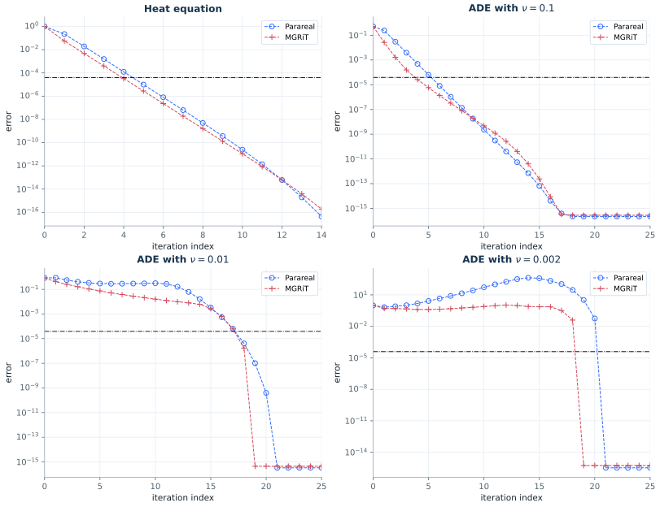

Four panels comparing one MGRiT iteration against two Parareal iterations, with
the truncation level `max(dx**2, dt**2)` drawn as the stopping criterion. Every
marker of all four panels is reproduced to the accuracy of the reading, but not
by one run of the script: three panels need an initial condition and a starting
iterate that the other one does not, and both alternatives are lines that
`MGRiT_Heat_ADE.m` carries.

### Digitizing Figure 4.10

The panels print no numbers, and what was in question was the shape of the first
iterations rather than the slope, so the curves were read off the raster by
[`scripts/digitize_figure_4_10.py`](../scripts/digitize_figure_4_10.py). Printed
page 460 of the article, the 76th page of the PDF, is rendered at 600 dpi; each
of the four axes boxes is found as a pair of long horizontal runs of ink joined
by continuous spines, and the pixel-to-data map of a panel is fitted on its
*interior* tick marks and never on the frame, so that the finite width of the
spines cannot bias it. The three panels drawn on the `1e-14` to `1e0` axis come
out at 49.130 pixels per iteration and 66.74 pixels per decade, the divergent
panel at 103.591 and 268.75; the tick fits leave at most 0.35 pixels, which is
0.005 decades.

Each curve is then read twice, independently. The marker reading takes the
midpoint of the marker glyph in the column through its centre, the glyph being
the widest pair of ink runs a marker diameter apart, which is what separates it
from a dash of the connecting line crossing the same column. The line reading is
a least-squares fit of the whole drawn polyline with the glyph columns cut out:
every remaining column contributes the mean row of its ink and the model
interpolates linearly between the unknown vertex heights. Rehearsing both on a
synthetic panel of known curves drawn in the article's conventions — one curve
falling more than a decade per iteration, so that its dashes are nearly
vertical, and one kinking from a steep start into a shallow tail — bounds the
marker reading by 0.018 decades and the line reading by 0.086. The marker
reading is used wherever the panel draws the glyph in full; three of the 124
points below come from the line, where two curves cross and the glyph is not
separable. Points the axis clips, which are the first marker of three panels,
are lower bounds and are left out.

The digitized errors, at the iteration index of the published x-axis; the
calibration and both readings of every point are in
[`data/figure_4_10_published.json`](data/figure_4_10_published.json):

| panel | curve | from `k` | published errors |
|---|---|---|---|
| heat | Parareal | 1 | 0.2224, 1.920e-2, 1.547e-3, 1.246e-4, 9.867e-6, 7.813e-7, 6.294e-8, 4.984e-9, 3.947e-10, 3.180e-11, 2.518e-12, 2.064e-13, 1.634e-14 |
| heat | MGRiT | 1 | 5.692e-2, 4.747e-3, 3.958e-4, 3.358e-5, 2.801e-6, 2.335e-7, 1.948e-8, 1.652e-9, 1.378e-10, 1.149e-11, 9.582e-13, 8.129e-14 |
| ADE `nu = 0.1` | Parareal | 0 | 0.518, 0.2425, 3.059e-2, 3.859e-3, 4.954e-4, 6.250e-5, 8.161e-6, 1.048e-6, 1.350e-7, 1.802e-8, 2.333e-9, 3.100e-10, 4.048e-11, 5.379e-12, 7.526e-13, 1.209e-13, 2.045e-14 |
| ADE `nu = 0.1` | MGRiT | 0 | 0.518, 2.619e-2, 1.657e-3, 1.559e-4, 2.638e-5, 5.780e-6, 1.357e-6, 3.241e-7, 7.877e-8, 1.948e-8, 4.815e-9, 1.211e-9, 3.047e-10, 7.664e-11, 1.962e-11, 5.020e-12, 1.285e-12, 3.403e-13, 9.016e-14, 2.838e-14 |
| ADE `nu = 0.01` | Parareal | 3 | 0.4214, 0.3367, 0.2984, 0.2883, 0.2883, 0.2984, 0.3036, 0.3197, 0.2834, 0.1631, 6.205e-2, 1.643e-2, 3.416e-3, 5.483e-4, 6.339e-5, 4.368e-6, 1.032e-7, 3.654e-10 |
| ADE `nu = 0.01` | MGRiT | 1 | 0.4214, 0.2555, 0.1659, 0.1078, 7.502e-2, 5.221e-2, 3.827e-2, 2.854e-2, 2.128e-2, 1.615e-2, 1.246e-2, 9.959e-3, 8.096e-3, 6.142e-3, 2.777e-3, 6.294e-4, 6.124e-5, 1.662e-6 |
| ADE `nu = 0.002` | Parareal | 0 | 0.9837, 0.6864, 0.8217, 1.036, 1.523, 2.635, 4.521, 8.026, 14.25, 26.41, 53.31, 101.4, 176.9 |
| ADE `nu = 0.002` | MGRiT | 0 | 0.9837, 0.5196, 0.4978, 0.4628, 0.4018, 0.4123, 0.4415, 0.4810, 0.5661, 0.6548, 0.7839, 0.9384, 1.086 |

The two curves of the divergent panel start at the same value, and so do the two
of the `nu = 0.1` panel, which already says that both methods there are started
from the same iterate. The same table is embedded as
`mgrit.PUBLISHED_FIGURE_4_10` and every run of the figure reports the ratio of
the reproduced value to the published one at every marker.

### What the first iterations at `nu = 0.1` measure

Against these numbers the committed setup — the chirped `sin(2 pi (1-x)**2)**2`
started from MATLAB's random draw — reproduced the divergent panel to a part in
a thousand and missed the `nu = 0.1` panel by a factor of four from the fourth
iteration on. Scanning one knob at a time over the MGRiT curve of that panel, the
first four errors against the published 0.518, 2.619e-2, 1.657e-3, 1.559e-4, and
the mean `|log10|` deviation over the first four markers and over `k = 4` to
`12`:

| variant | `e0` | `e1` | `e2` | `e3` | first four | tail |
|---|---|---|---|---|---|---|
| committed | 0.683 | 1.48e-2 | 2.57e-3 | 4.79e-4 | 0.26 | 0.61 |
| initial condition `sin(8 pi (1-x)**2)**2`, the text's | 0.590 | 1.17e-2 | 1.73e-3 | 2.74e-4 | 0.17 | 0.33 |
| initial condition `exp(-30 (x-1/2)**2)` | 0.847 | 2.02e-2 | 4.13e-3 | 8.14e-4 | 0.36 | 0.92 |
| initial condition random, three seeds | 0.52–0.58 | 1.2e-2 | 1.7e-3 – 2.2e-3 | 3.0e-4 – 5.1e-4 | 0.18–0.24 | 0.30–0.72 |
| starting iterate `u0` at every level | 0.698 | 8.48e-2 | 1.57e-2 | 3.57e-3 | 0.74 | 1.52 |
| starting iterate the coarse solution | 8.66e-2 | 1.07e-2 | 2.30e-3 | 5.30e-4 | 0.46 | 0.78 |
| starting iterate zero | 0.514 | 1.40e-2 | 2.72e-3 | 6.05e-4 | 0.27 | 0.82 |
| starting iterate random, two other seeds | 0.69 | 1.4e-2 – 2.2e-2 | 2.9e-3 – 3.2e-3 | 6.1e-4 – 6.6e-4 | 0.27–0.32 | 0.81–0.85 |
| error over all levels, or relative, or at the final time | 0.68 | 0.581 | 0.581 | 0.581 | 1.9 | 6.9 |
| error over the interior levels at `k = 0` too | 0.683 | 1.48e-2 | 2.57e-3 | 4.79e-4 | 0.26 | 0.61 |
| CF instead of FCF relaxation | 0.683 | 4.85e-2 | 1.15e-2 | 3.24e-3 | 0.64 | 2.48 |
| coarse solver the `J`-fold fine one | 0.683 | 1.67e-16 | 1.67e-16 | 1.67e-16 | 9.82 | 8.72 |
| coarse solver the trapezoidal rule | 0.683 | 4.57e-3 | 1.91e-4 | 1.01e-5 | 0.75 | 3.91 |
| `J = 10`, `J = 40` | 0.683 | 1.48e-2 | 2.57e-3 | 4.80e-4 | 0.26 | 0.62 |
| `N_t = 20`, `N_t = 80` | 0.683 | 1.5e-2 | 2.6e-3 – 2.9e-3 | 4.8e-4 – 6.9e-4 | 0.26–0.31 | 0.70–3.39 |
| `DT = 0.0625`, `DT = 0.25` | 0.61–0.74 | 1.0e-2 – 2.3e-2 | 1.4e-3 – 3.9e-3 | 2.3e-4 – 6.4e-4 | 0.18–0.30 | 0.43–3.29 |
| `nu = 0.05`, `nu = 0.2` | 0.63–0.77 | 6.1e-3 – 4.6e-2 | 6.1e-4 – 1.3e-2 | 6.0e-5 – 4.7e-3 | 0.39–0.70 | 1.76–2.82 |
| `dx = 1/80`, `dx = 1/320` | 0.65–0.69 | 1.7e-2 – 2.0e-2 | 3.4e-3 – 4.0e-3 | 7.9e-4 – 8.9e-4 | 0.33–0.34 | 0.92–1.05 |
| plain `sin(2 pi (1-x))**2` from `u0` at every level | 0.5158 | 2.611e-2 | 1.651e-3 | 1.557e-4 | 0.002 | 0.004 |
| published | 0.518 | 2.619e-2 | 1.657e-3 | 1.559e-4 | 0 | 0 |

The last row before the published one is the answer, and it is the only entry of
the scan that is inside the reading anywhere; changing either of its two
ingredients on its own leaves the panel a factor of two to four out.

Reading the published x-axis with an offset of one, which a transient would
imitate, is worse than reading it straight for every variant in the table, by
0.9 decades at best. What no single knob moves is the *shape*: the published
contraction factors are 0.051, 0.063, 0.094, 0.169, 0.219 and only then the
asymptotic 0.243, while every variant above jumps from 0.02 to between 0.148 and
0.216 at the second iteration and is within a per cent of its asymptote by the
fourth. Filtering the starting error down to its first two, four, eight or
sixteen harmonics moves the first error and leaves the second and every later one
unchanged to four digits, so the shape is not a property of how rough the
starting iterate is. It is a property of *which* harmonic: started from a single
mode, the second harmonic alone contracts by 0.052, 0.061, 0.089, 0.158, 0.214,
which is the published sequence, and no other mode comes near it — the third
gives 0.006, 0.119, 0.212 and the first 0.213, 0.220, 0.225.

An error that is one harmonic at every level is what `sin(2 pi (1-x))**2`, which
is `(1 - cos(4 pi x))/2`, produces when the iteration starts from `u0` at every
level: the constant part of `u0` is in the kernel of the operator, so the fine
solution differs from `u0` by the second harmonic alone. Both are lines of
`MGRiT_Heat_ADE.m`: the initial condition is the committed one with the inner
square dropped, and the starting iterate is the line `U_Ini(:,n+1)=u0` that the
script carries commented out at the top of its loop, with the random draw of the
line above left in place. With them the whole panel is reproduced, both curves
and not only MGRiT: no marker above the round-off floor is out by more than 1%,
against a factor of 4.5 before.

### Two setups, one figure

That setup then also reproduces the heat panel and the `nu = 0.01` panel at every
marker, and the committed one does not; the divergent panel is the other way
round. The panels were not all drawn by the same state of the script, which is
consistent with the script having been left in the state that draws the last of
them, down to the `nu=0.002max` on line 13. What each setup does to each panel,
as the largest ratio of reproduced to published over the markers above the
round-off floor:

| panel | plain `sin(2 pi (1-x))**2` from `u0` | committed chirp from the random draw |
|---|---:|---:|
| heat | 1.03 | 1.08 |
| ADE `nu = 0.1` | 1.01 | 4.55 |
| ADE `nu = 0.01` | 1.06 | 17.2 |
| ADE `nu = 0.002` | 14.9 | 1.00 |

`mgrit.FIGURE_4_10_SETUPS` records the split, and
`tests/test_section4.py::test_figure_4_10_setups_are_not_interchangeable` pins it
by swapping the two and checking that each panel then misses. Neither setup is a
free parameter: both are printed in the script, and each is fixed by the panels
it draws to within the width of a marker.

Below about `1e-9` the reproduced curves keep falling while the published ones
flatten towards `1e-14`, so the last two or three markers of the heat and
`nu = 0.1` panels come out low, by a factor of eight at the very bottom of the
axis. This is round-off and not iteration: the port applies one precomputed
propagator matrix per interval where the script takes `J` successive solves, and
the two accumulate differently. It sets in four decades below the truncation
level the figure draws, which is the level at which the figure says one would
stop iterating.

## Figure 4.11 — MGRiT for Burgers' equation

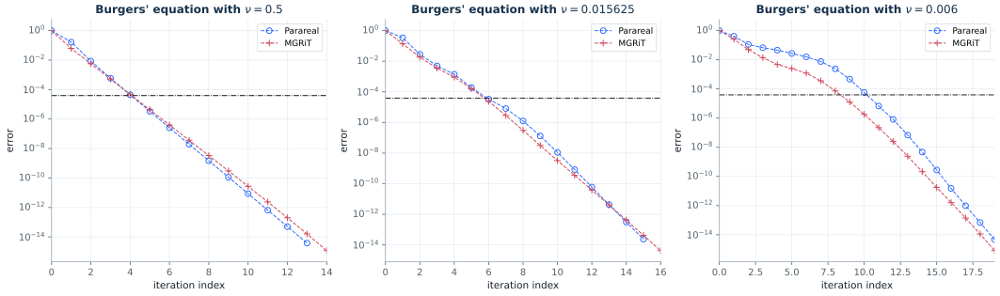

Neither the text nor the script states the three viscosities of this figure. They
were recovered by matching the panels: `nu = 0.5`, `1/64` and `0.006` reproduce the
three published panels, in that order. The script's Newton cap of 50 (as against
1000 in the Parareal scripts) also matters here, since it is visible in the
divergent panel.

## Figures 4.12 and 4.13 — a diagonalized coarse grid correction

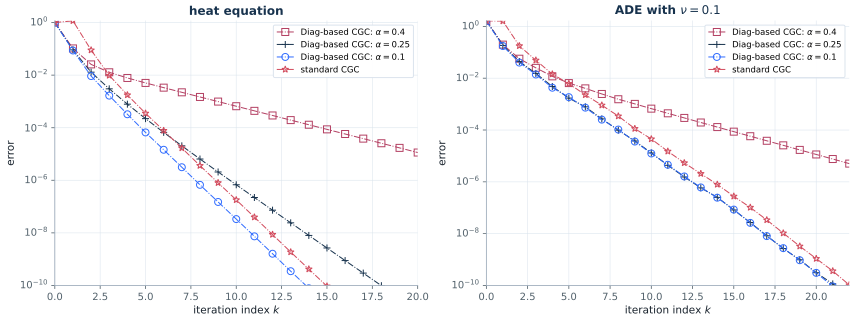

The variant (4.15) replaces the sequential coarse grid correction by an
`alpha`-circulant one, solved by the diagonalization (4.17), so the whole
correction becomes parallel. The published factors are reproduced to two digits
(heat 0.2295 against 0.22, threshold 0.1867 against 0.18) once the grid is read
from the text rather than from the script: the script puts 257 points on `[-1, 1]`,
the text 128 points on `(0, 1)`, and only the latter gives the printed factors.
SDIRK22 and SDIRK23 give the same factors to three digits, so the choice between
them cannot be settled from the figure; the script's SDIRK23 is used.

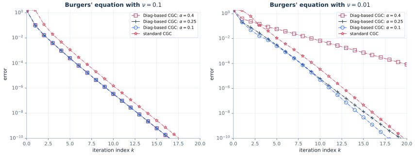

For Burgers' equation the flux factor goes the other way than in Figure 4.5: with
`(u**2)_x` the nonlinear iteration diverges, and the committed `0.5 (u**2)_x`
reproduces the published panels.

## Figures 4.14 to 4.16 — a diagonalized coarse solver

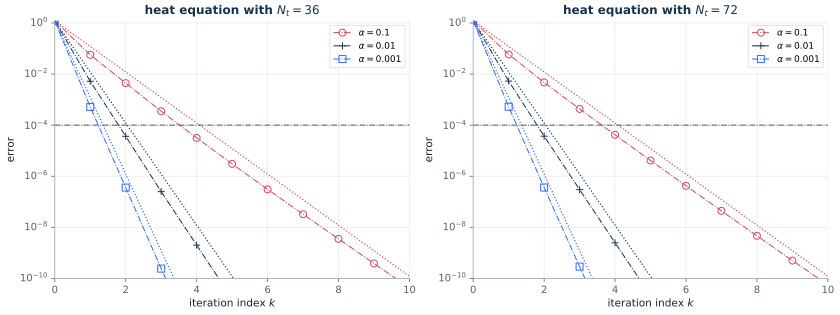

The variant (4.26) keeps the coarse grid correction of standard Parareal and
changes the coarse solver instead: `F*_alpha` runs the *fine* integrator across the
whole interval after replacing its initial condition by the `alpha`-coupled one of
(4.28), which makes the window system `alpha`-circulant and so solvable by one
diagonalization. This is the one Parareal variant in the chapter that also works
for the wave equation, which is why Figures 4.15 and 4.16 exist.

Write `x = R^J` for the fine amplification over one window. The factor `1 - alpha`
that (4.28) puts in front of the initial condition and that
`DiagG_Parareal_Heat_Wave.m` leaves out decides the shape of all three figures.
With it, `F* = (1 - alpha) x / (1 - alpha x)` and the error contracts per mode by
`alpha x`, which is the clean `rho = alpha` of Theorem 4.8; without it,
`F* = x / (1 - alpha x)` and the contraction per mode is
`alpha x**2 / (1 - (1 + alpha) x)`, which exceeds `alpha` once `x` is above about
0.6 and is only reached after `O(1/(1 - x))` windows. The published panels of all
three figures show the second, so the committed script is right and the factor
stays out; what varies between the heat and the wave panels is only the starting
iterate.

### Digitizing Figure 4.14

The panels print no numbers. Every curve of this figure is drawn in the PDF as
vector paths rather than as a raster, so the plotted coordinates are recovered
exactly: page 85 was converted to SVG, the axis frame and the eleven decade ticks
of each panel were read off the same page to fix the affine map from user space to
`(k, log10 error)`, and the marker paths were separated from the polylines by their
command sequence. The calibration is checked by the figure itself: each panel
carries three dotted `rho = alpha` reference lines whose slopes are known
analytically, and they digitize to factors of 0.10000, 0.010000 and 0.0010000 per
iteration, so the vertical scale is right to five digits. Rendering the same page to
a 600 dpi raster and running the marker-centroid pipeline of Figure 4.6 over it
finds 30 markers and reproduces the vector reading on 27 of them to a median of
2.3% and a worst case of 4.2%, which is a fraction of the plotted marker; the three
it misses are where the `alpha = 1e-2` and `alpha = 1e-3` curves cross near the
bottom of the frame and the centroid straddles two markers. The vector reading is
the one used below.

The digitized published errors, at iterations `k = 0, 1, 2, ...`:

| panel | `alpha` | published errors |
|---|---|---|
| `N_t = 36` | `1e-1` | 1.282, 5.81e-2, 3.87e-3, 3.41e-4, 3.61e-5, 3.78e-6, 4.03e-7, 3.91e-8, 3.54e-9, 3.47e-10, 3.43e-11 |
| `N_t = 36` | `1e-2` | 1.224, 4.91e-3, 3.28e-5, 2.59e-7, 1.93e-9, 1.55e-11 |
| `N_t = 36` | `1e-3` | 1.220, 4.92e-4, 3.43e-7, 2.61e-10 |
| `N_t = 72` | `1e-1` | 1.222, 6.34e-2, 4.03e-3, 3.38e-4, 3.44e-5, 3.73e-6, 4.08e-7, 4.52e-8, 5.06e-9, 5.70e-10, 6.46e-11 |
| `N_t = 72` | `1e-2` | 1.300, 5.08e-3, 3.42e-5, 2.71e-7, 2.16e-9, 1.89e-11 |
| `N_t = 72` | `1e-3` | 1.274, 6.77e-4, 4.38e-7, 3.28e-10 |

The first two iterations are a transient in every curve — the starting error is
spread over the whole spectrum and the modes the coarse solver already resolves go
at once — so the factor is fitted from the third point on, or from the second where
the curve reaches `1e-10` too fast for that. In units of `alpha` the published
factors are 0.73, 0.78 and 0.99 at `N_t = 36` and 0.70, 0.82 and 1.08 at
`N_t = 72`, for `alpha = 1e-3, 1e-2, 1e-1`. They are not the `alpha` of the
theorem: the largest one is above it, which no variant carrying the `1 - alpha`
factor can produce, and the two small ones are below it.

### Which variant draws them

The knobs were moved one at a time off the variant finally chosen; the entries are
the fitted factor in units of `alpha`, and `dev` is the root mean square distance
in decades between the six model curves and the six published ones.

| variant | dev | 36/`1e-3` | 36/`1e-2` | 36/`1e-1` | 72/`1e-3` | 72/`1e-2` | 72/`1e-1` |
|---|---|---|---|---|---|---|---|
| published | — | 0.73 | 0.78 | 0.99 | 0.70 | 0.82 | 1.08 |
| **chosen: no `1 - alpha`, `J = 20`, random draw** | **0.052** | 0.68 | 0.74 | 0.99 | 0.74 | 0.82 | 1.01 |
| with the `1 - alpha` of (4.28) | 0.829 | 0.39 | 0.48 | 0.51 | 0.39 | 0.51 | 0.53 |
| `J = 10` (the text) | 3.469 | 4.60 | 4.42 | 3.22 | 5.16 | 5.62 | 7.31 |
| `J = 10`, with `1 - alpha` (the previous state) | 0.494 | 0.60 | 0.59 | 0.64 | 0.61 | 0.66 | 0.73 |
| `J = 16` | 1.287 | 1.32 | 1.60 | 1.98 | 1.38 | 1.61 | 2.43 |
| `J = 19` | 0.238 | 0.78 | 0.89 | 0.86 | 0.86 | 0.96 | 0.88 |
| `J = 21` | 0.598 | 0.57 | 0.63 | 0.62 | 0.63 | 0.70 | 0.64 |
| `J = 24` | 1.092 | 0.36 | 0.38 | 0.45 | 0.36 | 0.41 | 0.48 |
| start: `u0` in every window | 1.060 | 0.38 | 0.38 | 0.41 | 0.38 | 0.38 | 0.41 |
| start: uniform(0,1) | 0.140 | 0.53 | 0.67 | 0.96 | 0.61 | 0.72 | 0.97 |
| start: uniform(−1,1), seed 0 | 0.049 | 0.69 | 0.79 | 1.01 | 0.69 | 0.79 | 1.05 |
| start: uniform(−1,1), seed 1 | 0.052 | 0.72 | 0.80 | 0.98 | 0.72 | 0.80 | 1.01 |
| start: uniform(−1,1), seed 2 | 0.046 | 0.70 | 0.76 | 0.98 | 0.70 | 0.79 | 1.05 |
| start: a single low mode | 0.964 | 0.38 | 0.38 | 0.41 | 0.38 | 0.38 | 0.41 |
| start: the highest mode | 0.585 | 1.01 | 1.02 | 1.17 | 1.01 | 1.02 | 1.20 |
| error: drop the last window | 0.053 | 0.68 | 0.74 | 0.99 | 0.74 | 0.82 | 1.01 |
| error: the last window only | 0.078 | 0.62 | 0.75 | 0.98 | 0.60 | 0.62 | 1.05 |
| error: `l2` in space, max in time | 0.173 | 0.66 | 0.78 | 1.03 | 0.66 | 0.82 | 1.07 |
| error: normalized by the solution | 0.052 | 0.68 | 0.74 | 0.99 | 0.74 | 0.82 | 1.01 |
| error: against the Parareal limit | 0.052 | 0.68 | 0.74 | 0.99 | 0.74 | 0.82 | 1.01 |
| fine solver: backward Euler | 1.641 | 0.27 | 0.30 | 0.38 | 0.27 | 0.30 | 0.38 |
| the coarse solve applied twice | 4.519 | 345 | 34.1 | 2.96 | 351 | 34.7 | 2.99 |

The coarsening factor is the knob that is worth 0.6 against 0.9, and the published
panels are drawn with `J = 20`, not the `J = 10` of the text — the same recovery
Figure 4.2 needed, where `J = 4` and not `J = 10` draws the published curves. The
reason it matters so much is visible in the formula above: the contraction per mode
is governed by `x = R^J`, and for the trapezoidal rule its largest value over the
spectrum is attained at the top, where `R -> -1`, and is
`|R(4 dt / dx**2)|**J = exp(-J**2 dx**2 / DT)` to leading order. That is 0.887 at
`J = 10`, where `alpha x**2 / (1 - (1 + alpha) x)` is several times `alpha` and the
curves bend, and 0.619 at `J = 20`, where it is a little under `alpha`, which is
what the published curves do. The dependence is sharp: the deviation over the six
curves is 0.05 decades at `J = 20`, 0.24 at 19, 0.60 at 21 and 3.47 at 10.

Only the product `J dx` enters that exponent, so `J = 10` with `dx = 1/50` and
`J = 40` with `dx = 1/200` fit the tails just as well. `dx = 1/100` is fixed
independently: the panels draw the discretization-error line `max(dx**2, dt**2)` at
`1e-4`, which is `dx = 1/100` and no other grid, and it is also what the text
states. Given `dx`, `J = 20` is the only value that draws the figure.

The starting iterate is the second thing the heat panels need, and it is the random
draw, not the committed overwrite of the script. The published curves start at
1.220, 1.224 and 1.282 in the left panel and 1.274, 1.300 and 1.222 in the right:
all six different, and different at the same `N_t`, which only a draw redrawn per
run produces. Repeating `u0` in every window — the state the wave panels need —
starts every curve at the same place and converges at a flat 0.4 `alpha`, 1.06
decades away. Over 200 draws of uniform(−1,1) the model gives a starting error of
1.25 ± 0.04 and tail factors of 0.68 ± 0.04, 0.73 ± 0.03 and 0.96 ± 0.03 at
`N_t = 36`; all twelve published numbers lie within 1.5 standard deviations of the
model, whereas the previous variant was 3 to 22 standard deviations out on the six
factors and the one with `1 - alpha` at `J = 20` is 9 to 46 out.

What the scan rules out: the `1 - alpha` factor of (4.28) in any combination, since
it caps the factor at `alpha` and the published `alpha = 0.1` curves are above it;
the fine solver, since backward Euler gives a flat 0.3 `alpha` at every `alpha`; a
second coarse solve per iteration, which diverges; and every reading of the error
measure, which moves the fitted factors by less than 0.03 and cannot account for
anything. Normalizing the error, or measuring it against the converged Parareal
limit instead of the sequential fine solution, changes nothing at all, since the
limit is the fine solution to round-off.

The reproduced curves now sit on the published ones to 0.05 decades, that is 13% in
the error at the worst point of six curves and eleven iterations, with the fitted
factors within 7% of the published ones curve by curve. The `N_t`-independence the
text points out survives: both panels give the same three slopes.

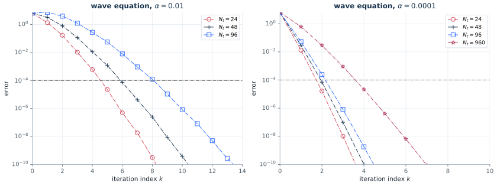

The wave panels keep `J = 10` and the script's committed start, and they are not
affected by any of this: they were digitized from page 86 the same way, and every
one of their points above the plotted floor `1e-10` is reproduced to 0.1%, over all
seven curves of the two panels — better than the two percent recorded before the
digitization, and 0.0002 decades in the measure the heat panels are scored in.
Both settings are pinned there by the same kind of evidence that pins them for the
heat panels, and pinned the other way. The published wave curves start at 6.272,
6.381, 6.381 and 6.498, one value per `N_t` and the same at both `alpha`, which is
what repeating `u0` in every window gives (6.272, 6.386, 6.386, 6.503) and not what
a draw gives; and those numbers are the `J = 10` fine solution, since at `J = 20`
the `N_t = 24` curve would start at 6.075, 3.1% below the published 6.272, the
worst point of the seven curves would move from 0.1% to 9.6%, and the deviation
would grow fifty-fold, to 0.0099 decades. So the two figures need different
coarsening factors and different starting iterates, and the module sets them per
figure rather than globally; Figures 4.15 and 4.16 are unchanged by this work, to
eleven digits.

For `alpha = 0.01` and `N_t = 24` the published errors are `1.343, 1.680e-1,
1.025e-2, 5.900e-4, 2.218e-5, 4.831e-7, 1.787e-8, 3.089e-10` and the reproduction
gives `1.342, 1.680e-1, 1.025e-2, 5.898e-4, 2.218e-5, 4.832e-7, 1.787e-8,
3.090e-10`. Figure 4.16 reproduces the point of the pair of panels: the predicted
`2 alpha N_t / (1 + alpha)` sits on the measured curve when `alpha N_t` is small
and is far from sharp when it is not.

## Figure 4.17 — the second variant for Burgers' equation

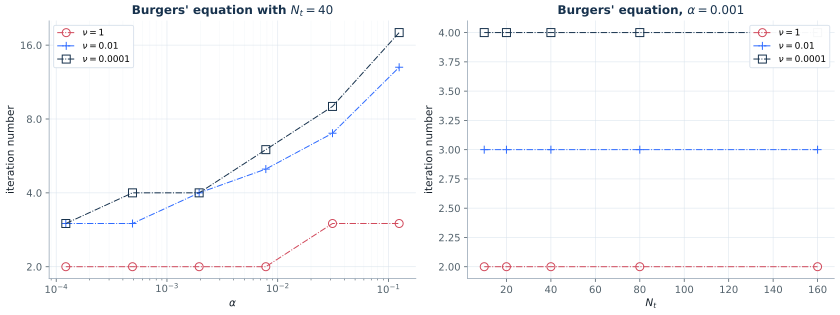

No script ships for this experiment. The setup is fully stated in the text
(periodic ends, `u0 = sin(2 pi x)**2`, `DT = 0.1`, `J = 10`, `dx = 1/100`,
iterations until the error reaches `1e-8`) and the three viscosities are readable
from the published legend: `nu = 1`, `0.01` and `0.0001`.

The coarse solver needed one decision. Solving the window system by the
quasi-Newton iteration of nonlinear ParaDiag — freeze the Jacobian, diagonalize,
correct — stalls once a window has steepened: at `nu = 1e-4` it cannot push the
residual below `5e-2`, with or without a line search, and the outer iteration then
diverges. The same system is therefore solved by its own fixed point: propagate the
window, re-couple head to tail, repeat, which contracts at rate `alpha` and reaches
roundoff in three to eight passes. That gives the solution of the same system, so
the iteration counts the figure reports are unaffected; what it gives up is the
parallelism across the `J` fine steps, and the diagonalized form is kept in the
module next to it for reference.

The counts then reproduce the published ones to one iteration. Panel (b), at
`alpha = 1e-3`, gives 2 iterations for `nu = 1` at every `N_t` from 10 to 160
(published 2), 3 for `nu = 0.01` (published 3 at `N_t = 10`, 4 above) and 4 for
`nu = 1e-4` (published 4, rising to 5 at `N_t = 80`). Panel (a) reproduces the
growth with `alpha` and its steepening as the viscosity falls, one `nu` step offset
from the published curves at the largest `alpha`.

## Figure 4.18 — local Fourier analysis for STMG

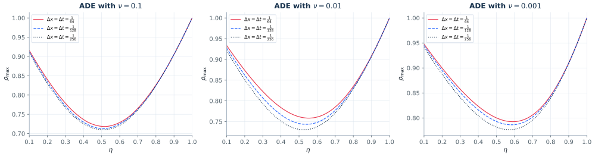

Analytic: the factor (4.40) of damped block Jacobi, maximized over
`xi dx in (-pi, pi)` and `omega dt in (pi/2, pi)`, for three viscosities and three
meshes. The curves come out almost mesh-independent, as published, with

| `nu` | minimum | at `eta` | value at `eta = 1/2` |
|---|---|---|---|
| 0.1 | 0.7128 | 0.50 | 0.7128 |
| 0.01 | 0.7435 | 0.54 | 0.7454 |
| 0.001 | 0.7863 | 0.58 | 0.7930 |

which is the quantitative form of the argument the text makes: the optimum drifts
above `1/2` as the diffusion weakens, but so little that `eta = 1/2` — the value
Theorem 4.9 proves optimal for the heat equation — costs less than a percent in the
factor.

## Figures 4.19 and 4.21 — the damping parameter

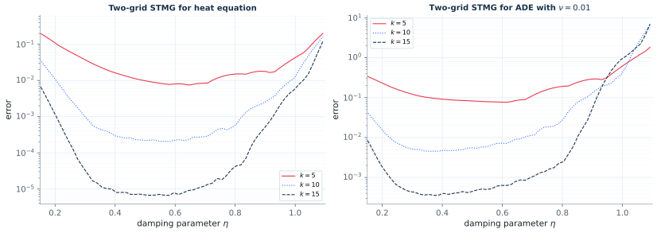

The sweep of `STMG_Heat_ADE.m`: `eta` from 0.1 to 1.1, the error after 5, 10 and 15
two-level cycles, one block Jacobi smoothing step, backward Euler. Both panels
reproduce the published shape — a flat basin over `0.3 <= eta <= 0.7` and a sharp
rise as `eta` approaches one — and the depth of the basin, about `1e-2`, `2e-4` and
`7e-6` after 5, 10 and 15 cycles for the heat equation.

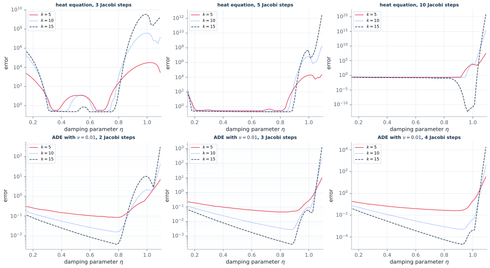

With the trapezoidal rule the picture changes, and the reproduction shows the same
change: for the heat equation the error after 15 cycles never drops far below one
for any `eta`, even with ten smoothing steps, so the two-level cycle does not
converge, while for the ADE it does converge, more smoothing helps, and the best
damping parameter moves to about 0.8 instead of `1/2`.

One quirk of the script is kept in both figures: the residual that drives the
coarse grid correction is the one of the iterate *before* the last smoothing step,
because the script reuses the `uold` of its Jacobi loop. It makes the correction
slightly inexact, and the published figures are the ones this version produces.

## Figure 4.20 — STMG against the iteration index

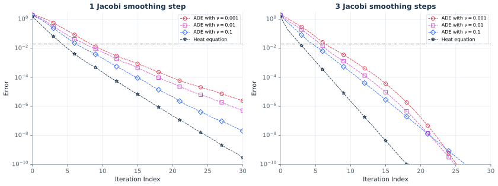

This is the most quantitative figure of the subsection and it is reproduced marker
by marker. With one smoothing step and `eta = 1/2`, at iterations 3, 6, 12, 21 and
30:

| curve | reproduced | published |
|---|---|---|
| ADE `nu = 0.001` | 5.5e-1, 8.6e-2, 3.0e-3, 5.9e-5, 2.4e-6 | 6e-1, 9e-2, 3e-3, 6e-5, 2.5e-6 |
| ADE `nu = 0.01` | 3.2e-1, 4.2e-2, 1.8e-3, 2.2e-5, 5.1e-7 | 4.5e-1, 6e-2, 2e-3, 2.5e-5, 5e-7 |
| ADE `nu = 0.1` | 2.4e-1, 2.3e-2, 5.5e-4, 2.3e-6, 2.0e-8 | 2.5e-1, 2.2e-2, 5e-4, 2.2e-6, 2e-8 |
| heat equation | 6.5e-2, 4.1e-3, 5.4e-5, 1.2e-7, 2.9e-10 | 6.5e-2, 4e-3, 5.4e-5, 1.2e-7, 2.1e-10 |

Three smoothing steps roughly double the rate, as published. The point the text
makes — that unlike Parareal and MGRiT, STMG barely notices the diffusion
parameter — is visible in the reproduction as a spread of only 0.63 to 0.48 in the
per-cycle factor across three decades of `nu`.

The published panels carry an unlabelled dash-dot line a little above `1e-2` that
the text never defines. On this grid it sits at the size of one time step, and that
is what the reproduction draws.

## Figure 4.22 — STMG for Burgers' equation

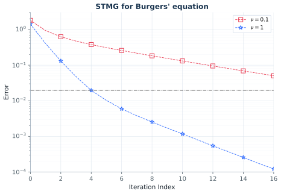

The nonlinear cycle keeps the structure of the linear one: an FAS coarse grid
correction, and a Newton solve per block inside the smoother. Two details of
`STMG_Bergers.m` had to be followed exactly to make it work and to match the
published curve. The Newton iterations inside the smoother start from zero, not
from their right-hand side, since what they solve for is a correction — starting
from the right-hand side diverges in one step, because the residual of a random
iterate is of size `1e3` on this grid. And `solve_Kc` keeps the previous coarse
level frozen at the restricted iterate rather than using the level it has just
computed, so the coarse problem decouples into one nonlinear equation per coarse
level; the first coarse level carries no initial condition at all. Both are kept.

The caption's two smoothing steps, with the `eta = 0.28` the script sets inside its
loop, reproduce the published curves closely: at iterations 0, 4, 8, 12 and 16 the
error is `1.4, 2.0e-2, 2.5e-3, 5.4e-4, 1.2e-4` here against `1.3, 2e-2, 1.6e-3,
3e-4, 1.1e-4` published for `nu = 1`, and `1.8, 3.8e-1, 1.8e-1, 9.5e-2, 5.0e-2`
against `1.3, 4e-1, 1.8e-1, 9e-2, 5e-2` for `nu = 0.1`. The script's committed
four smoothing steps give a visibly faster curve than the published one, so the
caption is the reliable source here.

## Table 4.1 — scaling of the full STMG method

Table 4.1 is not an experiment of this paper. It is quoted from Gander and
Neumüller (2016) and reports weak and strong scaling of a full space–time
multigrid method for a three-dimensional heat equation from 1 to 262 144 cores,
against sequential forward substitution. The original Example 6.1 explicitly
states that this comparison uses no spatial parallelization. Its measured
Vulcan BlueGene/Q timings depend on the machine and distributed implementation.

The new `actapint stmg_fem_3d` experiment reconstructs the 49,152-tetrahedron,
7,471-interior-node spatial problem, P1 finite elements and degree-three DG in
time, with `dt = 0.1`. It applies multilevel time coarsening, block Jacobi in
time, and one spatial V-cycle per block. With damped block Gauss–Seidel
`omega_x = 1.285`, forward pre/post sweeps, and `omega_t = 1`, all local 2/4/8-step
cases converge in seven cycles to relative residual below `1.3e-9`. A homogeneous
random-initial-error check also takes seven cycles.

[The implementation report](REPRODUCTION_CHECKS_2026-11-10.md) specifies the
mesh construction, coarse solve, independent checks and measured results. The
[2026-11-11 distributed report](REPRODUCTION_CHECKS_2026-11-11.md) extends this
baseline to MPI time-slab partitioning with neighbour exchange and pairwise
rank agglomeration. It includes actual host placement and repeated strong/weak
scaling measurements. `scripts/benchmark_stmg_sequential.py` supplies a separate
forward-substitution comparison using iterative spatial V-cycles.

The one claim in it that is method-related rather than machine-related is that the
iteration count stays at 7 across five orders of magnitude of problem size. That is
a property of the *full* multilevel method, and it does not transfer to the
two-level cycle of Figures 4.19 to 4.21: with `T` fixed and both directions
refined together, the two-level factor of this reproduction degrades from 0.08 at
`N_x = N_t = 63` to 0.36 at `N_x = N_t = 511`, since the ratio `dt / dx**2` grows
with the refinement. Nothing in the chapter claims otherwise — Figures 4.19 to 4.21
are all run at one grid — but it is worth recording that the two-level experiments
of this section do not by themselves demonstrate the scalability of Table 4.1.
